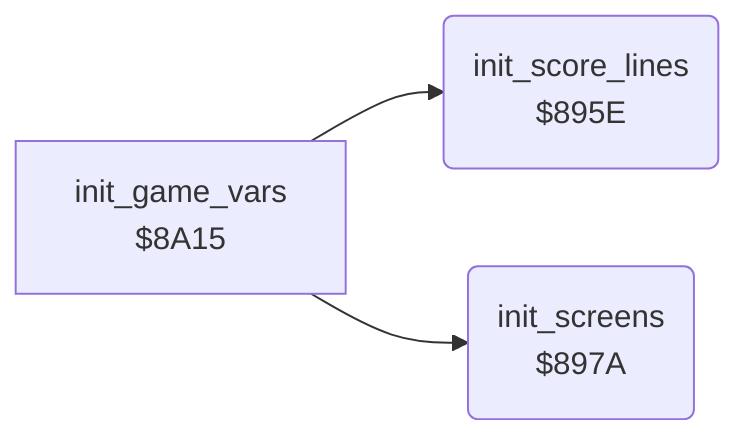

<!-- Generated by c64-docs from knowledge revision 20261024T103116.541-jn0vrj and .c64-re-tools/local/generated/src/source-map.json. Do not edit: change the knowledge, generate the source again, then run docs.ts generate. -->
# init/init_screens.asm: Screens, charsets and sprites

Range `$895E-$8A14`. Source: [init/init_screens.asm](../../../../src/init/init_screens.asm). Index: [the reference](../../index.md).

## Call graph

A solid arrow is a call, a thick arrow a table entry, a dotted arrow a jump. Rounded nodes are in this file.

## Names

### [`init_score_lines`](../../../../src/init/init_screens.asm#L6) `$895E`

*routine*

Fills the LAST and HIGH score lines from the texts at $6bcc and $6be0, and a blank third line.

- **Called from:** [`init_game_vars`](init_vars.md#init_game_vars) [`$8A7A`](../../../../src/init/init_vars.asm#L60)
- **Reads:** [`text_last_scores`](../text/texts.md#text_last_scores), [`text_high_scores`](../text/texts.md#text_high_scores)
- **Writes:** [`last_scores_line`](../../memory-map.md#last_scores_line), [`high_scores_line`](../../memory-map.md#high_scores_line), [`status_line`](../../memory-map.md#status_line), [`status_needed+2`](../../memory-map.md#status_needed)

### [`init_score_lines_loop`](../../../../src/init/init_screens.asm#L8) `$8960`

*label*

- **Jumped to from:** [`init_score_lines`](init_screens.md#init_score_lines) [`$8972`](../../../../src/init/init_screens.asm#L16)

### [`init_screens`](../../../../src/init/init_screens.asm#L21) `$897A`

*routine*

Clears both screens, copies both charsets from $5000 and $5fe8, makes the sprite bar and sets the seven expanded sprites in a row.

- **Called from:** [`init_game_vars`](init_vars.md#init_game_vars) [`$8A7D`](../../../../src/init/init_vars.asm#L61)
- **Reads:** [`text_chars_2000`](../data/text_charset.md#text_chars_2000), [`text_chars_2100`](../data/text_charset.md#text_chars_2100), [`text_chars_2200`](../data/text_charset.md#text_chars_2200), [`text_chars_2300`](../data/text_charset.md#text_chars_2300), [`title_tune_voice2`](../data/title_tune_notes.md#title_tune_voice2), [`cell_chars_3100`](../data/cell_charset.md#cell_chars_3100), [`cell_chars_3200`](../data/cell_charset.md#cell_chars_3200), [`cell_chars_3300`](../data/cell_charset.md#cell_chars_3300)
- **Writes:** [`title_level_digit+69`](../../memory-map.md#title_level_digit), [`screen0+40`](../../memory-map.md#screen0), [`screen0+256`](../../memory-map.md#screen0), [`screen0+512`](../../memory-map.md#screen0), [`screen0+768`](../../memory-map.md#screen0), [`screen1`](../../memory-map.md#screen1), [`screen1+256`](../../memory-map.md#screen1), [`screen1+512`](../../memory-map.md#screen1), [`screen1+768`](../../memory-map.md#screen1), [`charset_text`](../../memory-map.md#charset_text), [`charset_text+256`](../../memory-map.md#charset_text), [`charset_text+512`](../../memory-map.md#charset_text), [`charset_text+768`](../../memory-map.md#charset_text), [`charset_cave`](../../memory-map.md#charset_cave), [`gfx_butterfly_tl`](../../memory-map.md#gfx_butterfly_tl), [`gfx_amoeba_tl`](../../memory-map.md#gfx_amoeba_tl), [`gfx_space_tl`](../../memory-map.md#gfx_space_tl), [`gfx_cover+912`](../../memory-map.md#gfx_cover), `$3798`, [`screen0_sprite_ptrs`](../../memory-map.md#screen0_sprite_ptrs), [`screen1_sprite_ptrs`](../../memory-map.md#screen1_sprite_ptrs), [`SP0COL`](../../memory-map.md#SP0COL), [`SP0X`](../../memory-map.md#SP0X), [`SP0Y`](../../memory-map.md#SP0Y), [`XXPAND`](../../memory-map.md#XXPAND), [`MSIGX`](../../memory-map.md#MSIGX)

### [`init_screens_top_row`](../../../../src/init/init_screens.asm#L24) `$897E`

*label*

- **Jumped to from:** [`init_screens`](init_screens.md#init_screens) [`$8982`](../../../../src/init/init_screens.asm#L27)

### [`init_screens_fill`](../../../../src/init/init_screens.asm#L29) `$8986`

*label*

- **Jumped to from:** [`init_screens`](init_screens.md#init_screens) [`$899F`](../../../../src/init/init_screens.asm#L39)

### [`init_screens_charsets`](../../../../src/init/init_screens.asm#L40) `$89A1`

*label*

Text charset $2000-$23ff and cave charset $3000-$33ff.

- **Jumped to from:** [`init_screens`](init_screens.md#init_screens) [`$89D2`](../../../../src/init/init_screens.asm#L58)

### [`init_screens_sprite_bar`](../../../../src/init/init_screens.asm#L60) `$89D6`

*label*

Sprite data at $3780: eight solid rows, then empty rows.

- **Jumped to from:** [`init_screens`](init_screens.md#init_screens) [`$89E1`](../../../../src/init/init_screens.asm#L66)

### [`init_screens_sprite_ptrs`](../../../../src/init/init_screens.asm#L68) `$89E5`

*label*

Sprite pointers $de ($3780) for both screens, colour black.

- **Jumped to from:** [`init_screens`](init_screens.md#init_screens) [`$89F3`](../../../../src/init/init_screens.asm#L75)

### [`init_screens_sprite_pos`](../../../../src/init/init_screens.asm#L78) `$89F9`

*label*

Sprites 6 down to 0, 48 pixels apart.

- **Jumped to from:** [`init_screens`](init_screens.md#init_screens) [`$8A08`](../../../../src/init/init_screens.asm#L88)
