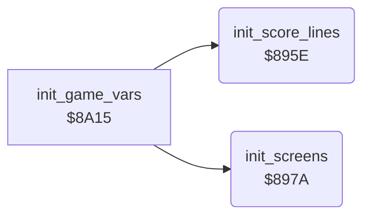

<!-- Generated by c64-docs from knowledge revision 20261025T214621.431-dj0nk4 and .c64-re-tools/local/generated/src/source-map.json. Do not edit: change the knowledge, generate the source again, then run docs.ts generate. -->
# init/init_screens.asm: Screens, charsets and sprites

Range `$895E-$8A14`. Source: [init/init_screens.asm](../../../../src/init/init_screens.asm). Index: [the reference](../../index.md).

## Routines

| Routine | Address | Reached from | Summary |
|---|---|---|---|
| [`init_score_lines`](init_screens.md#init_score_lines) | `$895E` | [`init_game_vars`](init_vars.md#init_game_vars) | Fills the LAST and HIGH score lines from the texts at $6bcc and $6be0, and a blank third line. |
| [`init_screens`](init_screens.md#init_screens) | `$897A` | [`init_game_vars`](init_vars.md#init_game_vars) | Clears both screens, copies both charsets from $5000 and $5fe8, makes the sprite bar and sets the seven expanded sprites in a row. |

## Call graph

A solid arrow is a call, a thick arrow a table entry. Rounded nodes are in this file.

## Details

### [`init_score_lines`](../../../../src/init/init_screens.asm#L6) `$895E`

*routine*

Fills the LAST and HIGH score lines from the texts at $6bcc and $6be0, and a blank third line.

- **Called from:** [`init_game_vars`](init_vars.md#init_game_vars)
- **Reads:** [`text_last_scores`](../text/texts.md#text_last_scores), [`text_high_scores`](../text/texts.md#text_high_scores)
- **Writes:** [`last_scores_line`](../../memory-map.md#last_scores_line), [`high_scores_line`](../../memory-map.md#high_scores_line), [`status_line`](../../memory-map.md#status_line), [`status_needed`](../../memory-map.md#status_needed)

| Label | Address | Comment |
|---|---|---|
| [`init_score_lines_loop`](../../../../src/init/init_screens.asm#L8) | `$8960` |  |

### [`init_screens`](../../../../src/init/init_screens.asm#L21) `$897A`

*routine*

Clears both screens, copies both charsets from $5000 and $5fe8, makes the sprite bar and sets the seven expanded sprites in a row.

- **Called from:** [`init_game_vars`](init_vars.md#init_game_vars)
- **Reads:** [`text_chars_2000`](../data/text_charset.md#text_chars_2000), [`text_chars_2100`](../data/text_charset.md#text_chars_2100), [`text_chars_2200`](../data/text_charset.md#text_chars_2200), [`text_chars_2300`](../data/text_charset.md#text_chars_2300), [`title_tune_voice2`](../data/title_tune_notes.md#title_tune_voice2), [`cell_chars_3100`](../data/cell_charset.md#cell_chars_3100), [`cell_chars_3200`](../data/cell_charset.md#cell_chars_3200), [`cell_chars_3300`](../data/cell_charset.md#cell_chars_3300)
- **Writes:** [`title_level_digit`](../../memory-map.md#title_level_digit), [`screen0`](../../memory-map.md#screen0), [`screen1`](../../memory-map.md#screen1), [`charset_text`](../../memory-map.md#charset_text), [`charset_cave`](../../memory-map.md#charset_cave), [`gfx_butterfly_tl`](../../memory-map.md#gfx_butterfly_tl), [`gfx_amoeba_tl`](../../memory-map.md#gfx_amoeba_tl), [`gfx_space_tl`](../../memory-map.md#gfx_space_tl), [`gfx_cover`](../../memory-map.md#gfx_cover), `$3798`, [`screen0_sprite_ptrs`](../../memory-map.md#screen0_sprite_ptrs), [`screen1_sprite_ptrs`](../../memory-map.md#screen1_sprite_ptrs) and 5 more

| Label | Address | Comment |
|---|---|---|
| [`init_screens_top_row`](../../../../src/init/init_screens.asm#L24) | `$897E` |  |
| [`init_screens_fill`](../../../../src/init/init_screens.asm#L29) | `$8986` |  |
| [`init_screens_charsets`](../../../../src/init/init_screens.asm#L40) | `$89A1` | Text charset $2000-$23ff and cave charset $3000-$33ff. |
| [`init_screens_sprite_bar`](../../../../src/init/init_screens.asm#L60) | `$89D6` | Sprite data at $3780: eight solid rows, then empty rows. |
| [`init_screens_sprite_ptrs`](../../../../src/init/init_screens.asm#L68) | `$89E5` | Sprite pointers $de ($3780) for both screens, colour black. |
| [`init_screens_sprite_pos`](../../../../src/init/init_screens.asm#L78) | `$89F9` | Sprites 6 down to 0, 48 pixels apart. |
