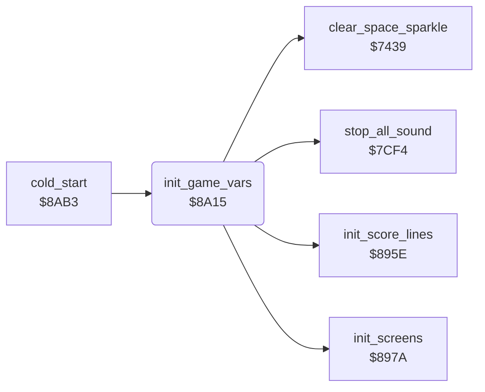

<!-- Generated by c64-docs from knowledge revision 20261024T103116.541-jn0vrj and .c64-re-tools/local/generated/src/source-map.json. Do not edit: change the knowledge, generate the source again, then run docs.ts generate. -->
# init/init_vars.asm: Game variables

Range `$8A15-$8A80`. Source: [init/init_vars.asm](../../../../src/init/init_vars.asm). Index: [the reference](../../index.md).

## Call graph

A solid arrow is a call, a thick arrow a table entry, a dotted arrow a jump. Rounded nodes are in this file.

## Names

### [`init_game_vars`](../../../../src/init/init_vars.asm#L6) `$8A15`

*routine*

Resets the game variables at each cold start. The first start also clears the best scores, sets one player and prepares screens and charsets.

- **Called from:** [`cold_start`](cold_start.md#cold_start) [`$8AEE`](../../../../src/init/cold_start.asm#L35)
- **Calls:** [`stop_all_sound`](../sound/voices_off.md#stop_all_sound), [`clear_space_sparkle`](../screen/space_sparkle.md#clear_space_sparkle), [`init_score_lines`](init_screens.md#init_score_lines), [`init_screens`](init_screens.md#init_screens)
- **Reads:** [`first_start_flag`](../../memory-map.md#first_start_flag)
- **Writes:** [`decoded_cave`](../../memory-map.md#decoded_cave), [`irq_mode`](../../memory-map.md#irq_mode), [`key_row0`](../../memory-map.md#key_row0), [`key_row7`](../../memory-map.md#key_row7), [`key_row0_last`](../../memory-map.md#key_row0_last), [`key_row7_last`](../../memory-map.md#key_row7_last), [`scroll_x_pos`](../../memory-map.md#scroll_x_pos), [`scroll_x_char`](../../memory-map.md#scroll_x_char), [`scroll_y_pos`](../../memory-map.md#scroll_y_pos), [`scroll_y_char`](../../memory-map.md#scroll_y_char), [`flash_frames`](../../memory-map.md#flash_frames), [`cave_number`](../../memory-map.md#cave_number), [`level`](../../memory-map.md#level), [`anim_frame`](../../memory-map.md#anim_frame), [`title_frame_count`](../../memory-map.md#title_frame_count), [`scroll_y_fine`](../../memory-map.md#scroll_y_fine), [`scroll_y_fine_last`](../../memory-map.md#scroll_y_fine_last), [`scroll_x_fine`](../../memory-map.md#scroll_x_fine), [`scroll_x_fine_last`](../../memory-map.md#scroll_x_fine_last), [`noise_request`](../../memory-map.md#noise_request), [`noise_timer`](../../memory-map.md#noise_timer), [`show_credits`](../../memory-map.md#show_credits), [`demo_mode`](../../memory-map.md#demo_mode), [`options_hidden`](../../memory-map.md#options_hidden), [`EXTCOL`](../../memory-map.md#EXTCOL), [`CHRGET+1`](../../memory-map.md#CHRGET), [`CHRGET+16`](../../memory-map.md#CHRGET), [`best_score`](../../memory-map.md#best_score), [`first_start_flag`](../../memory-map.md#first_start_flag), [`two_joysticks`](../../memory-map.md#two_joysticks), [`two_players`](../../memory-map.md#two_players), [`bonus_life_timer`](../../memory-map.md#bonus_life_timer), [`player_mode`](../../memory-map.md#player_mode)

### [`init_vars_black`](../../../../src/init/init_vars.asm#L39) `$8A54`

*label*

- **Jumped to from:** [`init_game_vars`](init_vars.md#init_game_vars) [`$8A58`](../../../../src/init/init_vars.asm#L42)

### [`init_vars_best_scores`](../../../../src/init/init_vars.asm#L45) `$8A5E`

*label*

- **Jumped to from:** [`init_game_vars`](init_vars.md#init_game_vars) [`$8A67`](../../../../src/init/init_vars.asm#L51)

### [`init_vars_done`](../../../../src/init/init_vars.asm#L62) `$8A80`

*label*

- **Jumped to from:** [`init_game_vars`](init_vars.md#init_game_vars) [`$8A4E`](../../../../src/init/init_vars.asm#L36)
