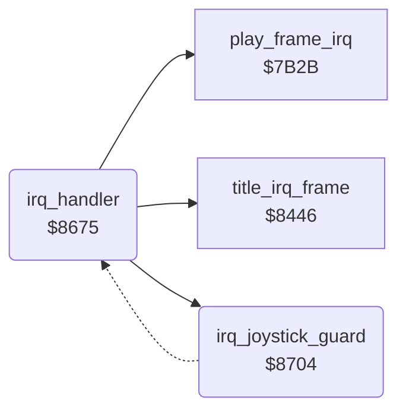

<!-- Generated by c64-docs from knowledge revision 20261024T103116.541-jn0vrj and .c64-re-tools/local/generated/src/source-map.json. Do not edit: change the knowledge, generate the source again, then run docs.ts generate. -->
# irq/irq_handler.asm: Raster IRQ handler

Range `$8675-$8721`. Source: [irq/irq_handler.asm](../../../../src/irq/irq_handler.asm). Index: [the reference](../../index.md).

## Call graph

A solid arrow is a call, a thick arrow a table entry, a dotted arrow a jump. Rounded nodes are in this file.

## Names

### [`irq_handler`](../../../../src/irq/irq_handler.asm#L6) `$8675`

*routine*

Raster IRQ. Sets two raster splits from the tables at $54-$5b, scans keyboard rows 0 and 7, then does the title or game frame work.

- **Referred to by:** [`init_irq`](irq_setup.md#init_irq) [`$8AA6`](../../../../src/irq/irq_setup.asm#L25), [`init_irq`](irq_setup.md#init_irq) [`$8AAB`](../../../../src/irq/irq_setup.asm#L27)
- **Calls:** [`irq_joystick_guard`](irq_handler.md#irq_joystick_guard), [`title_irq_frame`](../title/title_animation.md#title_irq_frame), [`play_frame_irq`](play_frame.md#play_frame_irq)
- **Reads:** [`VICIRQ`](../../memory-map.md#VICIRQ), [`irq_split_index`](../../memory-map.md#irq_split_index), [`irq_d011_values`](../../memory-map.md#irq_d011_values), [`irq_d016_values`](../../memory-map.md#irq_d016_values), [`irq_d018_values`](../../memory-map.md#irq_d018_values), [`irq_raster_lines`](../../memory-map.md#irq_raster_lines), [`CIAPRB`](../../memory-map.md#CIAPRB), [`key_row0_last`](../../memory-map.md#key_row0_last), [`key_row7_last`](../../memory-map.md#key_row7_last), [`irq_mode`](../../memory-map.md#irq_mode), [`options_hidden`](../../memory-map.md#options_hidden)
- **Writes:** [`VICIRQ`](../../memory-map.md#VICIRQ), [`irq_split_index`](../../memory-map.md#irq_split_index), [`SCROLY`](../../memory-map.md#SCROLY), [`SCROLX`](../../memory-map.md#SCROLX), [`VMCSB`](../../memory-map.md#VMCSB), [`RASTER`](../../memory-map.md#RASTER), [`CIAPRA`](../../memory-map.md#CIAPRA), [`key_row0`](../../memory-map.md#key_row0), [`key_row0_last`](../../memory-map.md#key_row0_last), [`key_row7`](../../memory-map.md#key_row7), [`key_row7_last`](../../memory-map.md#key_row7_last), [`irq_d018_values`](../../memory-map.md#irq_d018_values), [`SPENA`](../../memory-map.md#SPENA), [`irq_d016_values`](../../memory-map.md#irq_d016_values), [`irq_d011_values`](../../memory-map.md#irq_d011_values), [`SPBGPR`](../../memory-map.md#SPBGPR)

### [`irq_set_split`](../../../../src/irq/irq_handler.asm#L15) `$8687`

*label*

The split index selects the VIC-II values of the next split.

- **Jumped to from:** [`irq_handler`](irq_handler.md#irq_handler) [`$8681`](../../../../src/irq/irq_handler.asm#L12)

### [`irq_scan_keys`](../../../../src/irq/irq_handler.asm#L25) `$869D`

*label*

- **Jumped to from:** [`irq_handler`](irq_handler.md#irq_handler) [`$867D`](../../../../src/irq/irq_handler.asm#L10)

### [`irq_key_row0_new`](../../../../src/irq/irq_handler.asm#L36) `$86B4`

*label*

- **Jumped to from:** [`irq_handler`](irq_handler.md#irq_handler) [`$86AE`](../../../../src/irq/irq_handler.asm#L33)

### [`irq_scan_row7`](../../../../src/irq/irq_handler.asm#L38) `$86B6`

*label*

Keyboard row 7: a value counts when two scans agree.

- **Jumped to from:** [`irq_handler`](irq_handler.md#irq_handler) [`$86AA`](../../../../src/irq/irq_handler.asm#L31), [`irq_handler`](irq_handler.md#irq_handler) [`$86B2`](../../../../src/irq/irq_handler.asm#L35)

### [`irq_key_row7_new`](../../../../src/irq/irq_handler.asm#L48) `$86CA`

*label*

- **Jumped to from:** [`irq_handler`](irq_handler.md#irq_handler) [`$86C4`](../../../../src/irq/irq_handler.asm#L45)

### [`irq_keys_done`](../../../../src/irq/irq_handler.asm#L50) `$86CC`

*label*

- **Jumped to from:** [`irq_handler`](irq_handler.md#irq_handler) [`$86C0`](../../../../src/irq/irq_handler.asm#L43), [`irq_handler`](irq_handler.md#irq_handler) [`$86C8`](../../../../src/irq/irq_handler.asm#L47)

### [`irq_frame_work`](../../../../src/irq/irq_handler.asm#L52) `$86CF`

*label*

irq_mode 1: title frame work.

- **Jumped to from:** [`irq_joystick_guard`](irq_handler.md#irq_joystick_guard) [`$871E`](../../../../src/irq/irq_handler.asm#L98)

### [`irq_title_mode`](../../../../src/irq/irq_handler.asm#L60) `$86DD`

*label*

- **Jumped to from:** [`irq_handler`](irq_handler.md#irq_handler) [`$86D7`](../../../../src/irq/irq_handler.asm#L57)

### [`irq_check_game_mode`](../../../../src/irq/irq_handler.asm#L68) `$86ED`

*label*

irq_mode 0: game frame work with sprites 0-6.

- **Jumped to from:** [`irq_handler`](irq_handler.md#irq_handler) [`$86D3`](../../../../src/irq/irq_handler.asm#L55)

### [`irq_exit`](../../../../src/irq/irq_handler.asm#L74) `$86F9`

*label*

- **Jumped to from:** [`irq_handler`](irq_handler.md#irq_handler) [`$86EF`](../../../../src/irq/irq_handler.asm#L70)

### [`irq_joystick_guard`](../../../../src/irq/irq_handler.asm#L84) `$8704`

*routine*

Reads $dc01 with no keyboard column selected. A joystick 1 input sets all key values to $ff and skips the keyboard scan.

- **Called from:** [`irq_handler`](irq_handler.md#irq_handler) [`$869D`](../../../../src/irq/irq_handler.asm#L26), [`irq_handler`](irq_handler.md#irq_handler) [`$86CC`](../../../../src/irq/irq_handler.asm#L51)
- **Jumps to:** [`irq_frame_work`](irq_handler.md#irq_frame_work)
- **Reads:** [`CIAPRB`](../../memory-map.md#CIAPRB)
- **Writes:** [`CIAPRA`](../../memory-map.md#CIAPRA), [`key_row0`](../../memory-map.md#key_row0), [`key_row7`](../../memory-map.md#key_row7), [`key_row0_last`](../../memory-map.md#key_row0_last), [`key_row7_last`](../../memory-map.md#key_row7_last)

### [`irq_joystick_guard_ok`](../../../../src/irq/irq_handler.asm#L99) `$8721`

*label*

- **Jumped to from:** [`irq_joystick_guard`](irq_handler.md#irq_joystick_guard) [`$8710`](../../../../src/irq/irq_handler.asm#L90)
