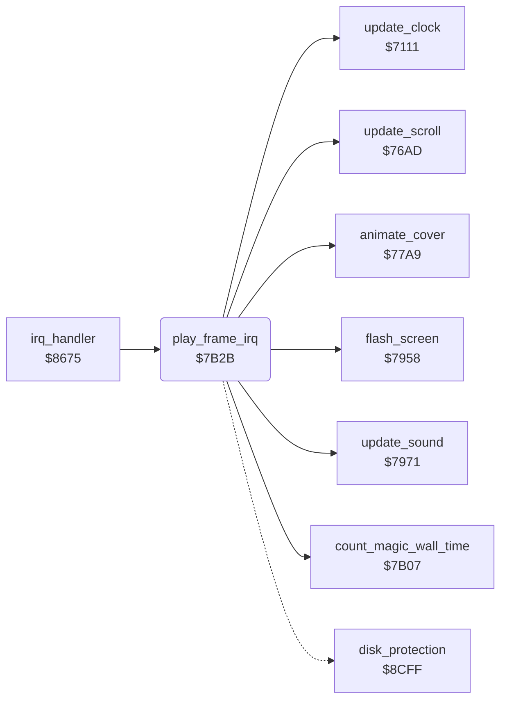

<!-- Generated by c64-docs from knowledge revision 20261024T103116.541-jn0vrj and .c64-re-tools/local/generated/src/source-map.json. Do not edit: change the knowledge, generate the source again, then run docs.ts generate. -->
# irq/play_frame.asm: Play frame work

Range `$7B2B-$7B57`. Source: [irq/play_frame.asm](../../../../src/irq/play_frame.asm). Index: [the reference](../../index.md).

## Call graph

A solid arrow is a call, a thick arrow a table entry, a dotted arrow a jump. Rounded nodes are in this file.

## Names

### [`play_frame_irq`](../../../../src/irq/play_frame.asm#L6) `$7B2B`

*routine*

Frame work of the play IRQ at split 0: flash, cover, magic wall time, cave time, sound and scroll. Even frames show the screen that was drawn last. Odd frames draw the other screen at $9E00.

- **Called from:** [`irq_handler`](irq_handler.md#irq_handler) [`$86F6`](../../../../src/irq/irq_handler.asm#L73)
- **Calls:** [`flash_screen`](../screen/flash.md#flash_screen), [`animate_cover`](../screen/cover.md#animate_cover), [`count_magic_wall_time`](../engine/magic_wall_time.md#count_magic_wall_time), [`update_clock`](../status/score_time.md#update_clock), [`update_sound`](../sound/effects.md#update_sound), [`update_scroll`](../screen/scroll.md#update_scroll)
- **Jumps to:** `$9E00`
- **Reads:** [`irq_split_index`](../../memory-map.md#irq_split_index), [`frame_counter`](../../memory-map.md#frame_counter), [`game_d018_value`](../../memory-map.md#game_d018_value)
- **Writes:** [`frame_counter`](../../memory-map.md#frame_counter), [`irq_d018_values`](../../memory-map.md#irq_d018_values), [`game_d018_value`](../../memory-map.md#game_d018_value)

### [`play_frame_irq_run`](../../../../src/irq/play_frame.asm#L10) `$7B30`

*label*

- **Jumped to from:** [`play_frame_irq`](play_frame.md#play_frame_irq) [`$7B2D`](../../../../src/irq/play_frame.asm#L8)

### [`play_frame_irq_draw`](../../../../src/irq/play_frame.asm#L26) `$7B55`

*label*

- **Jumped to from:** [`play_frame_irq`](play_frame.md#play_frame_irq) [`$7B48`](../../../../src/irq/play_frame.asm#L20)
