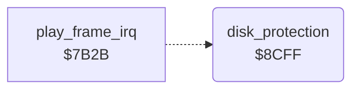

<!-- Generated by c64-docs from knowledge revision 20261024T103116.541-jn0vrj and .c64-re-tools/local/generated/src/source-map.json. Do not edit: change the knowledge, generate the source again, then run docs.ts generate. -->
# leftovers/leftover_8b86.asm

Range `$8B86-$8D8E`. Source: [leftovers/leftover_8b86.asm](../../../../src/leftovers/leftover_8b86.asm). Index: [the reference](../../index.md).

## Call graph

A solid arrow is a call, a thick arrow a table entry, a dotted arrow a jump. Rounded nodes are in this file.

## Data

| Range | Type | Name | Read by | Written by |
|---|---|---|---|---|
| [`$8B86`](../../../../src/leftovers/leftover_8b86.asm#L7)-`$8CF1` | bytes | [`symbol_table_leftover`](../../../../src/leftovers/leftover_8b86.asm#L6) |  |  |
| [`$8CF2`](../../../../src/leftovers/leftover_8b86.asm#L56) | petscii | [`disk_check_channel_name`](../../../../src/leftovers/leftover_8b86.asm#L55) |  |  |
| [`$8CF3`](../../../../src/leftovers/leftover_8b86.asm#L59)-`$8CFE` | petscii | [`disk_check_command`](../../../../src/leftovers/leftover_8b86.asm#L58) |  |  |
| [`$8D81`](../../../../src/leftovers/leftover_8b86.asm#L127)-`$8D8E` | bytes | [`leftover_fill_bytes`](../../../../src/leftovers/leftover_8b86.asm#L126) |  |  |

## Names

### [`symbol_table_leftover`](../../../../src/leftovers/leftover_8b86.asm#L6) `$8B86-$8CF1`

*data*

Part of the developer's symbol table: 12-byte records of a 6-byte name, $a8 $00, the value and two bytes. A colon marks a local name.
Tail of a record with the value $81d5.

### [`disk_check_channel_name`](../../../../src/leftovers/leftover_8b86.asm#L55) `$8CF2`

*data*

Name # of the buffer channel 5 that the disk check opens.

- **Referred to by:** [`disk_protection`](leftover_8b86.md#disk_protection) [`$8D15`](../../../../src/leftovers/leftover_8b86.asm#L72), [`disk_protection`](leftover_8b86.md#disk_protection) [`$8D17`](../../../../src/leftovers/leftover_8b86.asm#L73)

### [`disk_check_command`](../../../../src/leftovers/leftover_8b86.asm#L58) `$8CF3-$8CFE`

*data*

Drive command U1:5,0,18,18: reads track 18 sector 18 into channel 5.

### [`disk_protection`](../../../../src/leftovers/leftover_8b86.asm#L61) `$8CFF`

*routine*

Copy protection: reads track 18 sector 18 and expects drive error 23, a bad sector of the original disk. Another status clears $7000-$70ff, which breaks the game. Both paths then jump to cold_start. No release calls this routine: the Charsoft, Killer Kamakazi and Lord Markus boots all start at cold_start. The routine lies over the end of the symbol table leftover.

- **Refers to:** [`disk_check_channel_name`](leftover_8b86.md#disk_check_channel_name)

### [`disk_check_send`](../../../../src/leftovers/leftover_8b86.asm#L83) `$8D2F`

*label*

### [`disk_check_skip_status`](../../../../src/leftovers/leftover_8b86.asm#L100) `$8D54`

*label*

### [`disk_check_wipe`](../../../../src/leftovers/leftover_8b86.asm#L110) `$8D6A`

*label*

Other status: fills $7000-$70ff with 0 32 times.

### [`disk_check_wipe_loop`](../../../../src/leftovers/leftover_8b86.asm#L117) `$8D74`

*label*

### [`leftover_fill_bytes`](../../../../src/leftovers/leftover_8b86.asm#L126) `$8D81-$8D8E`

*data*

Bytes after the disk check that nothing uses.
