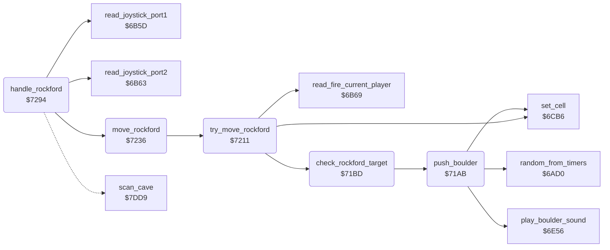

<!-- Generated by c64-docs from knowledge revision 20261024T103116.541-jn0vrj and .c64-re-tools/local/generated/src/source-map.json. Do not edit: change the knowledge, generate the source again, then run docs.ts generate. -->
# rockford/movement.asm: Rockford movement and digging

Range `$7191-$72B6`. Source: [rockford/movement.asm](../../../../src/rockford/movement.asm). Index: [the reference](../../index.md).

## Call graph

A solid arrow is a call, a thick arrow a table entry, a dotted arrow a jump. Rounded nodes are in this file.

## Names

### [`collect_diamond`](../../../../src/rockford/movement.asm#L6) `$7191`

*label*

Rockford collects a diamond: plays the sound, adds the diamond points to the score and counts the diamond.

- **Jumped to from:** [`check_rockford_target`](movement.md#check_rockford_target) [`$71DD`](../../../../src/rockford/movement.asm#L50)

### [`collect_diamond_copy`](../../../../src/rockford/movement.asm#L9) `$7196`

*label*

- **Jumped to from:** [`$719D`](../../../../src/rockford/movement.asm#L13)

### [`push_boulder`](../../../../src/rockford/movement.asm#L20) `$71AB`

*routine*

Pushes the boulder by one cell to scan_ptr+Y with a chance of 1 in 4 and plays the boulder sound.

- **Called from:** [`check_rockford_target`](movement.md#check_rockford_target) [`$71FC`](../../../../src/rockford/movement.asm#L68), [`check_rockford_target`](movement.md#check_rockford_target) [`$720B`](../../../../src/rockford/movement.asm#L77)
- **Calls:** [`random_from_timers`](../engine/random.md#random_from_timers), [`play_boulder_sound`](../sound/element_sounds.md#play_boulder_sound), [`set_cell`](../engine/cell_draw.md#set_cell)
- **Reads:** [`rockford_moved`](../../memory-map.md#rockford_moved)
- **Writes:** [`rockford_moved`](../../memory-map.md#rockford_moved)

### [`push_boulder_done`](../../../../src/rockford/movement.asm#L28) `$71BC`

*label*

- **Jumped to from:** [`push_boulder`](movement.md#push_boulder) [`$71B0`](../../../../src/rockford/movement.asm#L23)

### [`check_rockford_target`](../../../../src/rockford/movement.asm#L31) `$71BD`

*routine*

Examines the cell at scan_ptr+Y that Rockford moves to. Sets rockford_moved when Rockford can enter it and starts the step sound.

- **Called from:** [`try_move_rockford`](movement.md#try_move_rockford) [`$7211`](../../../../src/rockford/movement.asm#L84)
- **Calls:** [`push_boulder`](movement.md#push_boulder)
- **Jumps to:** [`collect_diamond`](movement.md#collect_diamond)
- **Reads:** [`cell_ptr`](../../memory-map.md#cell_ptr), [`rockford_moved`](../../memory-map.md#rockford_moved)
- **Writes:** [`rockford_moved`](../../memory-map.md#rockford_moved), [`step_sound_pitch`](../../memory-map.md#step_sound_pitch), [`cave_end_state`](../../memory-map.md#cave_end_state), [`exit_reached`](../../memory-map.md#exit_reached)

### [`check_target_dirt`](../../../../src/rockford/movement.asm#L40) `$71CD`

*label*

- **Jumped to from:** [`check_rockford_target`](movement.md#check_rockford_target) [`$71C3`](../../../../src/rockford/movement.asm#L35)

### [`check_target_diamond`](../../../../src/rockford/movement.asm#L47) `$71D9`

*label*

- **Jumped to from:** [`check_rockford_target`](movement.md#check_rockford_target) [`$71CF`](../../../../src/rockford/movement.asm#L42)

### [`check_target_exit`](../../../../src/rockford/movement.asm#L51) `$71E0`

*label*

- **Jumped to from:** [`check_rockford_target`](movement.md#check_rockford_target) [`$71DB`](../../../../src/rockford/movement.asm#L49)

### [`check_target_boulder`](../../../../src/rockford/movement.asm#L59) `$71EE`

*label*

- **Jumped to from:** [`check_rockford_target`](movement.md#check_rockford_target) [`$71E2`](../../../../src/rockford/movement.asm#L53)

### [`push_left_done`](../../../../src/rockford/movement.asm#L69) `$71FF`

*label*

- **Jumped to from:** [`check_rockford_target`](movement.md#check_rockford_target) [`$71FA`](../../../../src/rockford/movement.asm#L67)

### [`check_push_right`](../../../../src/rockford/movement.asm#L71) `$7201`

*label*

- **Jumped to from:** [`check_rockford_target`](movement.md#check_rockford_target) [`$71F4`](../../../../src/rockford/movement.asm#L63)

### [`push_right_done`](../../../../src/rockford/movement.asm#L78) `$720E`

*label*

- **Jumped to from:** [`check_rockford_target`](movement.md#check_rockford_target) [`$7209`](../../../../src/rockford/movement.asm#L76)

### [`check_target_done`](../../../../src/rockford/movement.asm#L80) `$7210`

*label*

- **Jumped to from:** [`check_rockford_target`](movement.md#check_rockford_target) [`$71F0`](../../../../src/rockford/movement.asm#L61), [`check_rockford_target`](movement.md#check_rockford_target) [`$7203`](../../../../src/rockford/movement.asm#L73)

### [`try_move_rockford`](../../../../src/rockford/movement.asm#L83) `$7211`

*routine*

Moves Rockford to scan_ptr+Y when the cell lets him in. With fire pressed he clears the cell and stays. Returns rockford_moved.

- **Called from:** [`move_rockford`](movement.md#move_rockford) [`$7247`](../../../../src/rockford/movement.asm#L117), [`move_rockford`](movement.md#move_rockford) [`$7257`](../../../../src/rockford/movement.asm#L127), [`move_rockford`](movement.md#move_rockford) [`$7276`](../../../../src/rockford/movement.asm#L147), [`move_rockford`](movement.md#move_rockford) [`$728A`](../../../../src/rockford/movement.asm#L159)
- **Calls:** [`check_rockford_target`](movement.md#check_rockford_target), [`read_fire_current_player`](../input/joystick.md#read_fire_current_player), [`set_cell`](../engine/cell_draw.md#set_cell)
- **Reads:** [`rockford_moved`](../../memory-map.md#rockford_moved)
- **Writes:** [`rockford_moved`](../../memory-map.md#rockford_moved)

### [`try_move_step`](../../../../src/rockford/movement.asm#L95) `$7227`

*label*

Scanned Rockford $39 in the new cell, space in the old cell.

- **Jumped to from:** [`try_move_rockford`](movement.md#try_move_rockford) [`$721B`](../../../../src/rockford/movement.asm#L88)

### [`try_move_done`](../../../../src/rockford/movement.asm#L102) `$7235`

*label*

- **Jumped to from:** [`try_move_rockford`](movement.md#try_move_rockford) [`$7216`](../../../../src/rockford/movement.asm#L86)

### [`move_rockford`](../../../../src/rockford/movement.asm#L105) `$7236`

*routine*

Moves Rockford by the joystick bits in A: down, up, right, left. Updates rockford_col, rockford_row and rockford_facing.

- **Called from:** [`handle_rockford`](movement.md#handle_rockford) [`$72AD`](../../../../src/rockford/movement.asm#L182)
- **Calls:** [`try_move_rockford`](movement.md#try_move_rockford)
- **Reads:** [`rockford_view_row`](../../memory-map.md#rockford_view_row), [`scroll_y_speed_hi`](../../memory-map.md#scroll_y_speed_hi), [`rockford_moved`](../../memory-map.md#rockford_moved), [`rockford_row`](../../memory-map.md#rockford_row), [`rockford_view_col`](../../memory-map.md#rockford_view_col), [`scroll_x_speed_hi`](../../memory-map.md#scroll_x_speed_hi), [`rockford_col`](../../memory-map.md#rockford_col)
- **Writes:** [`rockford_row`](../../memory-map.md#rockford_row), [`rockford_facing`](../../memory-map.md#rockford_facing), [`rockford_col`](../../memory-map.md#rockford_col)

### [`move_rockford_down`](../../../../src/rockford/movement.asm#L115) `$7245`

*label*

- **Jumped to from:** [`move_rockford`](movement.md#move_rockford) [`$723E`](../../../../src/rockford/movement.asm#L110), [`move_rockford`](movement.md#move_rockford) [`$7242`](../../../../src/rockford/movement.asm#L112)

### [`move_down_done`](../../../../src/rockford/movement.asm#L121) `$7250`

*label*

- **Jumped to from:** [`move_rockford`](movement.md#move_rockford) [`$724C`](../../../../src/rockford/movement.asm#L119)

### [`move_rockford_check_up`](../../../../src/rockford/movement.asm#L123) `$7251`

*label*

- **Jumped to from:** [`move_rockford`](movement.md#move_rockford) [`$7238`](../../../../src/rockford/movement.asm#L107)

### [`move_up_done`](../../../../src/rockford/movement.asm#L131) `$7260`

*label*

- **Jumped to from:** [`move_rockford`](movement.md#move_rockford) [`$725C`](../../../../src/rockford/movement.asm#L129)

### [`move_rockford_check_right`](../../../../src/rockford/movement.asm#L133) `$7261`

*label*

- **Jumped to from:** [`move_rockford`](movement.md#move_rockford) [`$7253`](../../../../src/rockford/movement.asm#L125)

### [`move_rockford_right`](../../../../src/rockford/movement.asm#L143) `$7270`

*label*

- **Jumped to from:** [`move_rockford`](movement.md#move_rockford) [`$7269`](../../../../src/rockford/movement.asm#L138), [`move_rockford`](movement.md#move_rockford) [`$726D`](../../../../src/rockford/movement.asm#L140)

### [`move_right_done`](../../../../src/rockford/movement.asm#L151) `$727F`

*label*

- **Jumped to from:** [`move_rockford`](movement.md#move_rockford) [`$727B`](../../../../src/rockford/movement.asm#L149)

### [`move_rockford_check_left`](../../../../src/rockford/movement.asm#L153) `$7280`

*label*

- **Jumped to from:** [`move_rockford`](movement.md#move_rockford) [`$7263`](../../../../src/rockford/movement.asm#L135)

### [`move_rockford_done`](../../../../src/rockford/movement.asm#L163) `$7293`

*label*

- **Jumped to from:** [`move_rockford`](movement.md#move_rockford) [`$7282`](../../../../src/rockford/movement.asm#L155), [`move_rockford`](movement.md#move_rockford) [`$728F`](../../../../src/rockford/movement.asm#L161)

### [`handle_rockford`](../../../../src/rockford/movement.asm#L166) `$7294`

*routine*

Handler of Rockford $38. Reads the joystick of the current player, or the demo input, and moves Rockford.

- **Calls:** [`read_joystick_port2`](../input/joystick.md#read_joystick_port2), [`read_joystick_port1`](../input/joystick.md#read_joystick_port1), [`move_rockford`](movement.md#move_rockford)
- **Jumps to:** [`scan_cell_settle`](../engine/cave_scan.md#scan_cell_settle)
- **Reads:** [`demo_mode`](../../memory-map.md#demo_mode), [`joystick_dir`](../../memory-map.md#joystick_dir), [`two_joysticks`](../../memory-map.md#two_joysticks), [`current_player`](../../memory-map.md#current_player)
- **Writes:** [`joystick_dir`](../../memory-map.md#joystick_dir), [`rockford_absent`](../../memory-map.md#rockford_absent)

### [`rockford_read_joystick`](../../../../src/rockford/movement.asm#L171) `$729D`

*label*

- **Jumped to from:** [`handle_rockford`](movement.md#handle_rockford) [`$7296`](../../../../src/rockford/movement.asm#L168)

### [`rockford_read_port1`](../../../../src/rockford/movement.asm#L177) `$72A8`

*label*

- **Jumped to from:** [`handle_rockford`](movement.md#handle_rockford) [`$72A1`](../../../../src/rockford/movement.asm#L174)

### [`rockford_store_input`](../../../../src/rockford/movement.asm#L179) `$72AB`

*label*

- **Jumped to from:** [`handle_rockford`](movement.md#handle_rockford) [`$72A6`](../../../../src/rockford/movement.asm#L176)

### [`rockford_move`](../../../../src/rockford/movement.asm#L181) `$72AD`

*label*

- **Jumped to from:** [`handle_rockford`](movement.md#handle_rockford) [`$729A`](../../../../src/rockford/movement.asm#L170)
