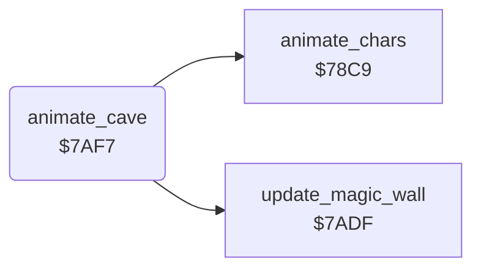

<!-- Generated by c64-docs from knowledge revision 20261025T214621.431-dj0nk4 and .c64-re-tools/local/generated/src/source-map.json. Do not edit: change the knowledge, generate the source again, then run docs.ts generate. -->
# screen/animate_cave.asm: Animation step

Range `$7AF7-$7B06`. Source: [screen/animate_cave.asm](../../../../src/screen/animate_cave.asm). Index: [the reference](../../index.md).

## Routines

| Routine | Address | Reached from | Summary |
|---|---|---|---|
| [`animate_cave`](animate_cave.md#animate_cave) | `$7AF7` |  | Steps anim_frame to the next of 8 frames, animates the cave characters and the magic wall. |

## Call graph

A solid arrow is a call, a thick arrow a table entry. Rounded nodes are in this file.

## Details

### [`animate_cave`](../../../../src/screen/animate_cave.asm#L6) `$7AF7`

*routine*

Steps anim_frame to the next of 8 frames, animates the cave characters and the magic wall. The screen drawing routine calls it.

- **Calls:** [`animate_chars`](animation.md#animate_chars), [`update_magic_wall`](../engine/magic_wall.md#update_magic_wall)
- **Reads:** [`anim_frame`](../../memory-map.md#anim_frame)
- **Writes:** [`anim_frame`](../../memory-map.md#anim_frame)
