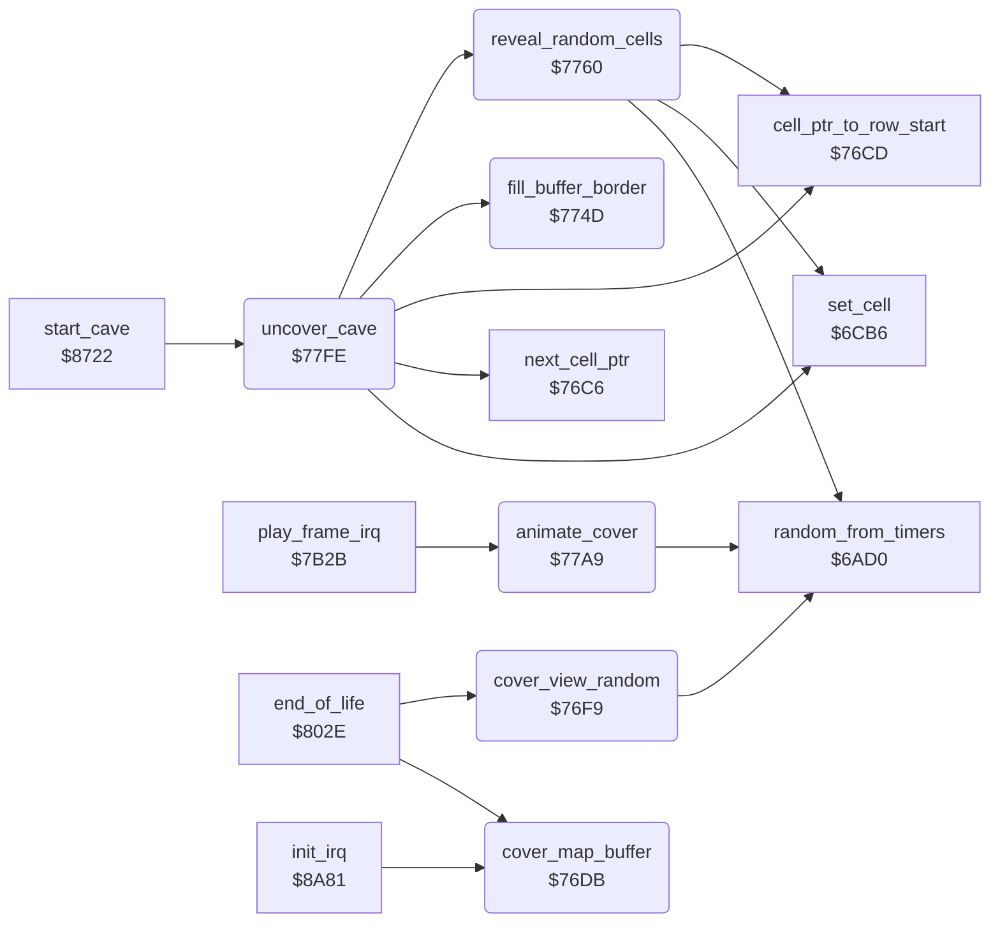

<!-- Generated by c64-docs from knowledge revision 20261024T103116.541-jn0vrj and .c64-re-tools/local/generated/src/source-map.json. Do not edit: change the knowledge, generate the source again, then run docs.ts generate. -->
# screen/cover.asm: Cover and uncover the cave

Range `$76DB-$7829`. Source: [screen/cover.asm](../../../../src/screen/cover.asm). Index: [the reference](../../index.md).

## Call graph

A solid arrow is a call, a thick arrow a table entry, a dotted arrow a jump. Rounded nodes are in this file.

## Names

### [`cover_map_buffer`](../../../../src/screen/cover.asm#L6) `$76DB`

*routine*

Fills the 22 rows of 160 bytes of the map buffer with the cover character $7C.

- **Called from:** [`end_of_life`](../status/end_of_life.md#end_of_life) [`$8063`](../../../../src/status/end_of_life.asm#L120), [`init_irq`](../irq/irq_setup.md#init_irq) [`$8A86`](../../../../src/irq/irq_setup.asm#L9)
- **Reads:** [`cave_row_addr_lo`](cell_screen_tables.md#cave_row_addr_lo), [`cave_row_addr_hi`](cell_screen_tables.md#cave_row_addr_hi), [`cell_buffer_ptr`](../../memory-map.md#cell_buffer_ptr)
- **Writes:** [`cell_buffer_ptr`](../../memory-map.md#cell_buffer_ptr), [`cell_buffer_ptr_hi`](../../memory-map.md#cell_buffer_ptr_hi)

### [`cover_map_buffer_row`](../../../../src/screen/cover.asm#L8) `$76DD`

*label*

- **Jumped to from:** [`cover_map_buffer`](cover.md#cover_map_buffer) [`$76F6`](../../../../src/screen/cover.asm#L23)

### [`cover_map_buffer_byte`](../../../../src/screen/cover.asm#L15) `$76EB`

*label*

- **Jumped to from:** [`cover_map_buffer`](cover.md#cover_map_buffer) [`$76F0`](../../../../src/screen/cover.asm#L19)

### [`cover_view_random`](../../../../src/screen/cover.asm#L26) `$76F9`

*routine*

Makes the table view_row_ptrs of the 24 visible character rows in the map buffer. Then puts the cover character $7C at a random place in each row, 48 times.

- **Called from:** [`end_of_life`](../status/end_of_life.md#end_of_life) [`$8060`](../../../../src/status/end_of_life.asm#L119)
- **Calls:** [`random_from_timers`](../engine/random.md#random_from_timers)
- **Reads:** [`view_ptr`](../../memory-map.md#view_ptr), [`view_ptr_hi`](../../memory-map.md#view_ptr_hi), [`view_row_ptrs`](../../memory-map.md#view_row_ptrs), [`view_row_ptrs_hi`](../../memory-map.md#view_row_ptrs_hi), [`cover_count`](../../memory-map.md#cover_count), [`draw_ptr`](../../memory-map.md#draw_ptr), [`scan_col`](../../memory-map.md#scan_col)
- **Writes:** [`view_row_ptrs`](../../memory-map.md#view_row_ptrs), [`view_row_ptrs_hi`](../../memory-map.md#view_row_ptrs_hi), [`view_row_ptrs_1`](../../memory-map.md#view_row_ptrs_1), [`view_row_ptrs_1_hi`](../../memory-map.md#view_row_ptrs_1_hi), [`scan_col`](../../memory-map.md#scan_col), [`cover_count`](../../memory-map.md#cover_count), [`draw_ptr`](../../memory-map.md#draw_ptr), [`draw_ptr_hi`](../../memory-map.md#draw_ptr_hi)

### [`cover_view_row_ptrs`](../../../../src/screen/cover.asm#L32) `$7703`

*label*

- **Jumped to from:** [`cover_view_random`](cover.md#cover_view_random) [`$7714`](../../../../src/screen/cover.asm#L43)

### [`cover_view_pass`](../../../../src/screen/cover.asm#L46) `$771A`

*label*

- **Jumped to from:** [`cover_view_random`](cover.md#cover_view_random) [`$774A`](../../../../src/screen/cover.asm#L76)

### [`cover_view_row`](../../../../src/screen/cover.asm#L48) `$771C`

*label*

- **Jumped to from:** [`cover_view_random`](cover.md#cover_view_random) [`$7742`](../../../../src/screen/cover.asm#L72)

### [`cover_view_random_col`](../../../../src/screen/cover.asm#L55) `$7728`

*label*

- **Jumped to from:** [`cover_view_random`](cover.md#cover_view_random) [`$772F`](../../../../src/screen/cover.asm#L59)

### [`cover_view_store`](../../../../src/screen/cover.asm#L66) `$773A`

*label*

- **Jumped to from:** [`cover_view_random`](cover.md#cover_view_random) [`$7734`](../../../../src/screen/cover.asm#L62)

### [`fill_buffer_border`](../../../../src/screen/cover.asm#L79) `$774D`

*routine*

Fills the 256 bytes after the map buffer ($4DC3) and the 3 bytes before it ($4000) with the steel wall character $4A.

- **Called from:** [`uncover_cave`](cover.md#uncover_cave) [`$7826`](../../../../src/screen/cover.asm#L198)
- **Writes:** `$4DC3`, `$4000`

### [`fill_buffer_border_end`](../../../../src/screen/cover.asm#L82) `$7751`

*label*

- **Jumped to from:** [`fill_buffer_border`](cover.md#fill_buffer_border) [`$7755`](../../../../src/screen/cover.asm#L85)

### [`fill_buffer_border_start`](../../../../src/screen/cover.asm#L87) `$7759`

*label*

- **Jumped to from:** [`fill_buffer_border`](cover.md#fill_buffer_border) [`$775D`](../../../../src/screen/cover.asm#L90)

### [`reveal_random_cells`](../../../../src/screen/cover.asm#L93) `$7760`

*routine*

Draws one random cell of each cave row into the map buffer, in 69 passes. This uncovers the cave at random places.

- **Called from:** [`uncover_cave`](cover.md#uncover_cave) [`$77FE`](../../../../src/screen/cover.asm#L178)
- **Calls:** [`cell_ptr_to_row_start`](../cave/cell_ptr.md#cell_ptr_to_row_start), [`random_from_timers`](../engine/random.md#random_from_timers), [`set_cell`](../engine/cell_draw.md#set_cell)
- **Reads:** [`scan_col`](../../memory-map.md#scan_col), [`reveal_skip`](../../memory-map.md#reveal_skip), [`cell_ptr`](../../memory-map.md#cell_ptr), [`cell_ptr_hi`](../../memory-map.md#cell_ptr_hi), [`scan_row`](../../memory-map.md#scan_row), [`reveal_passes`](../../memory-map.md#reveal_passes)
- **Writes:** [`reveal_passes`](../../memory-map.md#reveal_passes), [`scan_row`](../../memory-map.md#scan_row), [`scan_col`](../../memory-map.md#scan_col), [`reveal_skip`](../../memory-map.md#reveal_skip), [`cell_ptr`](../../memory-map.md#cell_ptr), [`cell_ptr_hi`](../../memory-map.md#cell_ptr_hi)

### [`reveal_random_pass`](../../../../src/screen/cover.asm#L96) `$7764`

*label*

- **Jumped to from:** [`reveal_random_cells`](cover.md#reveal_random_cells) [`$77A6`](../../../../src/screen/cover.asm#L131)

### [`reveal_random_row`](../../../../src/screen/cover.asm#L100) `$776B`

*label*

- **Jumped to from:** [`reveal_random_cells`](cover.md#reveal_random_cells) [`$7775`](../../../../src/screen/cover.asm#L106), [`reveal_random_cells`](cover.md#reveal_random_cells) [`$77A2`](../../../../src/screen/cover.asm#L129)

### [`animate_cover`](../../../../src/screen/cover.asm#L134) `$77A9`

*routine*

While cave_covered is set, rolls the cover character $7C up one pixel row each frame. It also plays the cover noise on voice 2 in a cycle of three frames.

- **Called from:** [`play_frame_irq`](../irq/play_frame.md#play_frame_irq) [`$7B33`](../../../../src/irq/play_frame.asm#L12)
- **Calls:** [`random_from_timers`](../engine/random.md#random_from_timers)
- **Reads:** [`cave_covered`](../../memory-map.md#cave_covered), [`cover_sound_step`](../../memory-map.md#cover_sound_step), [`gfx_cover`](../../memory-map.md#gfx_cover), [`gfx_cover+1`](../../memory-map.md#gfx_cover), [`cover_row_save`](../../memory-map.md#cover_row_save)
- **Writes:** [`sound1_request`](../../memory-map.md#sound1_request), [`cover_sound_step`](../../memory-map.md#cover_sound_step), [`ATDCY2`](../../memory-map.md#ATDCY2), [`FREHI2`](../../memory-map.md#FREHI2), [`VCREG2`](../../memory-map.md#VCREG2), [`cover_row_save`](../../memory-map.md#cover_row_save), [`gfx_cover`](../../memory-map.md#gfx_cover), [`gfx_cover+7`](../../memory-map.md#gfx_cover)

### [`animate_cover_sound_off`](../../../../src/screen/cover.asm#L154) `$77D6`

*label*

- **Jumped to from:** [`animate_cover`](cover.md#animate_cover) [`$77BE`](../../../../src/screen/cover.asm#L144)

### [`animate_cover_roll`](../../../../src/screen/cover.asm#L159) `$77E0`

*label*

- **Jumped to from:** [`animate_cover`](cover.md#animate_cover) [`$77BA`](../../../../src/screen/cover.asm#L142), [`animate_cover`](cover.md#animate_cover) [`$77D4`](../../../../src/screen/cover.asm#L153)

### [`animate_cover_roll_loop`](../../../../src/screen/cover.asm#L163) `$77E7`

*label*

- **Jumped to from:** [`animate_cover`](cover.md#animate_cover) [`$77F0`](../../../../src/screen/cover.asm#L168)

### [`animate_cover_idle`](../../../../src/screen/cover.asm#L172) `$77F8`

*label*

- **Jumped to from:** [`animate_cover`](cover.md#animate_cover) [`$77AB`](../../../../src/screen/cover.asm#L136)

### [`uncover_cave`](../../../../src/screen/cover.asm#L177) `$77FE`

*routine*

Uncovers the cave: draws random cells, then draws all 22 rows of 40 cells into the map buffer, then fills the buffer border.

- **Called from:** [`start_cave`](../cave/cave_start.md#start_cave) [`$873B`](../../../../src/cave/cave_start.asm#L17)
- **Calls:** [`reveal_random_cells`](cover.md#reveal_random_cells), [`cell_ptr_to_row_start`](../cave/cell_ptr.md#cell_ptr_to_row_start), [`set_cell`](../engine/cell_draw.md#set_cell), [`next_cell_ptr`](../cave/cell_ptr.md#next_cell_ptr), [`fill_buffer_border`](cover.md#fill_buffer_border)
- **Reads:** [`cell_ptr`](../../memory-map.md#cell_ptr), [`scan_col`](../../memory-map.md#scan_col), [`scan_row`](../../memory-map.md#scan_row)
- **Writes:** [`scan_row`](../../memory-map.md#scan_row), [`scan_col`](../../memory-map.md#scan_col)

### [`uncover_cave_row`](../../../../src/screen/cover.asm#L182) `$7808`

*label*

- **Jumped to from:** [`uncover_cave`](cover.md#uncover_cave) [`$7824`](../../../../src/screen/cover.asm#L197)

### [`uncover_cave_cell`](../../../../src/screen/cover.asm#L185) `$780C`

*label*

- **Jumped to from:** [`uncover_cave`](cover.md#uncover_cave) [`$781C`](../../../../src/screen/cover.asm#L193)
