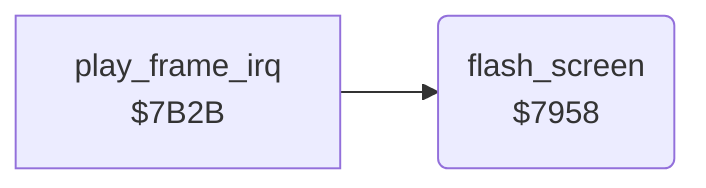

<!-- Generated by c64-docs from knowledge revision 20261025T214621.431-dj0nk4 and .c64-re-tools/local/generated/src/source-map.json. Do not edit: change the knowledge, generate the source again, then run docs.ts generate. -->
# screen/flash.asm: Screen flash

Range `$7958-$7970`. Source: [screen/flash.asm](../../../../src/screen/flash.asm). Index: [the reference](../../index.md).

## Routines

| Routine | Address | Reached from | Summary |
|---|---|---|---|
| [`flash_screen`](flash.md#flash_screen) | `$7958` | [`play_frame_irq`](../irq/play_frame.md#play_frame_irq) | While flash_frames is not 0, sets the border and the background white and decrements flash_frames. |

## Call graph

A solid arrow is a call, a thick arrow a table entry. Rounded nodes are in this file.

## Details

### [`flash_screen`](../../../../src/screen/flash.asm#L6) `$7958`

*routine*

While flash_frames is not 0, sets the border and the background white and decrements flash_frames. The last frame sets them black.

- **Called from:** [`play_frame_irq`](../irq/play_frame.md#play_frame_irq)
- **Reads:** [`flash_frames`](../../memory-map.md#flash_frames)
- **Writes:** [`BGCOL0`](../../memory-map.md#BGCOL0), [`EXTCOL`](../../memory-map.md#EXTCOL), [`flash_frames`](../../memory-map.md#flash_frames)

| Label | Address | Comment |
|---|---|---|
| [`flash_screen_done`](../../../../src/screen/flash.asm#L17) | `$7970` |  |
