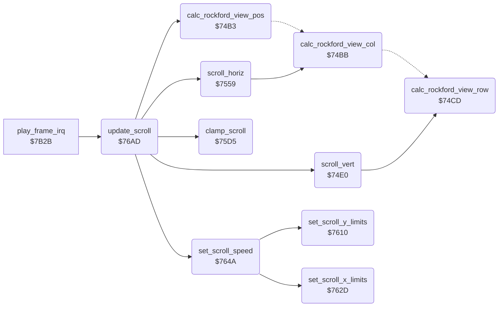

<!-- Generated by c64-docs from knowledge revision 20261024T103116.541-jn0vrj and .c64-re-tools/local/generated/src/source-map.json. Do not edit: change the knowledge, generate the source again, then run docs.ts generate. -->
# screen/scroll.asm: Scrolling of the view

Range `$749B-$76C5`. Source: [screen/scroll.asm](../../../../src/screen/scroll.asm). Index: [the reference](../../index.md).

## Call graph

A solid arrow is a call, a thick arrow a table entry, a dotted arrow a jump. Rounded nodes are in this file.

## Data

| Range | Type | Name | Read by | Written by |
|---|---|---|---|---|
| [`$749B`](../../../../src/screen/scroll.asm#L7)-`$74A6` | bytes of 3 | [`scroll_y_trigger_row`](../../../../src/screen/scroll.asm#L6) | [`set_scroll_speed`](scroll.md#set_scroll_speed) |  |
| [`$74A7`](../../../../src/screen/scroll.asm#L17)-`$74B2` | bytes of 3 | [`scroll_x_trigger_col`](../../../../src/screen/scroll.asm#L16) | [`set_scroll_speed`](scroll.md#set_scroll_speed) |  |
| [`$74D8`](../../../../src/screen/scroll.asm#L56)-`$74DB` | bytes | [`scroll_x_d016`](../../../../src/screen/scroll.asm#L55) | [`scroll_horiz`](scroll.md#scroll_horiz) |  |
| [`$74DC`](../../../../src/screen/scroll.asm#L59)-`$74DF` | bytes | [`scroll_y_d011`](../../../../src/screen/scroll.asm#L58) | [`scroll_vert`](scroll.md#scroll_vert) |  |

## Names

### [`scroll_y_trigger_row`](../../../../src/screen/scroll.asm#L6) `$749B`

*data*

Vertical scroll triggers: 4 entries of 3 bytes. Byte 0 is the screen row of Rockford, bytes 1-2 are the scroll speed for that row.

- **Read by:** [`set_scroll_speed`](scroll.md#set_scroll_speed) [`$7650`](../../../../src/screen/scroll.asm#L291), [`set_scroll_speed`](scroll.md#set_scroll_speed) [`$766D`](../../../../src/screen/scroll.asm#L306)

### [`scroll_y_trigger_lo`](../../../../src/screen/scroll.asm#L8) `$749C`

*data*

- **Read by:** [`set_scroll_speed`](scroll.md#set_scroll_speed) [`$7655`](../../../../src/screen/scroll.asm#L294)

### [`scroll_y_trigger_hi`](../../../../src/screen/scroll.asm#L10) `$749D-$74A6`

*data*

- **Read by:** [`set_scroll_speed`](scroll.md#set_scroll_speed) [`$765A`](../../../../src/screen/scroll.asm#L296)

### [`scroll_x_trigger_col`](../../../../src/screen/scroll.asm#L16) `$74A7`

*data*

Horizontal scroll triggers: 4 entries of 3 bytes. Byte 0 is the screen column of Rockford, bytes 1-2 are the scroll speed for that column.

- **Read by:** [`set_scroll_speed`](scroll.md#set_scroll_speed) [`$7681`](../../../../src/screen/scroll.asm#L319), [`set_scroll_speed`](scroll.md#set_scroll_speed) [`$769E`](../../../../src/screen/scroll.asm#L334)

### [`scroll_x_trigger_lo`](../../../../src/screen/scroll.asm#L18) `$74A8`

*data*

- **Read by:** [`set_scroll_speed`](scroll.md#set_scroll_speed) [`$7686`](../../../../src/screen/scroll.asm#L322)

### [`scroll_x_trigger_hi`](../../../../src/screen/scroll.asm#L20) `$74A9-$74B2`

*data*

- **Read by:** [`set_scroll_speed`](scroll.md#set_scroll_speed) [`$768B`](../../../../src/screen/scroll.asm#L324)

### [`calc_rockford_view_pos`](../../../../src/screen/scroll.asm#L26) `$74B3`

*routine*

When no pixel scroll is in progress on an axis, calculates the screen column and the screen row of Rockford in cells.

- **Called from:** [`update_scroll`](scroll.md#update_scroll) [`$76B6`](../../../../src/screen/scroll.asm#L352)
- **Jumps to:** [`calc_rockford_view_pos_y`](scroll.md#calc_rockford_view_pos_y)
- **Reads:** [`scroll_x_fine`](../../memory-map.md#scroll_x_fine), [`scroll_x_fine_last`](../../memory-map.md#scroll_x_fine_last)

### [`calc_rockford_view_col`](../../../../src/screen/scroll.asm#L32) `$74BB`

*routine*

Sets rockford_view_col to rockford_col minus the view column in cells (scroll_x_char / 2).

- **Called from:** [`scroll_horiz`](scroll.md#scroll_horiz) [`$75B1`](../../../../src/screen/scroll.asm#L189)
- **Jumps to:** [`calc_rockford_view_done`](scroll.md#calc_rockford_view_done)
- **Reads:** [`scroll_x_char`](../../memory-map.md#scroll_x_char), [`rockford_col`](../../memory-map.md#rockford_col), [`scroll_y_fine`](../../memory-map.md#scroll_y_fine), [`scroll_y_fine_last`](../../memory-map.md#scroll_y_fine_last)
- **Writes:** [`rockford_view_col`](../../memory-map.md#rockford_view_col)

### [`calc_rockford_view_pos_y`](../../../../src/screen/scroll.asm#L39) `$74C5`

*label*

- **Jumped to from:** [`calc_rockford_view_pos`](scroll.md#calc_rockford_view_pos) [`$74B5`](../../../../src/screen/scroll.asm#L28), [`calc_rockford_view_pos`](scroll.md#calc_rockford_view_pos) [`$74B9`](../../../../src/screen/scroll.asm#L30)

### [`calc_rockford_view_row`](../../../../src/screen/scroll.asm#L45) `$74CD`

*routine*

Sets rockford_view_row to rockford_row minus the view row in cells (scroll_y_char / 2).

- **Called from:** [`scroll_vert`](scroll.md#scroll_vert) [`$7535`](../../../../src/screen/scroll.asm#L112)
- **Reads:** [`scroll_y_char`](../../memory-map.md#scroll_y_char), [`rockford_row`](../../memory-map.md#rockford_row)
- **Writes:** [`rockford_view_row`](../../memory-map.md#rockford_view_row)

### [`calc_rockford_view_done`](../../../../src/screen/scroll.asm#L52) `$74D7`

*label*

- **Jumped to from:** [`calc_rockford_view_col`](scroll.md#calc_rockford_view_col) [`$74C7`](../../../../src/screen/scroll.asm#L41), [`calc_rockford_view_col`](scroll.md#calc_rockford_view_col) [`$74CB`](../../../../src/screen/scroll.asm#L43)

### [`scroll_x_d016`](../../../../src/screen/scroll.asm#L55) `$74D8-$74DB`

*data*

Values for $D016 (multicolour mode and fine X scroll) for the horizontal scroll phases 0-3.

- **Read by:** [`scroll_horiz`](scroll.md#scroll_horiz) [`$7586`](../../../../src/screen/scroll.asm#L164)

### [`scroll_y_d011`](../../../../src/screen/scroll.asm#L58) `$74DC-$74DF`

*data*

Values for $D011 (fine Y scroll) for the vertical scroll phases 0-3.

- **Read by:** [`scroll_vert`](scroll.md#scroll_vert) [`$750F`](../../../../src/screen/scroll.asm#L92)

### [`scroll_vert`](../../../../src/screen/scroll.asm#L61) `$74E0`

*routine*

Moves the view vertically by scroll_y_speed. Sets the fine Y scroll of the play area split. At a phase change, it moves view_ptr by one character row ($50). At rest, it moves only on even frames.

- **Called from:** [`update_scroll`](scroll.md#update_scroll) [`$76C2`](../../../../src/screen/scroll.asm#L356)
- **Calls:** [`calc_rockford_view_row`](scroll.md#calc_rockford_view_row)
- **Reads:** [`scroll_y_fine`](../../memory-map.md#scroll_y_fine), [`scroll_y_fine_last`](../../memory-map.md#scroll_y_fine_last), [`frame_counter`](../../memory-map.md#frame_counter), [`scroll_y_speed`](../../memory-map.md#scroll_y_speed), [`scroll_y_pos`](../../memory-map.md#scroll_y_pos), [`scroll_y_char`](../../memory-map.md#scroll_y_char), [`scroll_y_speed_hi`](../../memory-map.md#scroll_y_speed_hi), [`scroll_y_d011`](scroll.md#scroll_y_d011), [`view_ptr`](../../memory-map.md#view_ptr), [`view_ptr_hi`](../../memory-map.md#view_ptr_hi), [`rockford_view_row`](../../memory-map.md#rockford_view_row)
- **Writes:** [`scroll_y_pos`](../../memory-map.md#scroll_y_pos), [`scroll_y_char`](../../memory-map.md#scroll_y_char), [`scroll_y_fine`](../../memory-map.md#scroll_y_fine), [`irq_d011_values`](../../memory-map.md#irq_d011_values), [`view_ptr`](../../memory-map.md#view_ptr), [`view_ptr_hi`](../../memory-map.md#view_ptr_hi), [`scroll_y_fine_last`](../../memory-map.md#scroll_y_fine_last)

### [`scroll_vert_check_up`](../../../../src/screen/scroll.asm#L70) `$74EF`

*label*

- **Jumped to from:** [`scroll_vert`](scroll.md#scroll_vert) [`$74EC`](../../../../src/screen/scroll.asm#L68)

### [`scroll_vert_step`](../../../../src/screen/scroll.asm#L74) `$74F5`

*label*

- **Jumped to from:** [`scroll_vert`](scroll.md#scroll_vert) [`$74E2`](../../../../src/screen/scroll.asm#L63), [`scroll_vert`](scroll.md#scroll_vert) [`$74E6`](../../../../src/screen/scroll.asm#L65)

### [`scroll_vert_check_back`](../../../../src/screen/scroll.asm#L106) `$752B`

*label*

- **Jumped to from:** [`scroll_vert`](scroll.md#scroll_vert) [`$7518`](../../../../src/screen/scroll.asm#L96), [`scroll_vert`](scroll.md#scroll_vert) [`$751C`](../../../../src/screen/scroll.asm#L98)

### [`scroll_vert_row_up`](../../../../src/screen/scroll.asm#L119) `$7542`

*label*

Moves the view up one character row and starts at phase 3.

- **Jumped to from:** [`scroll_vert`](scroll.md#scroll_vert) [`$74F3`](../../../../src/screen/scroll.asm#L73)

### [`scroll_vert_save_phase`](../../../../src/screen/scroll.asm#L130) `$7554`

*label*

- **Jumped to from:** [`scroll_vert`](scroll.md#scroll_vert) [`$752D`](../../../../src/screen/scroll.asm#L108), [`scroll_vert`](scroll.md#scroll_vert) [`$7533`](../../../../src/screen/scroll.asm#L111), [`scroll_vert`](scroll.md#scroll_vert) [`$753A`](../../../../src/screen/scroll.asm#L114), [`scroll_vert`](scroll.md#scroll_vert) [`$7540`](../../../../src/screen/scroll.asm#L117)

### [`scroll_horiz`](../../../../src/screen/scroll.asm#L135) `$7559`

*routine*

Moves the view horizontally by scroll_x_speed. Sets the fine X scroll of the play area split. At a phase change, it moves view_ptr by one character. At rest, it moves only on even frames.

- **Called from:** [`update_scroll`](scroll.md#update_scroll) [`$76BF`](../../../../src/screen/scroll.asm#L355)
- **Calls:** [`calc_rockford_view_col`](scroll.md#calc_rockford_view_col)
- **Reads:** [`scroll_x_fine`](../../memory-map.md#scroll_x_fine), [`scroll_x_fine_last`](../../memory-map.md#scroll_x_fine_last), [`frame_counter`](../../memory-map.md#frame_counter), [`scroll_x_speed`](../../memory-map.md#scroll_x_speed), [`scroll_x_pos`](../../memory-map.md#scroll_x_pos), [`scroll_x_char`](../../memory-map.md#scroll_x_char), [`scroll_x_speed_hi`](../../memory-map.md#scroll_x_speed_hi), [`scroll_x_d016`](scroll.md#scroll_x_d016), [`birth_countdown`](../../memory-map.md#birth_countdown), [`cave_number`](../../memory-map.md#cave_number), [`view_ptr`](../../memory-map.md#view_ptr), [`view_ptr_hi`](../../memory-map.md#view_ptr_hi), [`rockford_view_col`](../../memory-map.md#rockford_view_col)
- **Writes:** [`scroll_x_pos`](../../memory-map.md#scroll_x_pos), [`scroll_x_char`](../../memory-map.md#scroll_x_char), [`scroll_x_fine`](../../memory-map.md#scroll_x_fine), [`irq_d016_values`](../../memory-map.md#irq_d016_values), [`view_ptr`](../../memory-map.md#view_ptr), [`view_ptr_hi`](../../memory-map.md#view_ptr_hi), [`scroll_x_fine_last`](../../memory-map.md#scroll_x_fine_last)

### [`scroll_horiz_check_left`](../../../../src/screen/scroll.asm#L144) `$7568`

*label*

- **Jumped to from:** [`scroll_horiz`](scroll.md#scroll_horiz) [`$7565`](../../../../src/screen/scroll.asm#L142)

### [`scroll_horiz_step`](../../../../src/screen/scroll.asm#L148) `$756E`

*label*

- **Jumped to from:** [`scroll_horiz`](scroll.md#scroll_horiz) [`$755B`](../../../../src/screen/scroll.asm#L137), [`scroll_horiz`](scroll.md#scroll_horiz) [`$755F`](../../../../src/screen/scroll.asm#L139)

### [`scroll_horiz_set_d016`](../../../../src/screen/scroll.asm#L172) `$7595`

*label*

- **Jumped to from:** [`scroll_horiz`](scroll.md#scroll_horiz) [`$758B`](../../../../src/screen/scroll.asm#L166), [`scroll_horiz`](scroll.md#scroll_horiz) [`$7591`](../../../../src/screen/scroll.asm#L169)

### [`scroll_horiz_check_back`](../../../../src/screen/scroll.asm#L183) `$75A7`

*label*

- **Jumped to from:** [`scroll_horiz`](scroll.md#scroll_horiz) [`$759B`](../../../../src/screen/scroll.asm#L176), [`scroll_horiz`](scroll.md#scroll_horiz) [`$759F`](../../../../src/screen/scroll.asm#L178), [`scroll_horiz`](scroll.md#scroll_horiz) [`$75A3`](../../../../src/screen/scroll.asm#L180)

### [`scroll_horiz_col_left`](../../../../src/screen/scroll.asm#L196) `$75BE`

*label*

Moves the view left one character and starts at phase 3.

- **Jumped to from:** [`scroll_horiz`](scroll.md#scroll_horiz) [`$756C`](../../../../src/screen/scroll.asm#L147)

### [`scroll_horiz_save_phase`](../../../../src/screen/scroll.asm#L207) `$75D0`

*label*

- **Jumped to from:** [`scroll_horiz`](scroll.md#scroll_horiz) [`$75A9`](../../../../src/screen/scroll.asm#L185), [`scroll_horiz`](scroll.md#scroll_horiz) [`$75AF`](../../../../src/screen/scroll.asm#L188), [`scroll_horiz`](scroll.md#scroll_horiz) [`$75B6`](../../../../src/screen/scroll.asm#L191), [`scroll_horiz`](scroll.md#scroll_horiz) [`$75BC`](../../../../src/screen/scroll.asm#L194)

### [`clamp_scroll`](../../../../src/screen/scroll.asm#L212) `$75D5`

*routine*

Stops the scroll at the edges of the map buffer: row 0 and row 21, column 0 and column 42.

- **Called from:** [`update_scroll`](scroll.md#update_scroll) [`$76BC`](../../../../src/screen/scroll.asm#L354)
- **Reads:** [`scroll_y_pos`](../../memory-map.md#scroll_y_pos), [`scroll_y_char`](../../memory-map.md#scroll_y_char), [`scroll_y_speed_hi`](../../memory-map.md#scroll_y_speed_hi), [`scroll_x_pos`](../../memory-map.md#scroll_x_pos), [`scroll_x_char`](../../memory-map.md#scroll_x_char), [`scroll_x_speed_hi`](../../memory-map.md#scroll_x_speed_hi)
- **Writes:** [`scroll_y_speed`](../../memory-map.md#scroll_y_speed), [`scroll_y_speed_hi`](../../memory-map.md#scroll_y_speed_hi), [`scroll_x_speed`](../../memory-map.md#scroll_x_speed), [`scroll_x_speed_hi`](../../memory-map.md#scroll_x_speed_hi)

### [`clamp_scroll_bottom`](../../../../src/screen/scroll.asm#L222) `$75E7`

*label*

- **Jumped to from:** [`clamp_scroll`](scroll.md#clamp_scroll) [`$75DD`](../../../../src/screen/scroll.asm#L217), [`clamp_scroll`](scroll.md#clamp_scroll) [`$75E1`](../../../../src/screen/scroll.asm#L219)

### [`clamp_scroll_x`](../../../../src/screen/scroll.asm#L229) `$75F3`

*label*

- **Jumped to from:** [`clamp_scroll`](scroll.md#clamp_scroll) [`$75D9`](../../../../src/screen/scroll.asm#L215), [`clamp_scroll`](scroll.md#clamp_scroll) [`$75E9`](../../../../src/screen/scroll.asm#L224), [`clamp_scroll`](scroll.md#clamp_scroll) [`$75ED`](../../../../src/screen/scroll.asm#L226)

### [`clamp_scroll_right`](../../../../src/screen/scroll.asm#L238) `$7603`

*label*

- **Jumped to from:** [`clamp_scroll`](scroll.md#clamp_scroll) [`$75F9`](../../../../src/screen/scroll.asm#L233), [`clamp_scroll`](scroll.md#clamp_scroll) [`$75FD`](../../../../src/screen/scroll.asm#L235)

### [`clamp_scroll_done`](../../../../src/screen/scroll.asm#L245) `$760F`

*label*

- **Jumped to from:** [`clamp_scroll`](scroll.md#clamp_scroll) [`$75F5`](../../../../src/screen/scroll.asm#L231), [`clamp_scroll`](scroll.md#clamp_scroll) [`$7605`](../../../../src/screen/scroll.asm#L240), [`clamp_scroll`](scroll.md#clamp_scroll) [`$7609`](../../../../src/screen/scroll.asm#L242)

### [`set_scroll_y_limits`](../../../../src/screen/scroll.asm#L248) `$7610`

*routine*

Scrolls down when Rockford is at screen row 11 or lower, and up when he is above screen row 5.

- **Called from:** [`set_scroll_speed`](scroll.md#set_scroll_speed) [`$7678`](../../../../src/screen/scroll.asm#L314)
- **Reads:** [`rockford_view_row`](../../memory-map.md#rockford_view_row)
- **Writes:** [`scroll_y_speed`](../../memory-map.md#scroll_y_speed), [`scroll_y_speed_hi`](../../memory-map.md#scroll_y_speed_hi)

### [`set_scroll_y_limits_top`](../../../../src/screen/scroll.asm#L256) `$761E`

*label*

- **Jumped to from:** [`set_scroll_y_limits`](scroll.md#set_scroll_y_limits) [`$7614`](../../../../src/screen/scroll.asm#L251)

### [`set_scroll_y_limits_done`](../../../../src/screen/scroll.asm#L264) `$762C`

*label*

- **Jumped to from:** [`set_scroll_y_limits`](scroll.md#set_scroll_y_limits) [`$7622`](../../../../src/screen/scroll.asm#L259)

### [`set_scroll_x_limits`](../../../../src/screen/scroll.asm#L267) `$762D`

*routine*

Scrolls right when Rockford is at screen column 17 or more, and left when he is left of screen column 3.

- **Called from:** [`set_scroll_speed`](scroll.md#set_scroll_speed) [`$76A9`](../../../../src/screen/scroll.asm#L342)
- **Reads:** [`rockford_view_col`](../../memory-map.md#rockford_view_col)
- **Writes:** [`scroll_x_speed`](../../memory-map.md#scroll_x_speed), [`scroll_x_speed_hi`](../../memory-map.md#scroll_x_speed_hi)

### [`set_scroll_x_limits_left`](../../../../src/screen/scroll.asm#L275) `$763B`

*label*

- **Jumped to from:** [`set_scroll_x_limits`](scroll.md#set_scroll_x_limits) [`$7631`](../../../../src/screen/scroll.asm#L270)

### [`set_scroll_x_limits_done`](../../../../src/screen/scroll.asm#L283) `$7649`

*label*

- **Jumped to from:** [`set_scroll_x_limits`](scroll.md#set_scroll_x_limits) [`$763F`](../../../../src/screen/scroll.asm#L278)

### [`set_scroll_speed`](../../../../src/screen/scroll.asm#L286) `$764A`

*routine*

Sets the scroll speeds from the trigger tables and the screen position of Rockford, then applies the screen edge limits. During the start delay, a stopped scroll also takes the speed of an entry whose position is more than the position of Rockford.

- **Called from:** [`update_scroll`](scroll.md#update_scroll) [`$76B9`](../../../../src/screen/scroll.asm#L353)
- **Calls:** [`set_scroll_y_limits`](scroll.md#set_scroll_y_limits), [`set_scroll_x_limits`](scroll.md#set_scroll_x_limits)
- **Reads:** [`rockford_view_row`](../../memory-map.md#rockford_view_row), [`scroll_y_trigger_row`](scroll.md#scroll_y_trigger_row), [`scroll_y_trigger_lo`](scroll.md#scroll_y_trigger_lo), [`scroll_y_trigger_hi`](scroll.md#scroll_y_trigger_hi), [`scroll_y_char`](../../memory-map.md#scroll_y_char), [`scroll_y_speed`](../../memory-map.md#scroll_y_speed), [`birth_countdown`](../../memory-map.md#birth_countdown), [`rockford_view_col`](../../memory-map.md#rockford_view_col), [`scroll_x_trigger_col`](scroll.md#scroll_x_trigger_col), [`scroll_x_trigger_lo`](scroll.md#scroll_x_trigger_lo), [`scroll_x_trigger_hi`](scroll.md#scroll_x_trigger_hi), [`scroll_x_char`](../../memory-map.md#scroll_x_char), [`scroll_x_speed`](../../memory-map.md#scroll_x_speed)
- **Writes:** [`scroll_y_speed`](../../memory-map.md#scroll_y_speed), [`scroll_y_speed_hi`](../../memory-map.md#scroll_y_speed_hi), [`scroll_x_speed`](../../memory-map.md#scroll_x_speed), [`scroll_x_speed_hi`](../../memory-map.md#scroll_x_speed_hi)

### [`set_scroll_speed_y_loop`](../../../../src/screen/scroll.asm#L289) `$764E`

*label*

- **Jumped to from:** [`set_scroll_speed`](scroll.md#set_scroll_speed) [`$7676`](../../../../src/screen/scroll.asm#L313)

### [`set_scroll_speed_y_set`](../../../../src/screen/scroll.asm#L293) `$7655`

*label*

- **Jumped to from:** [`set_scroll_speed`](scroll.md#set_scroll_speed) [`$7670`](../../../../src/screen/scroll.asm#L307)

### [`set_scroll_speed_y_catch`](../../../../src/screen/scroll.asm#L298) `$765F`

*label*

- **Jumped to from:** [`set_scroll_speed`](scroll.md#set_scroll_speed) [`$7653`](../../../../src/screen/scroll.asm#L292)

### [`set_scroll_speed_y_next`](../../../../src/screen/scroll.asm#L308) `$7672`

*label*

- **Jumped to from:** [`set_scroll_speed`](scroll.md#set_scroll_speed) [`$7661`](../../../../src/screen/scroll.asm#L300), [`set_scroll_speed`](scroll.md#set_scroll_speed) [`$7665`](../../../../src/screen/scroll.asm#L302), [`set_scroll_speed`](scroll.md#set_scroll_speed) [`$7669`](../../../../src/screen/scroll.asm#L304)

### [`set_scroll_speed_x_loop`](../../../../src/screen/scroll.asm#L317) `$767F`

*label*

- **Jumped to from:** [`set_scroll_speed`](scroll.md#set_scroll_speed) [`$76A7`](../../../../src/screen/scroll.asm#L341)

### [`set_scroll_speed_x_set`](../../../../src/screen/scroll.asm#L321) `$7686`

*label*

- **Jumped to from:** [`set_scroll_speed`](scroll.md#set_scroll_speed) [`$76A1`](../../../../src/screen/scroll.asm#L335)

### [`set_scroll_speed_x_catch`](../../../../src/screen/scroll.asm#L326) `$7690`

*label*

- **Jumped to from:** [`set_scroll_speed`](scroll.md#set_scroll_speed) [`$7684`](../../../../src/screen/scroll.asm#L320)

### [`set_scroll_speed_x_next`](../../../../src/screen/scroll.asm#L336) `$76A3`

*label*

- **Jumped to from:** [`set_scroll_speed`](scroll.md#set_scroll_speed) [`$7692`](../../../../src/screen/scroll.asm#L328), [`set_scroll_speed`](scroll.md#set_scroll_speed) [`$7696`](../../../../src/screen/scroll.asm#L330), [`set_scroll_speed`](scroll.md#set_scroll_speed) [`$769A`](../../../../src/screen/scroll.asm#L332)

### [`update_scroll`](../../../../src/screen/scroll.asm#L345) `$76AD`

*routine*

Scrolls the view to follow Rockford. In an intermission, the view scrolls only during the start delay.

- **Called from:** [`play_frame_irq`](../irq/play_frame.md#play_frame_irq) [`$7B41`](../../../../src/irq/play_frame.asm#L17)
- **Calls:** [`calc_rockford_view_pos`](scroll.md#calc_rockford_view_pos), [`set_scroll_speed`](scroll.md#set_scroll_speed), [`clamp_scroll`](scroll.md#clamp_scroll), [`scroll_horiz`](scroll.md#scroll_horiz), [`scroll_vert`](scroll.md#scroll_vert)
- **Reads:** [`intermission_flag`](../../memory-map.md#intermission_flag), [`birth_countdown`](../../memory-map.md#birth_countdown)

### [`update_scroll_run`](../../../../src/screen/scroll.asm#L351) `$76B6`

*label*

- **Jumped to from:** [`update_scroll`](scroll.md#update_scroll) [`$76AF`](../../../../src/screen/scroll.asm#L347), [`update_scroll`](scroll.md#update_scroll) [`$76B3`](../../../../src/screen/scroll.asm#L349)
