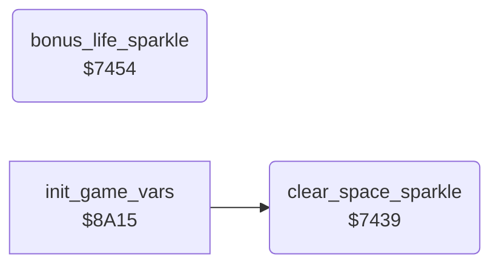

<!-- Generated by c64-docs from knowledge revision 20261025T214621.431-dj0nk4 and .c64-re-tools/local/generated/src/source-map.json. Do not edit: change the knowledge, generate the source again, then run docs.ts generate. -->
# screen/space_sparkle.asm: Space sparkle

Range `$7439-$7486`. Source: [screen/space_sparkle.asm](../../../../src/screen/space_sparkle.asm). Index: [the reference](../../index.md).

## Routines

| Routine | Address | Reached from | Summary |
|---|---|---|---|
| [`clear_space_sparkle`](space_sparkle.md#clear_space_sparkle) | `$7439` | [`init_game_vars`](../init/init_vars.md#init_game_vars) | Clears rows 0 and 4 of the four space characters $60, $61, $70 and $71. |
| [`bonus_life_sparkle`](space_sparkle.md#bonus_life_sparkle) | `$7454` |  | Bonus life sparkle: fills rows 0 and 4 of the space characters with random bytes and decrements bonus_life_timer. |

## Call graph

A solid arrow is a call, a thick arrow a table entry. Rounded nodes are in this file.

## Details

### [`clear_space_sparkle`](../../../../src/screen/space_sparkle.asm#L6) `$7439`

*routine*

Clears rows 0 and 4 of the four space characters $60, $61, $70 and $71. The cave set-up calls it.

- **Called from:** [`init_game_vars`](../init/init_vars.md#init_game_vars)
- **Writes:** [`gfx_space_tl`](../../memory-map.md#gfx_space_tl), [`gfx_space_tr`](../../memory-map.md#gfx_space_tr), [`gfx_space_bl`](../../memory-map.md#gfx_space_bl), [`gfx_space_br`](../../memory-map.md#gfx_space_br)

### [`bonus_life_sparkle`](../../../../src/screen/space_sparkle.asm#L18) `$7454`

*routine*

Bonus life sparkle: fills rows 0 and 4 of the space characters with random bytes and decrements bonus_life_timer. The last frame clears them. The screen drawing routine calls it while bonus_life_timer is not 0. add_bonus_life sets the timer to $80.

| Label | Address | Comment |
|---|---|---|
| [`bonus_life_sparkle_fill`](../../../../src/screen/space_sparkle.asm#L25) | `$7460` |  |
