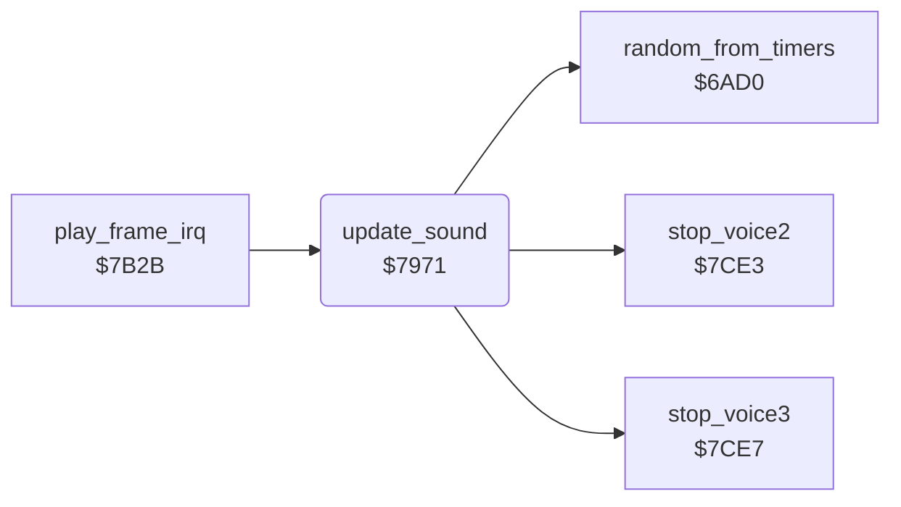

<!-- Generated by c64-docs from knowledge revision 20261024T103116.541-jn0vrj and .c64-re-tools/local/generated/src/source-map.json. Do not edit: change the knowledge, generate the source again, then run docs.ts generate. -->
# sound/effects.asm: Sound effects

Range `$7971-$7A85`. Source: [sound/effects.asm](../../../../src/sound/effects.asm). Index: [the reference](../../index.md).

## Call graph

A solid arrow is a call, a thick arrow a table entry, a dotted arrow a jump. Rounded nodes are in this file.

## Names

### [`update_sound`](../../../../src/sound/effects.asm#L6) `$7971`

*routine*

Plays the sound effects once each frame. Voice 3 plays the noise burst and the amoeba. Voice 1 plays the requested effects with a fade. Voice 2 plays the steps of Rockford. Nothing plays during the pause.

- **Called from:** [`play_frame_irq`](../irq/play_frame.md#play_frame_irq) [`$7B3C`](../../../../src/irq/play_frame.asm#L15)
- **Calls:** [`stop_voice3`](voices_off.md#stop_voice3), [`random_from_timers`](../engine/random.md#random_from_timers), [`stop_voice2`](voices_off.md#stop_voice2)
- **Jumps to:** [`stop_voice2`](voices_off.md#stop_voice2)
- **Reads:** [`pause_flag`](../../memory-map.md#pause_flag), [`noise_request`](../../memory-map.md#noise_request), [`noise_timer`](../../memory-map.md#noise_timer), [`crack_sound_regs`](../status/score_time.md#crack_sound_regs), [`cave_clock_on`](../../memory-map.md#cave_clock_on), [`amoeba_room_last`](../../memory-map.md#amoeba_room_last), [`magic_wall_state`](../../memory-map.md#magic_wall_state), [`sound1_frame`](../../memory-map.md#sound1_frame), [`sound1_rate`](../../memory-map.md#sound1_rate), [`sound1_request`](../../memory-map.md#sound1_request), [`sound1_ctrl`](../../memory-map.md#sound1_ctrl), [`sound1_pending`](../../memory-map.md#sound1_pending), [`sound1_sr`](../../memory-map.md#sound1_sr), [`cave_covered`](../../memory-map.md#cave_covered), [`sound2_lock`](../../memory-map.md#sound2_lock), [`step_sound_timer`](../../memory-map.md#step_sound_timer), [`step_sound_pitch`](../../memory-map.md#step_sound_pitch), [`step_sound_length`](../../memory-map.md#step_sound_length)
- **Writes:** [`SIGVOL`](../../memory-map.md#SIGVOL), [`FRELO3`](../../memory-map.md#FRELO3), [`noise_timer`](../../memory-map.md#noise_timer), [`noise_request`](../../memory-map.md#noise_request), [`VCREG3`](../../memory-map.md#VCREG3), [`FREHI3`](../../memory-map.md#FREHI3), [`ATDCY3`](../../memory-map.md#ATDCY3), [`sound1_frame`](../../memory-map.md#sound1_frame), [`VCREG1`](../../memory-map.md#VCREG1), [`sound1_current`](../../memory-map.md#sound1_current), [`FRELO1`](../../memory-map.md#FRELO1), [`sound1_request`](../../memory-map.md#sound1_request), [`sound1_sr`](../../memory-map.md#sound1_sr), [`SUREL1`](../../memory-map.md#SUREL1), [`sound2_lock`](../../memory-map.md#sound2_lock), [`FREHI2`](../../memory-map.md#FREHI2), [`step_sound_pitch`](../../memory-map.md#step_sound_pitch), [`SUREL2`](../../memory-map.md#SUREL2), [`ATDCY2`](../../memory-map.md#ATDCY2), [`VCREG2`](../../memory-map.md#VCREG2), [`step_sound_length`](../../memory-map.md#step_sound_length), [`step_sound_timer`](../../memory-map.md#step_sound_timer)

### [`update_sound_noise`](../../../../src/sound/effects.asm#L12) `$797B`

*label*

- **Jumped to from:** [`update_sound`](effects.md#update_sound) [`$7978`](../../../../src/sound/effects.asm#L10)

### [`update_sound_noise_regs`](../../../../src/sound/effects.asm#L19) `$7988`

*label*

- **Jumped to from:** [`update_sound`](effects.md#update_sound) [`$798F`](../../../../src/sound/effects.asm#L23)

### [`update_sound_noise_count`](../../../../src/sound/effects.asm#L26) `$7995`

*label*

- **Jumped to from:** [`update_sound`](effects.md#update_sound) [`$7981`](../../../../src/sound/effects.asm#L16)

### [`update_sound_amoeba`](../../../../src/sound/effects.asm#L32) `$79A0`

*label*

- **Jumped to from:** [`update_sound`](effects.md#update_sound) [`$797D`](../../../../src/sound/effects.asm#L14), [`update_sound`](effects.md#update_sound) [`$7997`](../../../../src/sound/effects.asm#L28)

### [`update_sound_amoeba_freq`](../../../../src/sound/effects.asm#L41) `$79B1`

*label*

- **Jumped to from:** [`update_sound`](effects.md#update_sound) [`$79B8`](../../../../src/sound/effects.asm#L45)

### [`update_sound_v3_off`](../../../../src/sound/effects.asm#L52) `$79C9`

*label*

- **Jumped to from:** [`update_sound`](effects.md#update_sound) [`$79A6`](../../../../src/sound/effects.asm#L36), [`update_sound`](effects.md#update_sound) [`$79AA`](../../../../src/sound/effects.asm#L38)

### [`update_sound_voice1`](../../../../src/sound/effects.asm#L57) `$79D2`

*label*

- **Jumped to from:** [`update_sound`](effects.md#update_sound) [`$79A2`](../../../../src/sound/effects.asm#L34), [`update_sound`](effects.md#update_sound) [`$79C7`](../../../../src/sound/effects.asm#L51), [`update_sound`](effects.md#update_sound) [`$79CD`](../../../../src/sound/effects.asm#L55)

### [`update_sound_v1_start`](../../../../src/sound/effects.asm#L72) `$79F4`

*label*

- **Jumped to from:** [`update_sound`](effects.md#update_sound) [`$79ED`](../../../../src/sound/effects.asm#L69)

### [`update_sound_v1_copy`](../../../../src/sound/effects.asm#L74) `$79F6`

*label*

- **Jumped to from:** [`update_sound`](effects.md#update_sound) [`$7A00`](../../../../src/sound/effects.asm#L79)

### [`update_sound_v1_fade`](../../../../src/sound/effects.asm#L84) `$7A0D`

*label*

- **Jumped to from:** [`update_sound`](effects.md#update_sound) [`$79E2`](../../../../src/sound/effects.asm#L64)

### [`update_sound_v1_off`](../../../../src/sound/effects.asm#L97) `$7A28`

*label*

- **Jumped to from:** [`update_sound`](effects.md#update_sound) [`$7A1B`](../../../../src/sound/effects.asm#L90)

### [`update_sound_voice2`](../../../../src/sound/effects.asm#L102) `$7A32`

*label*

- **Jumped to from:** [`update_sound`](effects.md#update_sound) [`$79DB`](../../../../src/sound/effects.asm#L61), [`update_sound`](effects.md#update_sound) [`$7A0A`](../../../../src/sound/effects.asm#L83), [`update_sound`](effects.md#update_sound) [`$7A1F`](../../../../src/sound/effects.asm#L92), [`update_sound`](effects.md#update_sound) [`$7A26`](../../../../src/sound/effects.asm#L96)

### [`update_sound_v2_lock`](../../../../src/sound/effects.asm#L106) `$7A37`

*label*

- **Jumped to from:** [`update_sound`](effects.md#update_sound) [`$7A34`](../../../../src/sound/effects.asm#L104)

### [`update_sound_v2_check`](../../../../src/sound/effects.asm#L110) `$7A3F`

*label*

- **Jumped to from:** [`update_sound`](effects.md#update_sound) [`$7A3A`](../../../../src/sound/effects.asm#L108)

### [`update_sound_v2_locked`](../../../../src/sound/effects.asm#L115) `$7A47`

*label*

- **Jumped to from:** [`update_sound`](effects.md#update_sound) [`$7A44`](../../../../src/sound/effects.asm#L113)

### [`update_sound_step`](../../../../src/sound/effects.asm#L119) `$7A4D`

*label*

- **Jumped to from:** [`update_sound`](effects.md#update_sound) [`$7A4A`](../../../../src/sound/effects.asm#L117)

### [`update_sound_step_len`](../../../../src/sound/effects.asm#L139) `$7A7C`

*label*

- **Jumped to from:** [`update_sound`](effects.md#update_sound) [`$7A76`](../../../../src/sound/effects.asm#L136)

### [`update_sound_step_count`](../../../../src/sound/effects.asm#L141) `$7A7F`

*label*

- **Jumped to from:** [`update_sound`](effects.md#update_sound) [`$7A50`](../../../../src/sound/effects.asm#L121)

### [`update_sound_v2_off`](../../../../src/sound/effects.asm#L144) `$7A83`

*label*

- **Jumped to from:** [`update_sound`](effects.md#update_sound) [`$7A55`](../../../../src/sound/effects.asm#L123)
