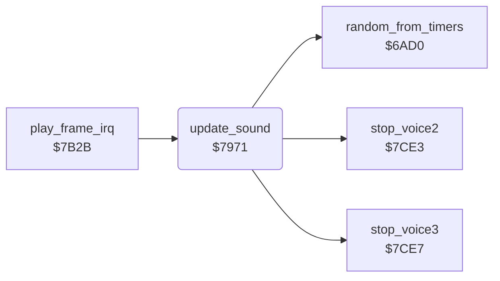

<!-- Generated by c64-docs from knowledge revision 20261025T214621.431-dj0nk4 and .c64-re-tools/local/generated/src/source-map.json. Do not edit: change the knowledge, generate the source again, then run docs.ts generate. -->
# sound/effects.asm: Sound effects

Range `$7971-$7A85`. Source: [sound/effects.asm](../../../../src/sound/effects.asm). Index: [the reference](../../index.md).

## Routines

| Routine | Address | Reached from | Summary |
|---|---|---|---|
| [`update_sound`](effects.md#update_sound) | `$7971` | [`play_frame_irq`](../irq/play_frame.md#play_frame_irq) | Plays the sound effects once each frame. |

## Call graph

A solid arrow is a call, a thick arrow a table entry. Rounded nodes are in this file.

## Details

### [`update_sound`](../../../../src/sound/effects.asm#L6) `$7971`

*routine*

Plays the sound effects once each frame. Voice 3 plays the noise burst and the amoeba. Voice 1 plays the requested effects with a fade. Voice 2 plays the steps of Rockford. Nothing plays during the pause.

- **Called from:** [`play_frame_irq`](../irq/play_frame.md#play_frame_irq)
- **Calls:** [`stop_voice3`](voices_off.md#stop_voice3), [`random_from_timers`](../engine/random.md#random_from_timers), [`stop_voice2`](voices_off.md#stop_voice2)
- **Jumps to:** [`stop_voice2`](voices_off.md#stop_voice2)
- **Reads:** [`pause_flag`](../../memory-map.md#pause_flag), [`noise_request`](../../memory-map.md#noise_request), [`noise_timer`](../../memory-map.md#noise_timer), [`crack_sound_regs`](../status/score_time.md#crack_sound_regs), [`cave_clock_on`](../../memory-map.md#cave_clock_on), [`amoeba_room_last`](../../memory-map.md#amoeba_room_last), [`magic_wall_state`](../../memory-map.md#magic_wall_state), [`sound1_frame`](../../memory-map.md#sound1_frame), [`sound1_rate`](../../memory-map.md#sound1_rate), [`sound1_request`](../../memory-map.md#sound1_request), [`sound1_ctrl`](../../memory-map.md#sound1_ctrl), [`sound1_pending`](../../memory-map.md#sound1_pending) and 6 more
- **Writes:** [`SIGVOL`](../../memory-map.md#SIGVOL), [`FRELO3`](../../memory-map.md#FRELO3), [`noise_timer`](../../memory-map.md#noise_timer), [`noise_request`](../../memory-map.md#noise_request), [`VCREG3`](../../memory-map.md#VCREG3), [`FREHI3`](../../memory-map.md#FREHI3), [`ATDCY3`](../../memory-map.md#ATDCY3), [`sound1_frame`](../../memory-map.md#sound1_frame), [`VCREG1`](../../memory-map.md#VCREG1), [`sound1_current`](../../memory-map.md#sound1_current), [`FRELO1`](../../memory-map.md#FRELO1), [`sound1_request`](../../memory-map.md#sound1_request) and 10 more

| Label | Address | Comment |
|---|---|---|
| [`update_sound_noise`](../../../../src/sound/effects.asm#L12) | `$797B` |  |
| [`update_sound_noise_regs`](../../../../src/sound/effects.asm#L19) | `$7988` |  |
| [`update_sound_noise_count`](../../../../src/sound/effects.asm#L26) | `$7995` |  |
| [`update_sound_amoeba`](../../../../src/sound/effects.asm#L32) | `$79A0` |  |
| [`update_sound_amoeba_freq`](../../../../src/sound/effects.asm#L41) | `$79B1` |  |
| [`update_sound_v3_off`](../../../../src/sound/effects.asm#L52) | `$79C9` |  |
| [`update_sound_voice1`](../../../../src/sound/effects.asm#L57) | `$79D2` |  |
| [`update_sound_v1_start`](../../../../src/sound/effects.asm#L72) | `$79F4` |  |
| [`update_sound_v1_copy`](../../../../src/sound/effects.asm#L74) | `$79F6` |  |
| [`update_sound_v1_fade`](../../../../src/sound/effects.asm#L84) | `$7A0D` |  |
| [`update_sound_v1_off`](../../../../src/sound/effects.asm#L97) | `$7A28` |  |
| [`update_sound_voice2`](../../../../src/sound/effects.asm#L102) | `$7A32` |  |
| [`update_sound_v2_lock`](../../../../src/sound/effects.asm#L106) | `$7A37` |  |
| [`update_sound_v2_check`](../../../../src/sound/effects.asm#L110) | `$7A3F` |  |
| [`update_sound_v2_locked`](../../../../src/sound/effects.asm#L115) | `$7A47` |  |
| [`update_sound_step`](../../../../src/sound/effects.asm#L119) | `$7A4D` |  |
| [`update_sound_step_len`](../../../../src/sound/effects.asm#L139) | `$7A7C` |  |
| [`update_sound_step_count`](../../../../src/sound/effects.asm#L141) | `$7A7F` |  |
| [`update_sound_v2_off`](../../../../src/sound/effects.asm#L144) | `$7A83` |  |
