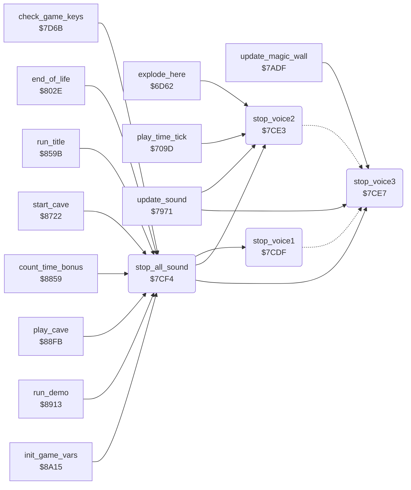

<!-- Generated by c64-docs from knowledge revision 20261024T103116.541-jn0vrj and .c64-re-tools/local/generated/src/source-map.json. Do not edit: change the knowledge, generate the source again, then run docs.ts generate. -->
# sound/voices_off.asm: Stop the SID voices

Range `$7CDF-$7D02`. Source: [sound/voices_off.asm](../../../../src/sound/voices_off.asm). Index: [the reference](../../index.md).

## Call graph

A solid arrow is a call, a thick arrow a table entry, a dotted arrow a jump. Rounded nodes are in this file.

## Names

### [`stop_voice1`](../../../../src/sound/voices_off.asm#L6) `$7CDF`

*routine*

Stops SID voice 1. It sets and clears the test bit of the voice control register.

- **Called from:** [`stop_all_sound`](voices_off.md#stop_all_sound) [`$7CF4`](../../../../src/sound/voices_off.asm#L24)
- **Jumps to:** [`stop_voice_x`](voices_off.md#stop_voice_x)

### [`stop_voice2`](../../../../src/sound/voices_off.asm#L10) `$7CE3`

*routine*

Stops SID voice 2.

- **Called from:** [`explode_here`](../engine/explosion.md#explode_here) [`$6D96`](../../../../src/engine/explosion.asm#L70), [`play_time_tick`](../status/score_time.md#play_time_tick) [`$70A2`](../../../../src/status/score_time.asm#L76), [`update_sound`](effects.md#update_sound) [`$7A57`](../../../../src/sound/effects.asm#L124), [`stop_all_sound`](voices_off.md#stop_all_sound) [`$7CF7`](../../../../src/sound/voices_off.asm#L25)
- **Jumped to from:** [`update_sound`](effects.md#update_sound) [`$7A83`](../../../../src/sound/effects.asm#L145)
- **Jumps to:** [`stop_voice_x`](voices_off.md#stop_voice_x)

### [`stop_voice3`](../../../../src/sound/voices_off.asm#L14) `$7CE7`

*routine*

Stops SID voice 3.

- **Called from:** [`update_sound`](effects.md#update_sound) [`$7983`](../../../../src/sound/effects.asm#L17), [`update_sound`](effects.md#update_sound) [`$799D`](../../../../src/sound/effects.asm#L31), [`update_sound`](effects.md#update_sound) [`$79CF`](../../../../src/sound/effects.asm#L56), [`update_magic_wall`](../engine/magic_wall.md#update_magic_wall) [`$7AEF`](../../../../src/engine/magic_wall.asm#L63), [`stop_all_sound`](voices_off.md#stop_all_sound) [`$7CFA`](../../../../src/sound/voices_off.asm#L26)
- **Writes:** [`FRELO1`](../../memory-map.md#FRELO1)

### [`stop_voice_x`](../../../../src/sound/voices_off.asm#L16) `$7CE9`

*label*

X is the register offset of the voice.

- **Jumped to from:** [`stop_voice1`](voices_off.md#stop_voice1) [`$7CE1`](../../../../src/sound/voices_off.asm#L8), [`stop_voice2`](voices_off.md#stop_voice2) [`$7CE5`](../../../../src/sound/voices_off.asm#L12)

### [`stop_all_sound`](../../../../src/sound/voices_off.asm#L23) `$7CF4`

*routine*

Stops the three voices and sets the SID volume to 15 with filter mode bit 6.

- **Called from:** [`check_game_keys`](../input/game_keys.md#check_game_keys) [`$7D75`](../../../../src/input/game_keys.asm#L75), [`end_of_life`](../status/end_of_life.md#end_of_life) [`$805D`](../../../../src/status/end_of_life.asm#L118), [`run_title`](../title/run_title.md#run_title) [`$85CD`](../../../../src/title/run_title.asm#L34), [`start_cave`](../cave/cave_start.md#start_cave) [`$8742`](../../../../src/cave/cave_start.asm#L20), [`count_time_bonus`](../cave/cave_end.md#count_time_bonus) [`$8878`](../../../../src/cave/cave_end.asm#L42), [`count_time_bonus`](../cave/cave_end.md#count_time_bonus) [`$8890`](../../../../src/cave/cave_end.asm#L53), [`play_cave`](../engine/play_loop.md#play_cave) [`$8902`](../../../../src/engine/play_loop.asm#L10), [`run_demo`](../title/demo.md#run_demo) [`$894F`](../../../../src/title/demo.asm#L43), [`init_game_vars`](../init/init_vars.md#init_game_vars) [`$8A15`](../../../../src/init/init_vars.asm#L7)
- **Calls:** [`stop_voice1`](voices_off.md#stop_voice1), [`stop_voice2`](voices_off.md#stop_voice2), [`stop_voice3`](voices_off.md#stop_voice3)
- **Writes:** [`SIGVOL`](../../memory-map.md#SIGVOL)
