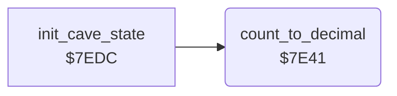

<!-- Generated by c64-docs from knowledge revision 20261024T103116.541-jn0vrj and .c64-re-tools/local/generated/src/source-map.json. Do not edit: change the knowledge, generate the source again, then run docs.ts generate. -->
# status/decimal.asm: Binary to decimal

Range `$7E3E-$7E65`. Source: [status/decimal.asm](../../../../src/status/decimal.asm). Index: [the reference](../../index.md).

## Call graph

A solid arrow is a call, a thick arrow a table entry, a dotted arrow a jump. Rounded nodes are in this file.

## Data

| Range | Type | Name | Read by | Written by |
|---|---|---|---|---|
| [`$7E3E`](../../../../src/status/decimal.asm#L7)-`$7E40` | bytes | [`decimal_one`](../../../../src/status/decimal.asm#L6) | [`count_to_decimal`](decimal.md#count_to_decimal) |  |

## Names

### [`decimal_one`](../../../../src/status/decimal.asm#L6) `$7E3E-$7E40`

*data*

The number 1 as three decimal digits, hundreds first.

- **Read by:** [`count_to_decimal`](decimal.md#count_to_decimal) [`$7E53`](../../../../src/status/decimal.asm#L23)

### [`count_to_decimal`](../../../../src/status/decimal.asm#L9) `$7E41`

*routine*

Converts decimal_count to three decimal digits in decimal_digits, hundreds first. It counts up one at a time and sets decimal_count to 0.

- **Called from:** [`init_cave_state`](../cave/setup.md#init_cave_state) [`$7F0D`](../../../../src/cave/setup.asm#L69), [`init_cave_state`](../cave/setup.md#init_cave_state) [`$7F25`](../../../../src/cave/setup.asm#L81), [`init_cave_state`](../cave/setup.md#init_cave_state) [`$7F39`](../../../../src/cave/setup.asm#L91), [`init_cave_state`](../cave/setup.md#init_cave_state) [`$7F4A`](../../../../src/cave/setup.asm#L100)
- **Reads:** [`decimal_count`](../../memory-map.md#decimal_count), [`decimal_digits`](../../memory-map.md#decimal_digits), [`decimal_one`](decimal.md#decimal_one)
- **Writes:** [`decimal_digits`](../../memory-map.md#decimal_digits), [`decimal_count`](../../memory-map.md#decimal_count)

### [`count_to_decimal_clear`](../../../../src/status/decimal.asm#L12) `$7E45`

*label*

- **Jumped to from:** [`count_to_decimal`](decimal.md#count_to_decimal) [`$7E48`](../../../../src/status/decimal.asm#L15)

### [`count_to_decimal_step`](../../../../src/status/decimal.asm#L18) `$7E4E`

*label*

- **Jumped to from:** [`count_to_decimal`](decimal.md#count_to_decimal) [`$7E63`](../../../../src/status/decimal.asm#L33)

### [`count_to_decimal_digit`](../../../../src/status/decimal.asm#L21) `$7E51`

*label*

- **Jumped to from:** [`count_to_decimal`](decimal.md#count_to_decimal) [`$7E5F`](../../../../src/status/decimal.asm#L30)

### [`count_to_decimal_store`](../../../../src/status/decimal.asm#L27) `$7E5C`

*label*

- **Jumped to from:** [`count_to_decimal`](decimal.md#count_to_decimal) [`$7E58`](../../../../src/status/decimal.asm#L25)

### [`cave_sequence_base`](../../../../src/status/decimal.asm#L32) `$7E64`

*label*

- **Read by:** [`next_cave`](../cave/cave_end.md#next_cave) [`$8845`](../../../../src/cave/cave_end.asm#L10)

### [`count_to_decimal_done`](../../../../src/status/decimal.asm#L34) `$7E65`

*label*

- **Jumped to from:** [`count_to_decimal`](decimal.md#count_to_decimal) [`$7E4C`](../../../../src/status/decimal.asm#L17)
- **Read by:** [`load_cave_data`](../cave/setup.md#load_cave_data) [`$7E98`](../../../../src/cave/setup.asm#L13), [`show_next_cave_text`](end_of_life.md#show_next_cave_text) [`$800A`](../../../../src/status/end_of_life.asm#L73)
