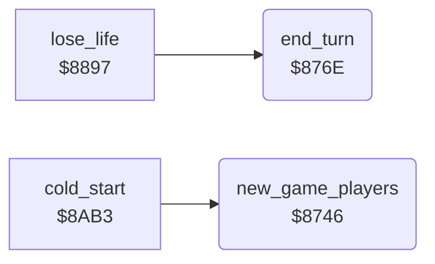

<!-- Generated by c64-docs from knowledge revision 20261024T103116.541-jn0vrj and .c64-re-tools/local/generated/src/source-map.json. Do not edit: change the knowledge, generate the source again, then run docs.ts generate. -->
# status/players.asm: Players and lives

Range `$8746-$87C7`. Source: [status/players.asm](../../../../src/status/players.asm). Index: [the reference](../../index.md).

## Call graph

A solid arrow is a call, a thick arrow a table entry, a dotted arrow a jump. Rounded nodes are in this file.

## Names

### [`new_game_players`](../../../../src/status/players.asm#L6) `$8746`

*routine*

Starts a new game: player 1, three lives, score 0 for both players. Loads the best score of player 1.

- **Called from:** [`cold_start`](../init/cold_start.md#cold_start) [`$8B54`](../../../../src/init/cold_start.asm#L86)
- **Reads:** [`lives`](../../memory-map.md#lives), [`CHRGET+1`](../../memory-map.md#CHRGET)
- **Writes:** [`current_player`](../../memory-map.md#current_player), [`game_over`](../../memory-map.md#game_over), [`score_digits`](../../memory-map.md#score_digits), [`points_to_add`](../../memory-map.md#points_to_add), [`lives`](../../memory-map.md#lives), [`player1_state`](../../memory-map.md#player1_state), [`player2_state`](../../memory-map.md#player2_state), [`best_score`](../../memory-map.md#best_score)

### [`new_game_clear_score`](../../../../src/status/players.asm#L11) `$874E`

*label*

- **Jumped to from:** [`new_game_players`](players.md#new_game_players) [`$8753`](../../../../src/status/players.asm#L15)

### [`new_game_copy_players`](../../../../src/status/players.asm#L19) `$875B`

*label*

Copies lives, cave, level and score to both player states.

- **Jumped to from:** [`new_game_players`](players.md#new_game_players) [`$8762`](../../../../src/status/players.asm#L24)

### [`new_game_load_best`](../../../../src/status/players.asm#L26) `$8766`

*label*

- **Jumped to from:** [`new_game_players`](players.md#new_game_players) [`$876B`](../../../../src/status/players.asm#L30)

### [`end_turn`](../../../../src/status/players.asm#L33) `$876E`

*routine*

Takes one life, saves the current player state and loads the next player with lives. No lives left sets game_over.

- **Called from:** [`lose_life`](../cave/cave_end.md#lose_life) [`$889A`](../../../../src/cave/cave_end.asm#L59)
- **Reads:** [`lives`](../../memory-map.md#lives), [`current_player`](../../memory-map.md#current_player), [`two_players`](../../memory-map.md#two_players), [`player2_state`](../../memory-map.md#player2_state), [`player1_state`](../../memory-map.md#player1_state)
- **Writes:** [`lives`](../../memory-map.md#lives), [`player1_state`](../../memory-map.md#player1_state), [`player2_state`](../../memory-map.md#player2_state), [`current_player`](../../memory-map.md#current_player), [`game_over`](../../memory-map.md#game_over)

### [`end_turn_save_p1`](../../../../src/status/players.asm#L38) `$8776`

*label*

- **Jumped to from:** [`end_turn`](players.md#end_turn) [`$877B`](../../../../src/status/players.asm#L42)

### [`end_turn_save_p2`](../../../../src/status/players.asm#L44) `$877F`

*label*

- **Jumped to from:** [`end_turn`](players.md#end_turn) [`$8772`](../../../../src/status/players.asm#L36)

### [`end_turn_save_p2_loop`](../../../../src/status/players.asm#L46) `$8781`

*label*

- **Jumped to from:** [`end_turn`](players.md#end_turn) [`$8786`](../../../../src/status/players.asm#L50)

### [`end_turn_choose`](../../../../src/status/players.asm#L51) `$8788`

*label*

Two players change turns when the other player has lives.

- **Jumped to from:** [`end_turn`](players.md#end_turn) [`$877D`](../../../../src/status/players.asm#L43)

### [`end_turn_to_p1`](../../../../src/status/players.asm#L60) `$8799`

*label*

- **Jumped to from:** [`end_turn`](players.md#end_turn) [`$878E`](../../../../src/status/players.asm#L55)

### [`end_turn_load`](../../../../src/status/players.asm#L64) `$879F`

*label*

- **Jumped to from:** [`end_turn`](players.md#end_turn) [`$878A`](../../../../src/status/players.asm#L53), [`end_turn`](players.md#end_turn) [`$8792`](../../../../src/status/players.asm#L57), [`end_turn`](players.md#end_turn) [`$8796`](../../../../src/status/players.asm#L59), [`end_turn`](players.md#end_turn) [`$879B`](../../../../src/status/players.asm#L62)

### [`end_turn_load_p1_loop`](../../../../src/status/players.asm#L68) `$87A5`

*label*

- **Jumped to from:** [`end_turn`](players.md#end_turn) [`$87AA`](../../../../src/status/players.asm#L72)

### [`end_turn_load_p2`](../../../../src/status/players.asm#L74) `$87AE`

*label*

- **Jumped to from:** [`end_turn`](players.md#end_turn) [`$87A1`](../../../../src/status/players.asm#L66)

### [`end_turn_load_p2_loop`](../../../../src/status/players.asm#L76) `$87B0`

*label*

- **Jumped to from:** [`end_turn`](players.md#end_turn) [`$87B5`](../../../../src/status/players.asm#L80)

### [`end_turn_check_lives`](../../../../src/status/players.asm#L81) `$87B7`

*label*

No lives: game over, the state resets to player 1 with three lives.

- **Jumped to from:** [`end_turn`](players.md#end_turn) [`$87AC`](../../../../src/status/players.asm#L73)

### [`end_turn_done`](../../../../src/status/players.asm#L90) `$87C7`

*label*

- **Jumped to from:** [`end_turn`](players.md#end_turn) [`$87B9`](../../../../src/status/players.asm#L83)
