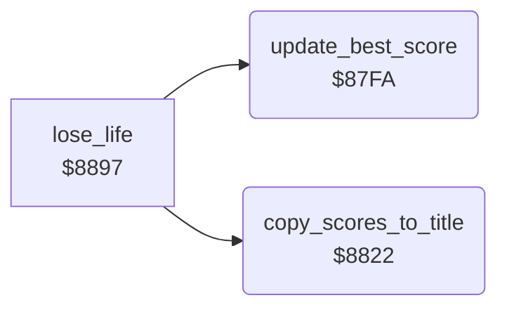

<!-- Generated by c64-docs from knowledge revision 20261025T214621.431-dj0nk4 and .c64-re-tools/local/generated/src/source-map.json. Do not edit: change the knowledge, generate the source again, then run docs.ts generate. -->
# status/scores.asm: Best scores

Range `$87FA-$8840`. Source: [status/scores.asm](../../../../src/status/scores.asm). Index: [the reference](../../index.md).

## Routines

| Routine | Address | Reached from | Summary |
|---|---|---|---|
| [`update_best_score`](scores.md#update_best_score) | `$87FA` | [`lose_life`](../cave/cave_end.md#lose_life) | Compares the score digits with best_score. |
| [`copy_scores_to_title`](scores.md#copy_scores_to_title) | `$8822` | [`lose_life`](../cave/cave_end.md#lose_life) | Writes the last score and the best score of both players into the LAST and HIGH lines of the title. |

## Call graph

A solid arrow is a call, a thick arrow a table entry. Rounded nodes are in this file.

## Details

### [`update_best_score`](../../../../src/status/scores.asm#L6) `$87FA`

*routine*

Compares the score digits with best_score. A higher score sets new_best_flag and becomes the best score of the player.

- **Called from:** [`lose_life`](../cave/cave_end.md#lose_life)
- **Reads:** [`best_score`](../../memory-map.md#best_score), [`status_score`](../../memory-map.md#status_score), [`new_best_flag`](../../memory-map.md#new_best_flag)
- **Writes:** [`new_best_flag`](../../memory-map.md#new_best_flag), [`best_score`](../../memory-map.md#best_score)

| Label | Address | Comment |
|---|---|---|
| [`update_best_compare`](../../../../src/status/scores.asm#L10) | `$87FF` |  |
| [`update_best_next`](../../../../src/status/scores.asm#L18) | `$880E` |  |
| [`update_best_copy`](../../../../src/status/scores.asm#L25) | `$8819` |  |
| [`update_best_done`](../../../../src/status/scores.asm#L30) | `$8821` |  |

### [`copy_scores_to_title`](../../../../src/status/scores.asm#L33) `$8822`

*routine*

Writes the last score and the best score of both players into the LAST and HIGH lines of the title.

- **Called from:** [`lose_life`](../cave/cave_end.md#lose_life)
- **Reads:** [`CHRGET`](../../memory-map.md#CHRGET), [`FAC2`](../../memory-map.md#FAC2)
- **Writes:** [`high_scores_line`](../../memory-map.md#high_scores_line), [`last_scores_line`](../../memory-map.md#last_scores_line)

| Label | Address | Comment |
|---|---|---|
| [`copy_scores_loop`](../../../../src/status/scores.asm#L35) | `$8824` |  |
