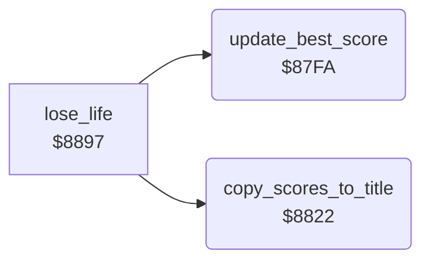

<!-- Generated by c64-docs from knowledge revision 20261024T103116.541-jn0vrj and .c64-re-tools/local/generated/src/source-map.json. Do not edit: change the knowledge, generate the source again, then run docs.ts generate. -->
# status/scores.asm: Best scores

Range `$87FA-$8840`. Source: [status/scores.asm](../../../../src/status/scores.asm). Index: [the reference](../../index.md).

## Call graph

A solid arrow is a call, a thick arrow a table entry, a dotted arrow a jump. Rounded nodes are in this file.

## Names

### [`update_best_score`](../../../../src/status/scores.asm#L6) `$87FA`

*routine*

Compares the score digits with best_score. A higher score sets new_best_flag and becomes the best score of the player.

- **Called from:** [`lose_life`](../cave/cave_end.md#lose_life) [`$8897`](../../../../src/cave/cave_end.asm#L58)
- **Reads:** [`best_score`](../../memory-map.md#best_score), [`status_score`](../../memory-map.md#status_score), [`new_best_flag`](../../memory-map.md#new_best_flag)
- **Writes:** [`new_best_flag`](../../memory-map.md#new_best_flag), [`best_score`](../../memory-map.md#best_score)

### [`update_best_compare`](../../../../src/status/scores.asm#L10) `$87FF`

*label*

- **Jumped to from:** [`update_best_score`](scores.md#update_best_score) [`$8811`](../../../../src/status/scores.asm#L21)

### [`update_best_next`](../../../../src/status/scores.asm#L18) `$880E`

*label*

- **Jumped to from:** [`update_best_score`](scores.md#update_best_score) [`$8804`](../../../../src/status/scores.asm#L13), [`update_best_score`](scores.md#update_best_score) [`$8808`](../../../../src/status/scores.asm#L15)

### [`update_best_copy`](../../../../src/status/scores.asm#L25) `$8819`

*label*

- **Jumped to from:** [`update_best_score`](scores.md#update_best_score) [`$881F`](../../../../src/status/scores.asm#L29)

### [`update_best_done`](../../../../src/status/scores.asm#L30) `$8821`

*label*

- **Jumped to from:** [`update_best_score`](scores.md#update_best_score) [`$8815`](../../../../src/status/scores.asm#L23)

### [`copy_scores_to_title`](../../../../src/status/scores.asm#L33) `$8822`

*routine*

Writes the last score and the best score of both players into the LAST and HIGH lines of the title.

- **Called from:** [`lose_life`](../cave/cave_end.md#lose_life) [`$88A7`](../../../../src/cave/cave_end.asm#L65)
- **Reads:** [`CHRGET+1`](../../memory-map.md#CHRGET), [`CHRGET+16`](../../memory-map.md#CHRGET), [`FAC2+5`](../../memory-map.md#FAC2), [`CHRGET+10`](../../memory-map.md#CHRGET)
- **Writes:** [`high_scores_line+1`](../../memory-map.md#high_scores_line), [`high_scores_line+13`](../../memory-map.md#high_scores_line), [`last_scores_line+1`](../../memory-map.md#last_scores_line), [`last_scores_line+13`](../../memory-map.md#last_scores_line)

### [`copy_scores_loop`](../../../../src/status/scores.asm#L35) `$8824`

*label*

- **Jumped to from:** [`copy_scores_to_title`](scores.md#copy_scores_to_title) [`$883E`](../../../../src/status/scores.asm#L48)
