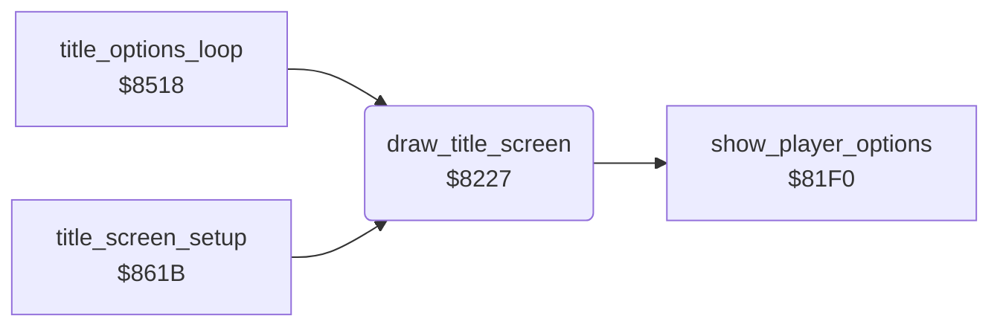

<!-- Generated by c64-docs from knowledge revision 20261024T103116.541-jn0vrj and .c64-re-tools/local/generated/src/source-map.json. Do not edit: change the knowledge, generate the source again, then run docs.ts generate. -->
# title/draw_title_screen.asm: Title screen

Range `$8227-$8316`. Source: [title/draw_title_screen.asm](../../../../src/title/draw_title_screen.asm). Index: [the reference](../../index.md).

## Call graph

A solid arrow is a call, a thick arrow a table entry, a dotted arrow a jump. Rounded nodes are in this file.

## Names

### [`draw_title_screen`](../../../../src/title/draw_title_screen.asm#L6) `$8227`

*routine*

Draws the title in the map: picture, credits or scores, player line and cave line. Each character takes two map cells.
TTSCEN in the developer symbol table (symbol_table_leftover).

- **Called from:** [`title_options_loop`](options.md#title_options_loop) [`$8539`](../../../../src/title/options.asm#L121), [`title_screen_setup`](run_title.md#title_screen_setup) [`$864B`](../../../../src/title/run_title.asm#L105)
- **Calls:** [`show_player_options`](player_options.md#show_player_options)
- **Reads:** [`title_screen`](../data/title_screen_text.md#title_screen), [`title_screen_0100`](../data/title_screen_text.md#title_screen_0100), [`title_screen_0200`](../data/title_screen_text.md#title_screen_0200), [`title_screen_02e8`](../data/title_screen_text.md#title_screen_02e8), [`show_credits`](../../memory-map.md#show_credits), [`demo_mode`](../../memory-map.md#demo_mode), [`text_by_peter_liepa`](../text/texts.md#text_by_peter_liepa), [`text_with_chris_grey`](../text/texts.md#text_with_chris_grey), [`text_press_button`](../text/texts.md#text_press_button), [`text_plyr_1_plyr_2`](../text/texts.md#text_plyr_1_plyr_2), [`last_scores_line`](../../memory-map.md#last_scores_line), [`high_scores_line`](../../memory-map.md#high_scores_line), [`text_cave_level`](../text/texts.md#text_cave_level), [`text_players_joysticks`](../text/texts.md#text_players_joysticks)
- **Writes:** [`map_base`](../../memory-map.md#map_base), [`map_base+256`](../../memory-map.md#map_base), [`map_base+512`](../../memory-map.md#map_base), [`screen0+744`](../../memory-map.md#screen0), [`map_base+760`](../../memory-map.md#map_base), [`map_base+800`](../../memory-map.md#map_base), [`map_base+840`](../../memory-map.md#map_base), [`title_player_digit+40`](../../memory-map.md#title_player_digit), [`title_player_digit`](../../memory-map.md#title_player_digit), [`title_level_digit+6`](../../memory-map.md#title_level_digit), [`show_credits`](../../memory-map.md#show_credits)

### [`title_copy_picture`](../../../../src/title/draw_title_screen.asm#L8) `$8229`

*label*

Title picture to map rows 0-18 and to the screen at $0EE8.

- **Jumped to from:** [`draw_title_screen`](draw_title_screen.md#draw_title_screen) [`$8242`](../../../../src/title/draw_title_screen.asm#L18)

### [`title_credits_line1`](../../../../src/title/draw_title_screen.asm#L24) `$824E`

*label*

- **Jumped to from:** [`draw_title_screen`](draw_title_screen.md#draw_title_screen) [`$825F`](../../../../src/title/draw_title_screen.asm#L34)

### [`title_credits_line2`](../../../../src/title/draw_title_screen.asm#L37) `$8265`

*label*

- **Jumped to from:** [`draw_title_screen`](draw_title_screen.md#draw_title_screen) [`$8276`](../../../../src/title/draw_title_screen.asm#L47)

### [`title_credits_line3`](../../../../src/title/draw_title_screen.asm#L50) `$827C`

*label*

- **Jumped to from:** [`draw_title_screen`](draw_title_screen.md#draw_title_screen) [`$828D`](../../../../src/title/draw_title_screen.asm#L60)

### [`title_scores`](../../../../src/title/draw_title_screen.asm#L62) `$8292`

*label*

- **Jumped to from:** [`draw_title_screen`](draw_title_screen.md#draw_title_screen) [`$8248`](../../../../src/title/draw_title_screen.asm#L21)

### [`title_scores_line1`](../../../../src/title/draw_title_screen.asm#L65) `$8296`

*label*

- **Jumped to from:** [`draw_title_screen`](draw_title_screen.md#draw_title_screen) [`$82A7`](../../../../src/title/draw_title_screen.asm#L75)

### [`title_scores_line2`](../../../../src/title/draw_title_screen.asm#L78) `$82AD`

*label*

- **Jumped to from:** [`draw_title_screen`](draw_title_screen.md#draw_title_screen) [`$82BE`](../../../../src/title/draw_title_screen.asm#L88)

### [`title_scores_line3`](../../../../src/title/draw_title_screen.asm#L91) `$82C4`

*label*

- **Jumped to from:** [`draw_title_screen`](draw_title_screen.md#draw_title_screen) [`$82D5`](../../../../src/title/draw_title_screen.asm#L101)

### [`title_cave_line`](../../../../src/title/draw_title_screen.asm#L102) `$82D7`

*label*

- **Jumped to from:** [`draw_title_screen`](draw_title_screen.md#draw_title_screen) [`$828F`](../../../../src/title/draw_title_screen.asm#L61)

### [`title_cave_line_loop`](../../../../src/title/draw_title_screen.asm#L105) `$82DB`

*label*

- **Jumped to from:** [`draw_title_screen`](draw_title_screen.md#draw_title_screen) [`$82EC`](../../../../src/title/draw_title_screen.asm#L115)

### [`title_player_line`](../../../../src/title/draw_title_screen.asm#L118) `$82F2`

*label*

- **Jumped to from:** [`draw_title_screen`](draw_title_screen.md#draw_title_screen) [`$8303`](../../../../src/title/draw_title_screen.asm#L130)

### [`FREQ`](../../../../src/title/draw_title_screen.asm#L128) `$8303`

*label*

FREQ of the developer symbol table: tune_freq_table minus $14. play_title_tune indexes it with note number times 2.

- **Read by:** [`play_title_tune`](../sound/title_tune.md#play_title_tune) [`$83D8`](../../../../src/sound/title_tune.asm#L27), [`play_title_tune`](../sound/title_tune.md#play_title_tune) [`$83E9`](../../../../src/sound/title_tune.asm#L34)

### [`FREQ_HI`](../../../../src/title/draw_title_screen.asm#L129) `$8304`

*label*

- **Read by:** [`play_title_tune`](../sound/title_tune.md#play_title_tune) [`$83DE`](../../../../src/sound/title_tune.asm#L29), [`play_title_tune`](../sound/title_tune.md#play_title_tune) [`$83EF`](../../../../src/sound/title_tune.asm#L36)

### [`title_clear_last_row`](../../../../src/title/draw_title_screen.asm#L133) `$8309`

*label*

- **Jumped to from:** [`draw_title_screen`](draw_title_screen.md#draw_title_screen) [`$830D`](../../../../src/title/draw_title_screen.asm#L136)
