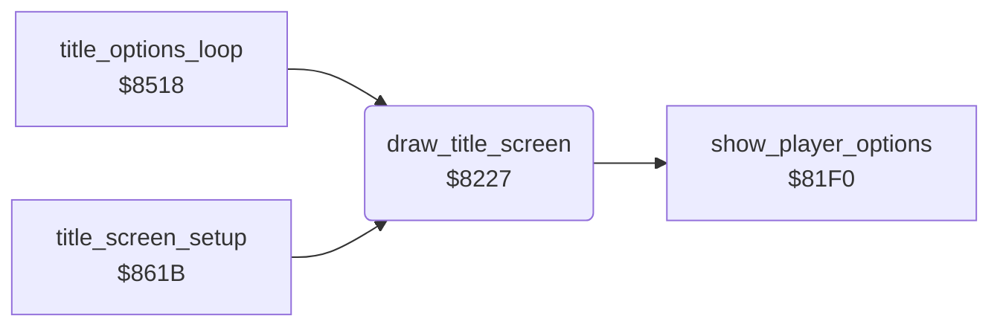

<!-- Generated by c64-docs from knowledge revision 20261025T214621.431-dj0nk4 and .c64-re-tools/local/generated/src/source-map.json. Do not edit: change the knowledge, generate the source again, then run docs.ts generate. -->
# title/draw_title_screen.asm: Title screen

Range `$8227-$8316`. Source: [title/draw_title_screen.asm](../../../../src/title/draw_title_screen.asm). Index: [the reference](../../index.md).

## Routines

| Routine | Address | Reached from | Summary |
|---|---|---|---|
| [`draw_title_screen`](draw_title_screen.md#draw_title_screen) | `$8227` | [`title_options_loop`](options.md#title_options_loop), [`title_screen_setup`](run_title.md#title_screen_setup) | Draws the title in the map: picture, credits or scores, player line and cave line. |

## Call graph

A solid arrow is a call, a thick arrow a table entry. Rounded nodes are in this file.

## Details

### [`draw_title_screen`](../../../../src/title/draw_title_screen.asm#L6) `$8227`

*routine*

Draws the title in the map: picture, credits or scores, player line and cave line. Each character takes two map cells.
TTSCEN in the developer symbol table (symbol_table_leftover).

- **Called from:** [`title_options_loop`](options.md#title_options_loop), [`title_screen_setup`](run_title.md#title_screen_setup)
- **Calls:** [`show_player_options`](player_options.md#show_player_options)
- **Reads:** [`title_screen`](../data/title_screen_text.md#title_screen), [`title_screen_0100`](../data/title_screen_text.md#title_screen_0100), [`title_screen_0200`](../data/title_screen_text.md#title_screen_0200), [`title_screen_02e8`](../data/title_screen_text.md#title_screen_02e8), [`show_credits`](../../memory-map.md#show_credits), [`demo_mode`](../../memory-map.md#demo_mode), [`text_by_peter_liepa`](../text/texts.md#text_by_peter_liepa), [`text_with_chris_grey`](../text/texts.md#text_with_chris_grey), [`text_press_button`](../text/texts.md#text_press_button), [`text_plyr_1_plyr_2`](../text/texts.md#text_plyr_1_plyr_2), [`last_scores_line`](../../memory-map.md#last_scores_line), [`high_scores_line`](../../memory-map.md#high_scores_line) and 2 more
- **Writes:** [`map_base`](../../memory-map.md#map_base), [`screen0`](../../memory-map.md#screen0), [`title_player_digit`](../../memory-map.md#title_player_digit), [`title_level_digit`](../../memory-map.md#title_level_digit), [`show_credits`](../../memory-map.md#show_credits)

| Label | Address | Comment |
|---|---|---|
| [`title_copy_picture`](../../../../src/title/draw_title_screen.asm#L8) | `$8229` | Title picture to map rows 0-18 and to the screen at $0EE8. |
| [`title_credits_line1`](../../../../src/title/draw_title_screen.asm#L24) | `$824E` |  |
| [`title_credits_line2`](../../../../src/title/draw_title_screen.asm#L37) | `$8265` |  |
| [`title_credits_line3`](../../../../src/title/draw_title_screen.asm#L50) | `$827C` |  |
| [`title_scores`](../../../../src/title/draw_title_screen.asm#L62) | `$8292` |  |
| [`title_scores_line1`](../../../../src/title/draw_title_screen.asm#L65) | `$8296` |  |
| [`title_scores_line2`](../../../../src/title/draw_title_screen.asm#L78) | `$82AD` |  |
| [`title_scores_line3`](../../../../src/title/draw_title_screen.asm#L91) | `$82C4` |  |
| [`title_cave_line`](../../../../src/title/draw_title_screen.asm#L102) | `$82D7` |  |
| [`title_cave_line_loop`](../../../../src/title/draw_title_screen.asm#L105) | `$82DB` |  |
| [`title_player_line`](../../../../src/title/draw_title_screen.asm#L118) | `$82F2` |  |
| [`FREQ`](../../../../src/title/draw_title_screen.asm#L128) | `$8303` | FREQ of the developer symbol table: tune_freq_table minus $14. play_title_tune indexes it with note number times 2. |
| [`FREQ_HI`](../../../../src/title/draw_title_screen.asm#L129) | `$8304` |  |
| [`title_clear_last_row`](../../../../src/title/draw_title_screen.asm#L133) | `$8309` |  |
