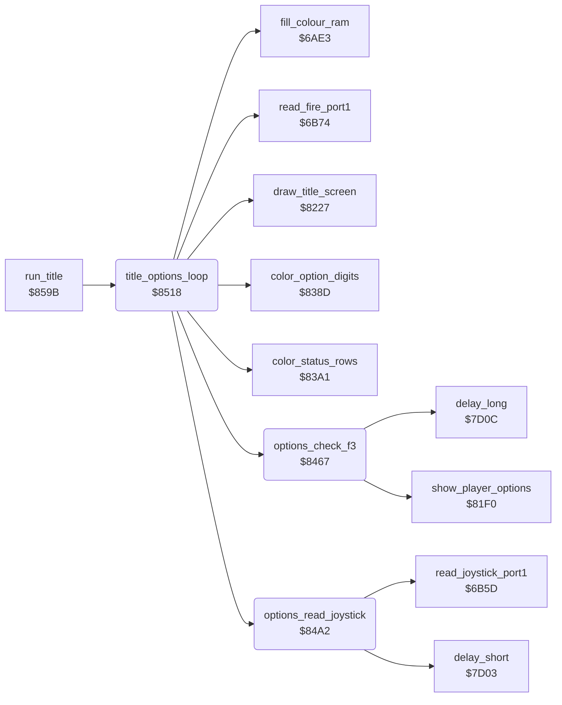

<!-- Generated by c64-docs from knowledge revision 20261024T103116.541-jn0vrj and .c64-re-tools/local/generated/src/source-map.json. Do not edit: change the knowledge, generate the source again, then run docs.ts generate. -->
# title/options.asm: Options on the title screen

Range `$8467-$859A`. Source: [title/options.asm](../../../../src/title/options.asm). Index: [the reference](../../index.md).

## Call graph

A solid arrow is a call, a thick arrow a table entry, a dotted arrow a jump. Rounded nodes are in this file.

## Names

### [`options_check_f3`](../../../../src/title/options.asm#L6) `$8467`

*routine*

F3 cycles player_mode 1-3 and sets two_players and two_joysticks from it. It shows the new mode, waits, and clears key_row0.

- **Called from:** [`title_options_loop`](options.md#title_options_loop) [`$8518`](../../../../src/title/options.asm#L105)
- **Calls:** [`show_player_options`](player_options.md#show_player_options), [`delay_long`](../input/game_keys.md#delay_long)
- **Jumps to:** [`show_player_options`](player_options.md#show_player_options)
- **Reads:** [`key_row0`](../../memory-map.md#key_row0), [`player_mode`](../../memory-map.md#player_mode), [`two_players`](../../memory-map.md#two_players), [`two_joysticks`](../../memory-map.md#two_joysticks)
- **Writes:** [`tune_loop_count`](../../memory-map.md#tune_loop_count), [`player_mode`](../../memory-map.md#player_mode), [`two_players`](../../memory-map.md#two_players), [`two_joysticks`](../../memory-map.md#two_joysticks), [`key_row0`](../../memory-map.md#key_row0)

### [`options_f3_mode2`](../../../../src/title/options.asm#L22) `$8485`

*label*

- **Jumped to from:** [`options_check_f3`](options.md#options_check_f3) [`$8478`](../../../../src/title/options.asm#L15)

### [`options_f3_mode3`](../../../../src/title/options.asm#L27) `$848D`

*label*

- **Jumped to from:** [`options_check_f3`](options.md#options_check_f3) [`$8489`](../../../../src/title/options.asm#L25)

### [`options_f3_show`](../../../../src/title/options.asm#L32) `$8495`

*label*

- **Jumped to from:** [`options_check_f3`](options.md#options_check_f3) [`$8483`](../../../../src/title/options.asm#L21), [`options_check_f3`](options.md#options_check_f3) [`$8491`](../../../../src/title/options.asm#L30)

### [`options_f3_done`](../../../../src/title/options.asm#L35) `$849B`

*label*

- **Jumped to from:** [`options_check_f3`](options.md#options_check_f3) [`$846B`](../../../../src/title/options.asm#L9)

### [`options_read_joystick`](../../../../src/title/options.asm#L40) `$84A2`

*routine*

Joystick 1 on the options: down and up change the level, left and right change the start cave by 4. Shows them, then waits.

- **Called from:** [`title_options_loop`](options.md#title_options_loop) [`$851B`](../../../../src/title/options.asm#L106)
- **Calls:** [`read_joystick_port1`](../input/joystick.md#read_joystick_port1), [`delay_short`](../input/game_keys.md#delay_short)
- **Reads:** [`level`](../../memory-map.md#level), [`cave_number`](../../memory-map.md#cave_number), [`options_hidden`](../../memory-map.md#options_hidden)
- **Writes:** [`tune_loop_count`](../../memory-map.md#tune_loop_count), [`level`](../../memory-map.md#level), [`cave_number`](../../memory-map.md#cave_number), [`title_level_digit`](../../memory-map.md#title_level_digit), [`title_level_digit+1`](../../memory-map.md#title_level_digit), [`title_cave_letter`](../../memory-map.md#title_cave_letter), [`title_cave_letter+1`](../../memory-map.md#title_cave_letter)

### [`options_joy_up`](../../../../src/title/options.asm#L51) `$84B8`

*label*

Up: level plus 1, at most 4.

- **Jumped to from:** [`options_read_joystick`](options.md#options_read_joystick) [`$84B0`](../../../../src/title/options.asm#L47), [`options_read_joystick`](options.md#options_read_joystick) [`$84B4`](../../../../src/title/options.asm#L49)

### [`options_joy_level_set`](../../../../src/title/options.asm#L58) `$84C4`

*label*

- **Jumped to from:** [`options_read_joystick`](options.md#options_read_joystick) [`$84C0`](../../../../src/title/options.asm#L56)

### [`options_joy_left`](../../../../src/title/options.asm#L64) `$84CE`

*label*

- **Jumped to from:** [`options_read_joystick`](options.md#options_read_joystick) [`$84BA`](../../../../src/title/options.asm#L53), [`options_read_joystick`](options.md#options_read_joystick) [`$84C8`](../../../../src/title/options.asm#L61)

### [`options_joy_right`](../../../../src/title/options.asm#L73) `$84DF`

*label*

- **Jumped to from:** [`options_read_joystick`](options.md#options_read_joystick) [`$84D3`](../../../../src/title/options.asm#L67), [`options_read_joystick`](options.md#options_read_joystick) [`$84D9`](../../../../src/title/options.asm#L70)

### [`options_joy_show`](../../../../src/title/options.asm#L85) `$84F6`

*label*

- **Jumped to from:** [`options_read_joystick`](options.md#options_read_joystick) [`$84E4`](../../../../src/title/options.asm#L76), [`options_read_joystick`](options.md#options_read_joystick) [`$84EA`](../../../../src/title/options.asm#L79), [`options_read_joystick`](options.md#options_read_joystick) [`$84F0`](../../../../src/title/options.asm#L82)

### [`options_joy_delay`](../../../../src/title/options.asm#L100) `$8514`

*label*

- **Jumped to from:** [`options_read_joystick`](options.md#options_read_joystick) [`$84A7`](../../../../src/title/options.asm#L43), [`options_read_joystick`](options.md#options_read_joystick) [`$84F8`](../../../../src/title/options.asm#L87)

### [`title_options_loop`](../../../../src/title/options.asm#L104) `$8518`

*routine*

Runs the title until title_done. F1 opens the options. Fire on the options starts a game. The title tune sets title_done for the demo.

- **Called from:** [`run_title`](run_title.md#run_title) [`$85AE`](../../../../src/title/run_title.asm#L17)
- **Calls:** [`options_check_f3`](options.md#options_check_f3), [`options_read_joystick`](options.md#options_read_joystick), [`draw_title_screen`](draw_title_screen.md#draw_title_screen), [`fill_colour_ram`](../screen/colour_ram.md#fill_colour_ram), [`color_option_digits`](title_colours.md#color_option_digits), [`color_status_rows`](title_colours.md#color_status_rows), [`read_fire_port1`](../input/joystick.md#read_fire_port1)
- **Reads:** [`options_hidden`](../../memory-map.md#options_hidden), [`key_row0`](../../memory-map.md#key_row0), [`level`](../../memory-map.md#level), [`cave_number`](../../memory-map.md#cave_number), [`two_players`](../../memory-map.md#two_players), [`title_done`](../../memory-map.md#title_done)
- **Writes:** `$DB98`, `$D800`, [`show_credits`](../../memory-map.md#show_credits), `$DBAA`, [`title_level_digit`](../../memory-map.md#title_level_digit), [`title_level_digit+1`](../../memory-map.md#title_level_digit), [`title_cave_letter`](../../memory-map.md#title_cave_letter), [`title_cave_letter+1`](../../memory-map.md#title_cave_letter), [`two_players`](../../memory-map.md#two_players), [`title_player_digit`](../../memory-map.md#title_player_digit), [`options_hidden`](../../memory-map.md#options_hidden), [`demo_mode`](../../memory-map.md#demo_mode), [`title_done`](../../memory-map.md#title_done)

### [`title_colour_text_rows`](../../../../src/title/options.asm#L111) `$8526`

*label*

- **Jumped to from:** [`title_options_loop`](options.md#title_options_loop) [`$852D`](../../../../src/title/options.asm#L115)

### [`options_show`](../../../../src/title/options.asm#L125) `$8543`

*label*

- **Jumped to from:** [`title_options_loop`](options.md#title_options_loop) [`$8520`](../../../../src/title/options.asm#L108)

### [`options_colour_rows`](../../../../src/title/options.asm#L130) `$854D`

*label*

- **Jumped to from:** [`title_options_loop`](options.md#title_options_loop) [`$8554`](../../../../src/title/options.asm#L134)

### [`options_show_players`](../../../../src/title/options.asm#L152) `$8578`

*label*

- **Jumped to from:** [`title_options_loop`](options.md#title_options_loop) [`$8574`](../../../../src/title/options.asm#L149)

### [`title_check_fire`](../../../../src/title/options.asm#L159) `$8584`

*label*

- **Jumped to from:** [`title_options_loop`](options.md#title_options_loop) [`$8533`](../../../../src/title/options.asm#L118)

### [`title_check_done`](../../../../src/title/options.asm#L167) `$8593`

*label*

- **Jumped to from:** [`title_options_loop`](options.md#title_options_loop) [`$8586`](../../../../src/title/options.asm#L161), [`title_options_loop`](options.md#title_options_loop) [`$858B`](../../../../src/title/options.asm#L163)

### [`title_loop_exit`](../../../../src/title/options.asm#L171) `$859A`

*label*

- **Jumped to from:** [`title_options_loop`](options.md#title_options_loop) [`$8595`](../../../../src/title/options.asm#L169)
