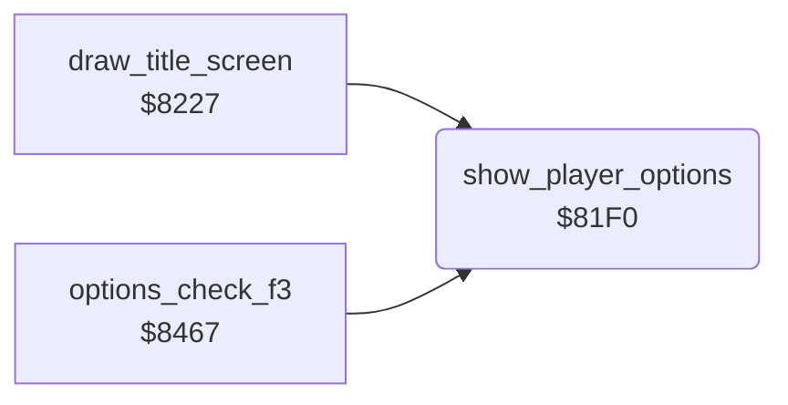

<!-- Generated by c64-docs from knowledge revision 20261025T214621.431-dj0nk4 and .c64-re-tools/local/generated/src/source-map.json. Do not edit: change the knowledge, generate the source again, then run docs.ts generate. -->
# title/player_options.asm: Player and joystick digits of the title

Range `$81F0-$820E`. Source: [title/player_options.asm](../../../../src/title/player_options.asm). Index: [the reference](../../index.md).

## Routines

| Routine | Address | Reached from | Summary |
|---|---|---|---|
| [`show_player_options`](player_options.md#show_player_options) | `$81F0` | [`draw_title_screen`](draw_title_screen.md#draw_title_screen), [`options_check_f3`](options.md#options_check_f3) | When the options show, writes the number of players and of joysticks as two map cells each. |

## Call graph

A solid arrow is a call, a thick arrow a table entry. Rounded nodes are in this file.

## Details

### [`show_player_options`](../../../../src/title/player_options.asm#L6) `$81F0`

*routine*

When the options show, writes the number of players and of joysticks as two map cells each.
OPTION in the developer symbol table (symbol_table_leftover).

- **Called from:** [`draw_title_screen`](draw_title_screen.md#draw_title_screen), [`options_check_f3`](options.md#options_check_f3)
- **Jumped to from:** [`options_check_f3`](options.md#options_check_f3)
- **Reads:** [`options_hidden`](../../memory-map.md#options_hidden), [`two_players`](../../memory-map.md#two_players), [`two_joysticks`](../../memory-map.md#two_joysticks)
- **Writes:** [`title_player_digit`](../../memory-map.md#title_player_digit)

| Label | Address | Comment |
|---|---|---|
| [`show_player_options_done`](../../../../src/title/player_options.asm#L21) | `$820E` | EXIT in the developer symbol table (symbol_table_leftover). |
