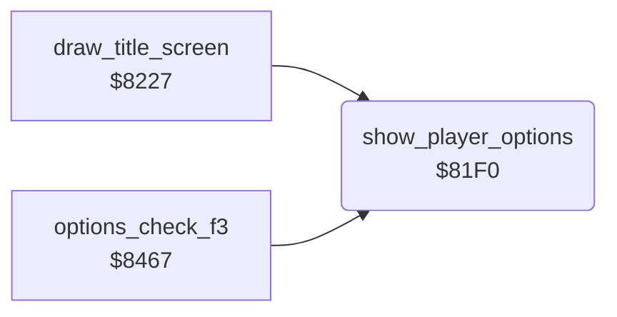

<!-- Generated by c64-docs from knowledge revision 20261024T103116.541-jn0vrj and .c64-re-tools/local/generated/src/source-map.json. Do not edit: change the knowledge, generate the source again, then run docs.ts generate. -->
# title/player_options.asm: Player and joystick digits of the title

Range `$81F0-$820E`. Source: [title/player_options.asm](../../../../src/title/player_options.asm). Index: [the reference](../../index.md).

## Call graph

A solid arrow is a call, a thick arrow a table entry, a dotted arrow a jump. Rounded nodes are in this file.

## Names

### [`show_player_options`](../../../../src/title/player_options.asm#L6) `$81F0`

*routine*

When the options show, writes the number of players and of joysticks as two map cells each.
OPTION in the developer symbol table (symbol_table_leftover).

- **Called from:** [`draw_title_screen`](draw_title_screen.md#draw_title_screen) [`$830F`](../../../../src/title/draw_title_screen.asm#L137), [`options_check_f3`](options.md#options_check_f3) [`$8495`](../../../../src/title/options.asm#L33)
- **Jumped to from:** [`options_check_f3`](options.md#options_check_f3) [`$849F`](../../../../src/title/options.asm#L38)
- **Reads:** [`options_hidden`](../../memory-map.md#options_hidden), [`two_players`](../../memory-map.md#two_players), [`two_joysticks`](../../memory-map.md#two_joysticks)
- **Writes:** [`title_player_digit`](../../memory-map.md#title_player_digit), [`title_player_digit+1`](../../memory-map.md#title_player_digit), [`title_player_digit+20`](../../memory-map.md#title_player_digit), [`title_player_digit+21`](../../memory-map.md#title_player_digit)

### [`show_player_options_done`](../../../../src/title/player_options.asm#L21) `$820E`

*label*

EXIT in the developer symbol table (symbol_table_leftover).

- **Jumped to from:** [`show_player_options`](player_options.md#show_player_options) [`$81F2`](../../../../src/title/player_options.asm#L8)
