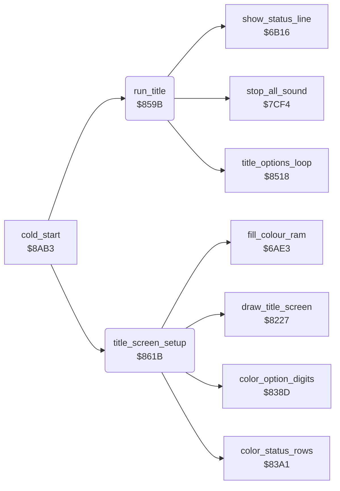

<!-- Generated by c64-docs from knowledge revision 20261024T103116.541-jn0vrj and .c64-re-tools/local/generated/src/source-map.json. Do not edit: change the knowledge, generate the source again, then run docs.ts generate. -->
# title/run_title.asm: Title screen and its start

Range `$859B-$8674`. Source: [title/run_title.asm](../../../../src/title/run_title.asm). Index: [the reference](../../index.md).

## Call graph

A solid arrow is a call, a thick arrow a table entry, a dotted arrow a jump. Rounded nodes are in this file.

## Data

| Range | Type | Name | Read by | Written by |
|---|---|---|---|---|
| [`$8606`](../../../../src/title/run_title.asm#L65)-`$860A` | bytes | [`title_colours`](../../../../src/title/run_title.asm#L64) | [`title_screen_setup`](run_title.md#title_screen_setup) |  |
| [`$860B`](../../../../src/title/run_title.asm#L68)-`$8612` | bytes of 2 | [`irq_title_values`](../../../../src/title/run_title.asm#L67) | [`init_irq`](../irq/irq_setup.md#init_irq) |  |
| [`$8613`](../../../../src/title/run_title.asm#L74)-`$861A` | bytes of 2 | [`irq_game_values`](../../../../src/title/run_title.asm#L73) | [`run_title`](run_title.md#run_title) |  |

## Names

### [`run_title`](../../../../src/title/run_title.asm#L6) `$859B`

*routine*

Runs the title until a game or the demo starts. Then sets the game IRQ values and fills the status line.

- **Called from:** [`cold_start`](../init/cold_start.md#cold_start) [`$8B3E`](../../../../src/init/cold_start.asm#L76)
- **Calls:** [`title_options_loop`](options.md#title_options_loop), [`stop_all_sound`](../sound/voices_off.md#stop_all_sound), [`show_status_line`](../status/status_line.md#show_status_line)
- **Reads:** [`charset_text+88`](../../memory-map.md#charset_text), [`demo_mode`](../../memory-map.md#demo_mode), [`cave_number`](../../memory-map.md#cave_number), [`level`](../../memory-map.md#level)
- **Writes:** [`charset_text`](../../memory-map.md#charset_text), [`cave_number`](../../memory-map.md#cave_number), [`demo_mode`](../../memory-map.md#demo_mode), [`cave_covered`](../../memory-map.md#cave_covered), [`frame_counter`](../../memory-map.md#frame_counter), [`irq_d011_values`](../../memory-map.md#irq_d011_values), [`irq_mode`](../../memory-map.md#irq_mode), [`title_frame_count`](../../memory-map.md#title_frame_count), [`key_row0`](../../memory-map.md#key_row0), [`key_row7`](../../memory-map.md#key_row7), [`level`](../../memory-map.md#level), [`status_line_text+10`](../../memory-map.md#status_line_text), [`birth_countdown`](../../memory-map.md#birth_countdown), [`status_line_text+16`](../../memory-map.md#status_line_text), [`status_line_text+18`](../../memory-map.md#status_line_text), [`cave_clock_on`](../../memory-map.md#cave_clock_on), [`text_ptr`](../../memory-map.md#text_ptr), [`text_ptr_hi`](../../memory-map.md#text_ptr_hi), [`cave_end_state`](../../memory-map.md#cave_end_state)
- **Refers to:** [`status_line_text`](../../memory-map.md#status_line_text)

### [`run_title_copy_char0`](../../../../src/title/run_title.asm#L8) `$859D`

*label*

- **Jumped to from:** [`run_title`](run_title.md#run_title) [`$85A6`](../../../../src/title/run_title.asm#L13)

### [`run_title_game_irq`](../../../../src/title/run_title.asm#L23) `$85BA`

*label*

- **Jumped to from:** [`run_title`](run_title.md#run_title) [`$85C0`](../../../../src/title/run_title.asm#L27)

### [`run_title_status`](../../../../src/title/run_title.asm#L41) `$85DB`

*label*

Digit 3: three lives in the status line.

- **Jumped to from:** [`run_title`](run_title.md#run_title) [`$85D2`](../../../../src/title/run_title.asm#L36)

### [`title_colours`](../../../../src/title/run_title.asm#L64) `$8606-$860A`

*data*

Colours of the border and of the background registers 0-3 on the title, for $d020-$d024.

- **Read by:** [`title_screen_setup`](run_title.md#title_screen_setup) [`$8626`](../../../../src/title/run_title.asm#L86)

### [`irq_title_values`](../../../../src/title/run_title.asm#L67) `$860B-$8612`

*data*

Raster split values of the title: two bytes each for $d011, $d016, $d018 and $d012, copied to $54-$5b.

- **Read by:** [`init_irq`](../irq/irq_setup.md#init_irq) [`$8A8C`](../../../../src/irq/irq_setup.asm#L13)

### [`irq_game_values`](../../../../src/title/run_title.asm#L73) `$8613-$861A`

*data*

Raster split values of the game: two bytes each for $d011, $d016, $d018 and $d012, copied to $54-$5b.

- **Read by:** [`run_title`](run_title.md#run_title) [`$85BA`](../../../../src/title/run_title.asm#L24)

### [`title_screen_setup`](../../../../src/title/run_title.asm#L79) `$861B`

*routine*

Sets the title colours, draws the title scene, puts the IRQ into title mode, waits for its first frame and clears the sound state.

- **Called from:** [`cold_start`](../init/cold_start.md#cold_start) [`$8B3B`](../../../../src/init/cold_start.asm#L75)
- **Calls:** [`fill_colour_ram`](../screen/colour_ram.md#fill_colour_ram), [`color_status_rows`](title_colours.md#color_status_rows), [`color_option_digits`](title_colours.md#color_option_digits), [`draw_title_screen`](draw_title_screen.md#draw_title_screen)
- **Reads:** [`title_colours`](run_title.md#title_colours), [`text_ptr`](../../memory-map.md#text_ptr), [`text_ptr_hi`](../../memory-map.md#text_ptr_hi), [`options_hidden`](../../memory-map.md#options_hidden), [`irq_started`](../../memory-map.md#irq_started)
- **Writes:** [`title_done`](../../memory-map.md#title_done), [`VMCSB`](../../memory-map.md#VMCSB), [`EXTCOL`](../../memory-map.md#EXTCOL), [`text_ptr`](../../memory-map.md#text_ptr), [`text_ptr_hi`](../../memory-map.md#text_ptr_hi), [`irq_started`](../../memory-map.md#irq_started), [`irq_mode`](../../memory-map.md#irq_mode), [`tune_index`](../../memory-map.md#tune_index), [`tune_loop_count`](../../memory-map.md#tune_loop_count), [`cover_sound_step`](../../memory-map.md#cover_sound_step), [`sound_spare`](../../memory-map.md#sound_spare), [`sound1_frame`](../../memory-map.md#sound1_frame), [`step_sound_timer`](../../memory-map.md#step_sound_timer), [`step_sound_pitch`](../../memory-map.md#step_sound_pitch), [`sound2_lock`](../../memory-map.md#sound2_lock)

### [`title_setup_colours`](../../../../src/title/run_title.asm#L85) `$8626`

*label*

- **Jumped to from:** [`title_screen_setup`](run_title.md#title_screen_setup) [`$862D`](../../../../src/title/run_title.asm#L89)

### [`title_setup_fill_white`](../../../../src/title/run_title.asm#L96) `$863C`

*label*

- **Jumped to from:** [`title_screen_setup`](run_title.md#title_screen_setup) [`$863F`](../../../../src/title/run_title.asm#L99)

### [`title_setup_draw`](../../../../src/title/run_title.asm#L104) `$864B`

*label*

Draws the title scene: TTSCEN in the symbol table leftover.

- **Jumped to from:** [`title_screen_setup`](run_title.md#title_screen_setup) [`$8646`](../../../../src/title/run_title.asm#L102)

### [`title_setup_wait_irq`](../../../../src/title/run_title.asm#L110) `$8656`

*label*

- **Jumped to from:** [`title_screen_setup`](run_title.md#title_screen_setup) [`$8658`](../../../../src/title/run_title.asm#L112)
