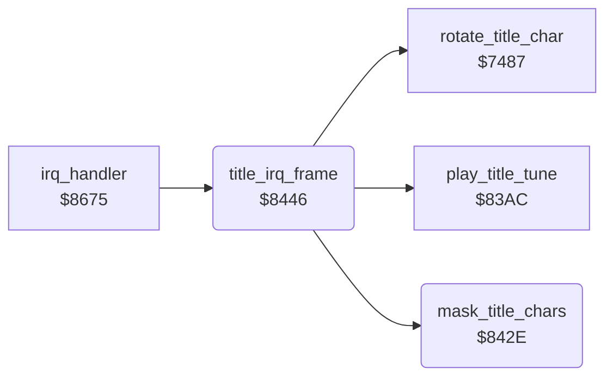

<!-- Generated by c64-docs from knowledge revision 20261024T103116.541-jn0vrj and .c64-re-tools/local/generated/src/source-map.json. Do not edit: change the knowledge, generate the source again, then run docs.ts generate. -->
# title/title_animation.asm: Title screen animation

Range `$842E-$8466`. Source: [title/title_animation.asm](../../../../src/title/title_animation.asm). Index: [the reference](../../index.md).

## Call graph

A solid arrow is a call, a thick arrow a table entry, a dotted arrow a jump. Rounded nodes are in this file.

## Names

### [`mask_title_chars`](../../../../src/title/title_animation.asm#L6) `$842E`

*routine*

Builds text characters 9 and 10: characters 6 and 7 ORed with the scrolled character 0. The symbol table calls it MASQUE.
MASQUE in the developer symbol table (symbol_table_leftover).

- **Called from:** [`title_irq_frame`](title_animation.md#title_irq_frame) [`$8460`](../../../../src/title/title_animation.asm#L33)
- **Reads:** [`charset_text+48`](../../memory-map.md#charset_text), [`charset_text`](../../memory-map.md#charset_text), [`charset_text+56`](../../memory-map.md#charset_text)
- **Writes:** [`charset_text+72`](../../memory-map.md#charset_text), [`charset_text+80`](../../memory-map.md#charset_text)

### [`mask_title_chars_loop`](../../../../src/title/title_animation.asm#L8) `$8430`

*label*

- **Jumped to from:** [`mask_title_chars`](title_animation.md#mask_title_chars) [`$8443`](../../../../src/title/title_animation.asm#L16)

### [`title_irq_frame`](../../../../src/title/title_animation.asm#L19) `$8446`

*routine*

Title IRQ work. The first call sets irq_started. Every fourth call scrolls character 0 and masks the title characters. Each call plays the tune.

- **Called from:** [`irq_handler`](../irq/irq_handler.md#irq_handler) [`$86EA`](../../../../src/irq/irq_handler.asm#L67)
- **Calls:** [`rotate_title_char`](title_char.md#rotate_title_char), [`mask_title_chars`](title_animation.md#mask_title_chars), [`play_title_tune`](../sound/title_tune.md#play_title_tune)
- **Reads:** [`irq_started`](../../memory-map.md#irq_started), [`title_frame_count`](../../memory-map.md#title_frame_count)
- **Writes:** [`irq_started`](../../memory-map.md#irq_started), [`title_frame_count`](../../memory-map.md#title_frame_count)

### [`title_irq_count`](../../../../src/title/title_animation.asm#L25) `$8451`

*label*

- **Jumped to from:** [`title_irq_frame`](title_animation.md#title_irq_frame) [`$8448`](../../../../src/title/title_animation.asm#L21)

### [`title_irq_tune`](../../../../src/title/title_animation.asm#L34) `$8463`

*label*

- **Jumped to from:** [`title_irq_frame`](title_animation.md#title_irq_frame) [`$8457`](../../../../src/title/title_animation.asm#L29)

### [`title_irq_done`](../../../../src/title/title_animation.asm#L36) `$8466`

*label*

- **Jumped to from:** [`title_irq_frame`](title_animation.md#title_irq_frame) [`$844E`](../../../../src/title/title_animation.asm#L24)
