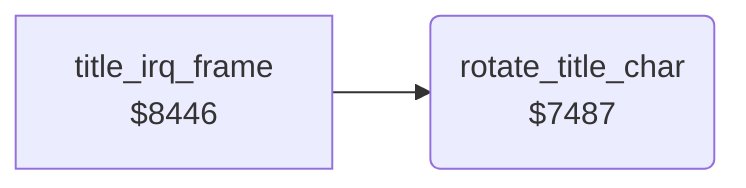

<!-- Generated by c64-docs from knowledge revision 20261024T103116.541-jn0vrj and .c64-re-tools/local/generated/src/source-map.json. Do not edit: change the knowledge, generate the source again, then run docs.ts generate. -->
# title/title_char.asm: Title character animation

Range `$7487-$749A`. Source: [title/title_char.asm](../../../../src/title/title_char.asm). Index: [the reference](../../index.md).

## Call graph

A solid arrow is a call, a thick arrow a table entry, a dotted arrow a jump. Rounded nodes are in this file.

## Names

### [`rotate_title_char`](../../../../src/title/title_char.asm#L6) `$7487`

*routine*

Rotates the 8 bytes of character 0 of the charset at $2000 up by one byte. The title IRQ calls it every fourth time.

- **Called from:** [`title_irq_frame`](title_animation.md#title_irq_frame) [`$845D`](../../../../src/title/title_animation.asm#L32)
- **Reads:** [`charset_text`](../../memory-map.md#charset_text), [`charset_text+1`](../../memory-map.md#charset_text)
- **Writes:** [`charset_text`](../../memory-map.md#charset_text), [`charset_text+7`](../../memory-map.md#charset_text)

### [`rotate_title_char_loop`](../../../../src/title/title_char.asm#L9) `$748C`

*label*

- **Jumped to from:** [`rotate_title_char`](title_char.md#rotate_title_char) [`$7495`](../../../../src/title/title_char.asm#L14)
