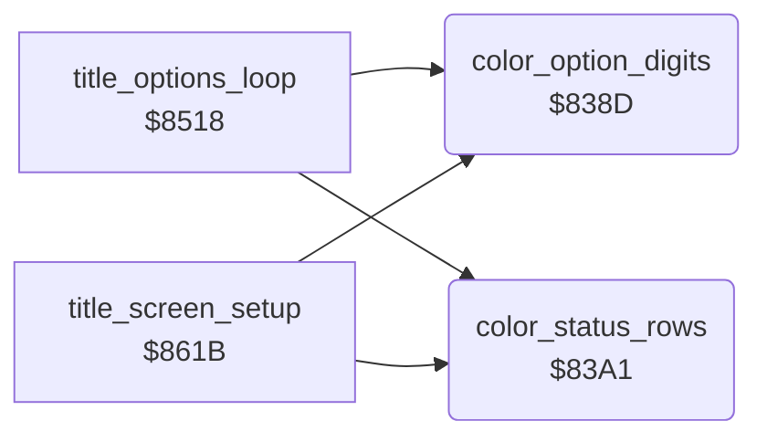

<!-- Generated by c64-docs from knowledge revision 20261024T103116.541-jn0vrj and .c64-re-tools/local/generated/src/source-map.json. Do not edit: change the knowledge, generate the source again, then run docs.ts generate. -->
# title/title_colours.asm: Colours of the title

Range `$838D-$83AB`. Source: [title/title_colours.asm](../../../../src/title/title_colours.asm). Index: [the reference](../../index.md).

## Call graph

A solid arrow is a call, a thick arrow a table entry, a dotted arrow a jump. Rounded nodes are in this file.

## Names

### [`color_option_digits`](../../../../src/title/title_colours.asm#L6) `$838D`

*routine*

Gives the player, joystick, cave and level digits colour 14 in colour RAM.
BLUE in the developer symbol table (symbol_table_leftover).

- **Called from:** [`title_options_loop`](options.md#title_options_loop) [`$8543`](../../../../src/title/options.asm#L126), [`title_screen_setup`](run_title.md#title_screen_setup) [`$8648`](../../../../src/title/run_title.asm#L103)
- **Writes:** `$DB70`, `$DB84`, `$DBA6`, `$DBBA`

### [`color_option_digits_loop`](../../../../src/title/title_colours.asm#L9) `$8391`

*label*

- **Jumped to from:** [`color_option_digits`](title_colours.md#color_option_digits) [`$839E`](../../../../src/title/title_colours.asm#L15)

### [`color_status_rows`](../../../../src/title/title_colours.asm#L18) `$83A1`

*routine*

Gives the two top rows colour 7 in colour RAM.
YELLOW in the developer symbol table (symbol_table_leftover).

- **Called from:** [`title_options_loop`](options.md#title_options_loop) [`$8546`](../../../../src/title/options.asm#L127), [`title_screen_setup`](run_title.md#title_screen_setup) [`$8641`](../../../../src/title/run_title.asm#L100)
- **Writes:** `$D800`

### [`color_status_rows_loop`](../../../../src/title/title_colours.asm#L21) `$83A5`

*label*

- **Jumped to from:** [`color_status_rows`](title_colours.md#color_status_rows) [`$83A9`](../../../../src/title/title_colours.asm#L24)
