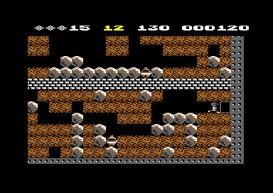

# Rockford

Rockford is the digger that the player moves through the cave. He appears from the flashing inbox a few seconds after the cave starts. The joystick moves him one cell in each scan of the cave. He digs dirt, collects diamonds, pushes boulders to the side and leaves through the exit. A falling boulder or diamond, a firefly or a butterfly kills him. While he stands, he blinks and taps his foot. While he walks, he runs to the left or to the right. The program needs this part to connect the player to the cave: Rockford is the only cell that reads the input.

**Conventions.**
- Addresses are C64 addresses. Names are the names of the knowledge.
- A *scan* is one run of `scan_cave`: one pass over all rows of the cave, one handler for each cell. Rockford moves at most one cell in a scan.
- A *frame* is one run of the play interrupt at raster line 59. A *cave second* is 60 frames (`update_clock`).
- A *cell* is one place of the 40 × 22 cave map. Its *code* is one byte, for example `$38` Rockford, `$14` diamond, `$10` boulder.
- The cell offsets are the Y values for `(cell_ptr),Y`. `$29` is the current cell, `$01` up, `$28` left, `$2A` right, `$51` down.
- **Observed** marks a fact that a run showed. **Code** marks a fact from the code only. **Conclusion** marks an interpretation.

Cave A in the first seconds of play. The status line shows 12 diamonds needed, 10 points each, 0 collected, 150 seconds and the score. Rockford stands at the top left.

## How it works

The cave scan calls the handler of each cell. For the Rockford code `$38`, the handler reads the input, moves Rockford and marks him as alive. All the other effects come from the target cell of the move.

~~~mermaid
flowchart TB
  S["Cave scan finds code $38 (scan_cave)"] --> H["Rockford handler (handle_rockford)"]
  H --> D{"Demo?"}
  D -- yes --> J1["Use the demo direction"]
  D -- no --> J2["Read port 1 or port 2"]
  J1 --> M["Select the direction (move_rockford)"]
  J2 --> M
  M --> T["Examine the target cell (check_rockford_target)"]
  T --> F{"Fire pressed?"}
  F -- no --> W["Step: $39 in the target, space in the old cell"]
  F -- yes --> N["Snap: space in the target, Rockford stays"]
  H --> A["rockford_absent = 0"]
~~~

[`handle_rockford` `$7294`](../src/rockford/movement.asm#L166) does these steps, in the order of the code:

1. **It gets the direction.** In the title demo, it uses `joystick_dir`, which `run_demo` writes from the demo table. Else it reads joystick port 1, or port 2 for player 2 with two joysticks. It keeps the bits in `joystick_dir`. (**Code**)
2. **It moves Rockford.** [`move_rockford` `$7236`](../src/rockford/movement.asm#L105) selects one of four directions and calls `try_move_rockford` with the offset of the target cell. When the move succeeds, it changes `rockford_col` or `rockford_row`. (**Code**)
3. **It marks Rockford as alive.** It writes 0 into `rockford_absent`. The scan increments this counter at its start, so the counter tells how many scans had no Rockford. (**Code**)
4. **It returns to the scan.** It jumps to `scan_cell_settle`, as all handlers do. (**Code**)

The new cell gets the code `$39`, the scanned Rockford. The scan writes `$39` back to `$38` after it passed the cell. **Conclusion**: a move to the right or down puts Rockford into a cell that the scan did not read yet. The code `$39` has no handler, so Rockford does not move two times in one scan.

### The joystick input

[`read_joystick_port1` `$6B5D`](../src/input/joystick.asm#L6) reads `$DC01` and keeps bits 0-3. `read_joystick_port2` reads `$DC00` in the same way. A bit is 0 when the stick points in that direction, so `$0F` is no direction. (**Code**)

| `joystick_dir` | Stick | `move_rockford` does |
|---|---|---|
| `$0F` | centre | no move |
| `$0E` | up | target `$01` |
| `$0D` | down | target `$51` |
| `$07`, `$06`, `$05` | right, up-right, down-right | target `$2A`, faces right |
| `$0B`, `$0A`, `$09` | left, up-left, down-left | target `$28`, faces left |

`move_rockford` tests the exact values `$0D` and `$0E` first, then the ranges below `$08` and `$0C`. Thus a diagonal gives a horizontal move. An up or down move keeps the last facing in `rockford_facing`. (**Code**)

The handler reads port 2 only when `two_joysticks` AND `current_player` is 1. That is player 2 in the mode "2 players, 2 joysticks" of the F3 key. In the other modes, both players use port 1. The extras recording plays player 2 on port 2, and the run executes `read_joystick_port2` (**Observed**).

[`read_fire_of_player` `$6B6B`](../src/input/joystick.asm#L19) uses the same rule for the fire button. It keeps bit 4 of the port in `fire_button`, and `$00` means pressed. The other parts of the game also use this routine, for example the wait for fire after a lost life. (**Code**)

Port 1 shares its lines with the keyboard rows. [`irq_joystick_guard` `$8704`](../src/irq/irq_handler.asm#L84) reads `$DC01` with no keyboard column selected. When the joystick gives a signal, the guard writes `$FF` into all key values and skips the keyboard scan of that interrupt. **Conclusion**: a move of joystick 1 cannot give a false SPACE, RUN/STOP or F1 key.

### The target cell

[`check_rockford_target` `$71BD`](../src/rockford/movement.asm#L31) reads the code of the target cell and sets `rockford_moved` when Rockford can enter it. It also starts the effect of the cell. (**Code**)

| Target code | Element | Result |
|---|---|---|
| `$00` | space | Rockford enters. The step sound gets the pitch `$35`. |
| `$01` | dirt | Rockford enters and digs the dirt. The step sound gets the pitch `$A5`. |
| `$14` | diamond | `collect_diamond`: sound, points, one more diamond, test of the exit. Rockford enters. |
| `$05` | open exit | `cave_end_state` = 2 and `exit_reached` = 1. Rockford enters. |
| `$10` | boulder, left or right | A push with a chance of 1 in 4 (see below). |
| other | wall, falling object, enemy, closed exit | No move. |

Only the code `$14` is a diamond that Rockford can collect. A falling diamond (`$16`) or a diamond that landed in this scan (`$15`) stops him. (**Code**)

[`collect_diamond` `$7191`](../src/rockford/movement.asm#L6) adds the points of one diamond to the score and adds 1 to the count. Then `check_enough_diamonds` compares the count with the diamonds that the cave needs. At the needed count, the exit opens, the diamond value changes to the extra value, and the screen flashes white for 6 frames. The cave A recording collects 12 diamonds on a planned route and enters the exit (**Observed**).

Cave A after 12 diamonds. The diamond symbols replace the needed count, and each diamond now gives 15 points. The open exit flashes at the right edge, next to Rockford.

### Pushing a boulder

Rockford can push a boulder only to the left or to the right. The cell behind the boulder must be space: offset `$27` for a push to the left, `$2B` for a push to the right. Then [`push_boulder` `$71AB`](../src/rockford/movement.asm#L20) takes a random number from the CIA timers. Only when its bits 0-1 are 0 does the push occur. (**Code**)

When the push occurs, `push_boulder` writes the scanned boulder `$11` behind the boulder and plays the boulder sound. Then Rockford steps into the old cell of the boulder. Thus a push takes on average 4 scans of a held stick. The extras recording pushes a boulder to the right (**Observed**). No run pushed a boulder to the left: the coverage marks `$71F6-$7200` as not executed (**Observed**).

### Fire: the snap

`try_move_rockford` reads the fire button after a successful test of the target. With fire pressed, it writes space into the target cell and clears `rockford_moved`. Rockford stays in his cell. (**Code**)

The code of the snap is complete. `check_rockford_target` already ran, so a snap of a diamond collects it with its points. A snap of dirt removes the dirt. A snap toward a boulder that the push moved leaves the boulder in its new cell. **Conclusion**: this is the "snap" of Boulder Dash, a dig or a collect without a step. No run pressed fire during play, so the instructions `$721D-$7226` are not executed (**Observed**).

### Two tests at the screen edge

`move_rockford` refuses a step down while Rockford is at view row 6 and the view scrolls up. It refuses a step right while Rockford is at view column 8 and the view scrolls left. No run reached these two returns (**Observed**). The page [screen.md](screen.md) explains the view rows and columns.

### The exit

The closed exit has the code `$04`. It shows the steel wall characters, so the player cannot see it. [`handle_closed_exit` `$6D54`](../src/engine/explosion.asm#L37) changes it to the open exit `$05` after `check_enough_diamonds` sets `enough_diamonds`. (**Code**)

The open exit and the inbox use the same handler, `handle_flashing_box`. On each second call it draws the steel wall, and on the other call it draws the cell. Thus the open exit flashes. (**Code**)

When Rockford steps into the open exit, `check_rockford_target` sets `cave_end_state` to 2. `play_cave` stops the scans after this scan. Then the time bonus counts down. The cave A recording enters the exit, the bonus counts down, and cave B starts (**Observed**).

## The death of Rockford

Rockford has no handler for a death. Other cells explode, and the explosion writes over his cell. After that, no cell has the code `$38`, and his handler does not run. (**Code**)

- **A falling object lands on him.** [`handle_falling_boulder` `$73AD`](../src/engine/boulder.asm#L47) tests the cell below the boulder. When it is `$38`, `explode_below` writes the explosion code `$1C` into the 3 × 3 cells around Rockford. The falling diamond does the same in `falling_diamond_hit`. The lives recording drops a boulder on Rockford, and the run executes this path (**Observed**). No run killed Rockford with a diamond (**Observed**).
- **An enemy touches him.** The handlers of the firefly and the butterfly call [`check_enemy_touch` `$6DC1`](../src/engine/firefly.asm#L22). It tests the four neighbours for `$38`, `$39` or the amoeba `$3A`. On a match, `explode_here` explodes the 3 × 3 cells around the enemy. A firefly explodes to space, a butterfly explodes to diamonds. (**Code**)
- **The explosion stops at steel wall.** `explode_cell` does not change a cell with the code `$07`. (**Code**)

The explosion codes change in each scan. `$1C` goes through `$1D`, `$1E` and `$1F` to space. `$21` goes through `$22`, `$23` and `$24` to a diamond. The cells after the current cell get the code minus 1, because the scan reaches them later in the same scan. (**Code**)

Rockford can also lose a life without a death. RUN/STOP sets `cave_end_state` to 2 when Rockford is born. The cave time can also run out. (**Code**)

### After the death

`scan_cave` increments `rockford_absent` at the start of each scan, up to 16. [`check_restart_fire` `$7DC3`](../src/engine/cave_scan.asm#L25) ends the play of the cave when all these conditions are true:

1. 16 scans had no Rockford.
2. The current player presses fire.
3. The cave clock counted at least one second.

Until then, the cave continues: the enemies move and the objects fall. In the lives recording, a boulder kills Rockford, and the second life starts again at the inbox (**Observed**).

## The birth from the inbox

The cave data puts the inbox `$25` at one cell. `draw_cave_objects` copies its column and row into `rockford_col` and `rockford_row`, so Rockford knows his position before he exists. (**Code**)

`init_cave_state` sets `birth_countdown` to 4 cave seconds. Two players with one joystick get 6 seconds. Cave B gets one second more. While the countdown runs, `update_clock` counts it in place of the cave time. [`tick_inbox_delay` `$70F1`](../src/status/score_time.asm#L122) plays the crack sound at 0 and starts the cave clock. (**Code**)

[`handle_rockford_birth` `$72F0`](../src/engine/stages.asm#L46) then changes the inbox through three stages to Rockford. The stages `$26-$28` use the characters of the explosion. Thus Rockford appears from a small explosion. (**Code**)

## The state machine of the birth

The inbox flashes until the countdown is 0. Then each scan moves the cell one stage. `handle_flashing_box` and `handle_rockford_birth` make each change.

~~~mermaid
stateDiagram-v2
  state "Inbox, flashing ($25)" as Inbox
  state "Birth stage 1 ($26)" as B1
  state "Birth stage 2 ($27)" as B2
  state "Birth stage 3 ($28)" as B3
  state "Rockford ($38)" as R
  state "Explosion ($1B-$24)" as X
  [*] --> Inbox
  Inbox --> Inbox: countdown > 0
  Inbox --> B1: countdown = 0, even flash
  B1 --> B2
  B2 --> B3
  B3 --> R
  R --> R: step ($39 for one scan)
  R --> X: falling object or enemy
  X --> [*]: 16 scans, fire
~~~

| State | Condition | Next state | Code |
|---|---|---|---|
| Inbox `$25` | `birth_countdown` > 0 | Inbox `$25` (steel or inbox look) | `handle_flashing_box` |
| Inbox `$25` | `birth_countdown` = 0 and `flash_counter` even | Stage 1 `$26` | `handle_rockford_birth` |
| Stage 1 `$26` | next scan | Stage 2 `$27` | `handle_rockford_birth` |
| Stage 2 `$27` | next scan | Stage 3 `$28` | `handle_rockford_birth` |
| Stage 3 `$28` | next scan | Rockford `$38` | `handle_rockford_birth` |
| Rockford `$38` | a move succeeds | Rockford `$39` in the target | `try_move_rockford` |
| Rockford `$38` | a falling object lands on him | Explosion `$1C` | `handle_falling_boulder` |
| Rockford `$38` | a firefly or a butterfly touches him | Explosion `$1C` or `$21` | `handle_firefly`, `handle_butterfly` |

## The animation

Rockford has four characters of his own in the cave character set: `$4C` and `$4D` on top, `$5C` and `$5D` below. The cell codes `$38` and `$39` both point to them. The program does not change the characters on the screen. It changes the bitmaps of the four characters. (**Code**)

[`animate_rockford` `$782A`](../src/screen/animation.asm#L6) copies one byte row of each character. `animate_chars` calls it 8 times for each frame of the animation, one time for each byte row. The screen drawing routine calls `animate_chars` on each second frame, so the 8 frames of a cycle take 16 frames. (**Code**)

- **Walk.** When `joystick_dir` is not `$0F`, it copies the frame of `rockford_left_tl` or `rockford_right_tl`, by `rockford_facing`. Rockford also runs on the spot when the player pushes him into a wall. (**Code**)
- **Stand.** When the stick is in the centre, it copies the standing image from the characters `$42-$43` and `$52-$53`. (**Code**)
- **Blink.** At the start of each cycle, a random number gives a chance of 1 in 4 for a blink. The blink cycle copies the 8 frames of `rockford_blink_tl` into the top characters. (**Code**)
- **Foot tap.** At the start of each cycle, a chance of 1 in 16 changes `rockford_tap`. Thus the tap continues for some cycles and then stops. (**Code**)

## The data

The six animation tables lie at [`rockford_blink_tl` `$63E8`](../src/rockford/rockford_glyphs.asm#L6) to `$66E7`, 128 bytes each. Each table holds 8 frames of 16 bytes: 8 bytes of the left character, then 8 bytes of the right character. (**Code**)

| Table | Address | Part | Used when |
|---|---|---|---|
| `rockford_blink_tl` | `$63E8` | top | standing, blink |
| `rockford_tap_bl` | `$6468` | bottom | standing, foot tap |
| `rockford_left_tl` | `$64E8` | top | walking, faces left |
| `rockford_left_bl` | `$6568` | bottom | walking, faces left |
| `rockford_right_tl` | `$65E8` | top | walking, faces right |
| `rockford_right_bl` | `$6668` | bottom | walking, faces right |

`anim_frame` holds the frame times 8. `animate_chars` doubles it, so X is the frame times 16. The routine reads the left character at X and the right character at X + 8. (**Code**)

The cell codes of Rockford and his birth:

| Code | Meaning | First character |
|---|---|---|
| `$25` | inbox | `$62` |
| `$26` | birth stage 1 | `$66` |
| `$27` | birth stage 2 | `$68` |
| `$28` | birth stage 3 | `$6A` |
| `$38` | Rockford | `$4C` |
| `$39` | Rockford, scanned in this scan | `$4C` |

## The worked example

The cave A data at `$582E` ends with the commands `25 03 04 04 26 12 FF`. (**Code**)

1. Bits 6-7 of `$25` are 0, so the command is a point. Bits 0-5 give the code `$25`, the inbox.
2. The next two bytes are the column 3 and the map row 4. Map rows 0-1 are the two status rows, so the inbox is in cave row 2. `rockford_col` = 3 and `rockford_row` = 4.
3. `$04` is the closed exit at column `$26` = 38, map row `$12` = 18.
4. `$FF` ends the commands.

After 4 cave seconds, the inbox at column 3 changes through `$26`, `$27` and `$28` to Rockford. The lives recording waits for the code `$38` at `$08A3`, which is cave row 2, column 3 of the map at `$0850`. The second screen shot shows the open exit at column 38, at the right edge. (**Observed**)

## Still open

- The snap with fire: no run pressed fire during play. A recording that presses fire next to a diamond can show the collect without a step.
- The push to the left and the two tests at the screen edge: no run reached them. A recording with a push to the left and a walk at the scroll limits can reach them.
- A falling diamond on Rockford: no run did it. A run that writes a falling diamond above Rockford can show the explosion.
