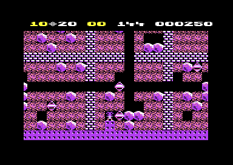
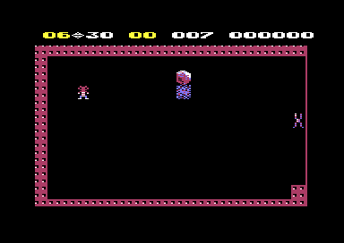

# The screen

The cave is 40 cells wide and 22 cells high, and each cell is 2 × 2 characters. The full cave needs 80 × 44 characters, but the C64 screen shows 40 × 25. Thus the game keeps the full cave as characters in a buffer at `$4000` and shows a window of 20 × 12 cells. The window follows Rockford with a smooth scroll. Two screens take turns: the program draws one screen while the VIC-II shows the other. A status line at the top shows the counts, the time and the score. The screen also covers the cave between lives, reveals the next cave, animates the elements and makes the space sparkle for a bonus life.

**Conventions.**
- Addresses are C64 addresses. Names are the names of the knowledge.
- A *frame* is one run of the play interrupt at raster line 59. An *odd frame* and an *even frame* refer to bit 0 of `frame_counter`.
- A *cell* is one place of the 40 × 22 cave. The *cave map* holds one code for each cell at `$0850`. The *map buffer* holds the characters of each cell at `$4003`.
- The *view* is the part of the map buffer that the screen shows: 40 characters × 24 rows from `view_ptr`.
- A *phase* is one of the four fine scroll positions 0-3 of an axis. One phase is 2 pixels.
- **Observed** marks a fact that a run showed. **Code** marks a fact from the code only. **Conclusion** marks an interpretation.

Cave B during play. The cave colours are light red and purple, and the status line shows the needed count in yellow.

## How it works

The work of the screen runs in the raster interrupt. The main loop only scans the cave and writes cell codes. Each write of a cell code also draws the four characters of the cell into the map buffer. The interrupt copies the view from the map buffer to a screen.

~~~mermaid
flowchart TB
  M["Cave scan writes a cell (set_cell)"] --> B["Map buffer $4003: 2 x 2 characters"]
  I["Raster line 40: status split"] --> P["Raster line 59: play split (play_frame_irq)"]
  P --> S["Cover, clock, sound, scroll (update_scroll)"]
  S --> O{"Odd frame?"}
  O -- yes --> D["Copy the view to the hidden screen (draw_screen at $9E00)"]
  D --> A["Animate the characters (animate_cave)"]
  O -- no --> F["Show the drawn screen next frame"]
  B -.-> D
~~~

[`play_frame_irq` `$7B2B`](../src/irq/play_frame.asm#L6) runs once in each frame, after the split of the play area. It does these steps, in the order of the code:

1. **It flashes the screen.** `flash_screen` makes the border and the background white while `flash_frames` is not 0. (**Code**)
2. **It rolls the cover.** `animate_cover` moves the cover character while `cave_covered` is 1. (**Code**)
3. **It counts the time.** It counts the magic wall time and the cave clock, and it plays the sound. (**Code**)
4. **It scrolls.** It increments `frame_counter`, then `update_scroll` moves the view and writes the fine scroll values for the next split. (**Code**)
5. **It draws or it shows.** On an odd frame, it jumps to the drawing routine at `$9E00`. On an even frame, it puts `game_d018_value` into the split values and changes bit 7 of `game_d018_value`. Thus the screen that was drawn becomes visible, and the next drawing goes into the other screen. (**Code**)

**Conclusion**: the screen shows a new picture 25 times each second on a PAL C64. The fine scroll registers change in each frame, 50 times each second.

### The memory of the screens

All screens and character sets lie in VIC-II bank 0. The map buffer at `$4000` is outside the bank. The VIC-II never shows it, and only the drawing routine reads it. (**Code**)

| Range | Content |
|---|---|
| `$0800-$0BFF` | The title screen. In a game: two status rows of the map, then the cave map at `$0850`, 40 × 22 codes. |
| `$0C00-$0FE7` | Screen 0. Row 0 is the status line. Rows 1-24 show the view. |
| `$0FF8-$0FFF` | Sprite pointers of screen 0. |
| `$2000-$23FF` | The text character set: title, status line and messages. |
| `$2C00-$2FE7` | Screen 1. Rows 1-24 show the view. |
| `$3000-$33FF` | The cave character set. |
| `$3780-$37BF` | One sprite: 8 solid rows, then empty rows. |
| `$4000-$4EC2` | The map buffer and its steel wall border. |
| `$9800-$98FF` | Variables, the status line texts and `game_d018_value` at `$9807`. |
| `$9E00-$9FFF` | The copy of the drawing routine. |

The title screen and the cave map share `$0800-$0BFF`. `draw_title_screen` writes the title picture to `map_base`, and the cave set-up later writes the cave codes there. **Conclusion**: the two never show at the same time, so the program saves 1 KB.

[`init_screens` `$897A`](../src/init/init_screens.asm#L21) copies the two character sets. The text set comes from `$5000-$53FF`, and its characters `$76-$7F` hold the bytes of the tables at `$53B0`. The cave set gets its characters `$20-$7F` from `$60E8-$63E7`. Its characters `$00-$1F` get the 256 bytes of the title tune notes at `$5FE8`. `cell_glyph_chars` points into this range only with `$00`, for codes without a handler, for example `$18-$1A`. (**Code**)

### The two raster splits

[`irq_handler` `$8675`](../src/irq/irq_handler.asm#L6) changes between two sets of VIC-II values on each raster interrupt. `run_title` copies the game values from `irq_game_values` to `$54-$5B`. (**Code**)

| Split | Starts at raster line | `$D011` | `$D016` | `$D018` | Shows |
|---|---|---|---|---|---|
| 1 | `$28` (40) | `$1B` | `$18` | `$38` | Screen 0, text set `$2000`, 25 rows, 40 columns, Y scroll 3 |
| 0 | `$3B` (59) | `$11-$17` | `$11-$17` | `$3C` or `$BC` | Screen 0 or 1, cave set `$3000`, 24 rows, 38 columns, fine scroll |

Both splits use multicolour characters. The status split always shows screen 0, so only screen 0 has a status line. The play split takes `$D018` from `game_d018_value`: `$3C` selects screen 0, `$BC` selects screen 1. (**Code**)

`init_screens` also puts seven sprites in a row at Y `$3A`. They are black, expanded in X and 48 pixels apart. Each sprite shows 8 solid rows of the data at `$3780`. The play interrupt turns on sprites 0-6, and they are in front of the characters. **Conclusion**: the sprites make a black bar under the status line. It hides the top edge of the play area, which moves with the fine Y scroll.

### The status line

The status line has 20 characters of double width. [`show_status_line` `$6B16`](../src/status/status_line.asm#L19) writes each character c and c + `$34` into two columns of row 0 of screen 0. The text set holds the left halves at `$21-$3A` and `$10-$19`, and the right halves `$34` higher. (**Code**)

The game uses these lines:

- Before Rockford appears: the player, the lives, MEN or MAN, the cave letter and the level, from `status_line_text` at `$984E`.
- During play: the needed diamonds, the value of one diamond, the collected diamonds, the time and the score, from `status_line` at `$983A`. `animate_chars` writes this line again on each odd frame.
- Messages: OUT OF TIME, GAME OVER, SPACEBAR TO RESUME and BONUS LIFE. For OUT OF TIME and the pause, the program saves the play line in `saved_status_line` and blinks the message with it.

`show_status_line` also sets the colour of two fields. The needed count is yellow, and it becomes white when the diamond symbols replace it. The collected count is yellow in the play line and white in the other lines. The other characters of row 0 have colour 9: multicolour with white. (**Code**)

## The map buffer

The map buffer holds 22 cell rows of 160 bytes. Each cell row is two character rows of 80 characters. [`set_cell` `$6CB6`](../src/engine/cell_draw.asm#L41) writes a code into the cave map and then draws the cell. `draw_cell` writes the four characters n, n + 1, n + 16 and n + 17 at the offsets 0, 1, `$50` and `$51`. The table `cell_glyph_chars` gives n for each code. (**Code**)

The cell of row r and column c starts at `$4003` + 160 × r + 2 × c. The table `cave_row_addr_lo` holds the 22 row addresses. A handler can also write a neighbour cell. Then `cell_draw_address` changes the cave map offset into a buffer offset with the table at `cell_offset_keys`. (**Code**)

[`fill_buffer_border` `$774D`](../src/screen/cover.asm#L79) writes the steel wall character `$4A` into the 3 bytes before the buffer and the 256 bytes after it. **Conclusion**: when the view is at its lowest position, the last screen row reads the bytes after the buffer, and they show as steel wall.

The buffer holds characters, not codes. Thus the drawing routine copies bytes and does no conversion. A cell that does not change costs no work in the main loop. (**Conclusion**)

## The drawing routine at $9E00

The drawing routine copies the 24 view rows from the map buffer to the hidden screen. Its name is `draw_screen` in space bank1 at `$9E00`. Its source is [draw_screen.asm](../src/bank1/screen/draw_screen.asm). (**Code**)

### The copy at the cold start

The image holds the routine as bytes at [`draw_screen_source` `$7B58`](../src/data/draw_screen_copy.asm#L6). [`cold_start` `$8AB3`](../src/init/cold_start.asm#L9) copies two pages, `$7B58-$7D57`, to `$9E00-$9FFF`. The first `$139` bytes are the routine. The other bytes are a copy of the code at `$7C91`, which runs in its own place. Nothing calls the copy of it at `$9F39`. (**Code**)

### The self-modified copy loops

The routine has two unrolled loops. Each pair of `LDA abs,X` and `STA abs,X` copies one row of 40 characters, with X from 39 to 0. (**Code**)

1. **Rows 11-24.** It sets the source of the first pair to `view_ptr` + `$320`, which is 10 view rows lower. It sets the target to row 11 of the hidden screen. The page of the target comes from `game_d018_value`. (**Code**)
2. **The operands of the bottom loop.** `draw_bottom_ptrs` in space bank1 at `$9E00` writes the operands of the next 13 pairs. Each source is 80 bytes after the last source, and each target is 40 bytes after the last target. (**Code**)
3. **The bottom loop.** `draw_bottom_loop` copies 14 rows in one pass of X. (**Code**)
4. **Rows 1-10.** `draw_top_ptrs` sets the operands of 10 pairs in the same way, from `view_ptr` to row 1. `draw_top_loop` copies them. (**Code**)
5. **The animation.** It calls `animate_cave` at `$7AF7`. When `bonus_life_timer` is not 0, it also calls `bonus_life_sparkle` at `$7454`. (**Code**)

**Conclusion**: one row costs 40 × 9 cycles. The 24 rows and the operand loops take about 10,000 cycles, about half of a PAL frame of 19,656 cycles. This explains why the program draws only on each second frame.

### Why it runs at $9E00

The routine writes its own operands. Its stores name fixed addresses inside the routine, for example `STA $9E51` and `STA $9EF6,X`. `play_frame_irq` also jumps to `$9E00`. Thus the routine works only at `$9E00`, and the bytes at `$7B58` cannot run in their place. (**Code**)

The v2 build holds the same routine at `$7EF0`, but it copies it to the same `$9E00`. The two copies differ only in 40 operand bytes. **Conclusion**: the authors assembled the drawing routine for the fixed address `$9E00`, apart from the rest of the game. The code does not tell why they selected this address.

## The scrolling

The view follows Rockford in steps of one cell. [`update_scroll` `$76AD`](../src/screen/scroll.asm#L345) runs in each frame. It calculates the position of Rockford in the view, selects a speed for each axis, stops the speed at the edges, and moves the view. (**Code**)

### The triggers

`rockford_view_col` is the column of Rockford minus the view column in cells. `rockford_view_row` is the row of Rockford minus the view row in cells. `rockford_row` counts the two status rows of the map, so the top cell row of the view has the view row 2. [`set_scroll_speed` `$764A`](../src/screen/scroll.asm#L286) compares the two values with the trigger tables. (**Code**)

| Axis | Starts to scroll | Stops |
|---|---|---|
| Vertical, down | view row 11 or more (screen cell row 9 or more) | view row 8 |
| Vertical, up | view row 4 or less (screen cell row 2 or less) | view row 7 |
| Horizontal, right | view column 16 or more | view column 10 |
| Horizontal, left | view column 3 or less | view column 9 |

The trigger tables `scroll_y_trigger_row` and `scroll_x_trigger_col` hold four entries each: rows 3, 7, 8, 12 and columns 3, 9, 10, 16. An entry sets its speed when Rockford is exactly at its row or column. Then `set_scroll_y_limits` starts a scroll at view row 11 or more and below view row 5. `set_scroll_x_limits` does the same at column 17 or more and below column 3. A speed stays until an entry with speed 0 stops it. (**Code**)

Thus the view stops when Rockford is near the centre: the cell rows 5-6 and the cell columns 9-10 of the screen. A horizontal scroll moves the view 6 cells, a vertical scroll 3 cells. (**Conclusion**)

During the start delay, `set_scroll_speed` also gives a speed to a view at rest. Then the entries move the view until the inbox is at view row 7 or 8. **Conclusion**: the view centres on the inbox before Rockford appears.

`clamp_scroll` stops the view at the edges of the map buffer. The view row in characters stays in 0-21, and the view column in characters stays in 0-42. (**Code**)

### The speed and the fine scroll

A speed is `$0040` forward, `$FFC0` back or 0. Each frame adds the speed to a 16-bit position. Bits 6-7 of the low byte give the phase, and the high byte is the view position in characters. Thus one phase takes one frame, one character takes 4 frames, and one cell takes 8 frames. (**Code**)

| Phase | `$D016` (X) | `$D011` (Y) |
|---|---|---|
| 0 | `$15` | `$17` |
| 1 | `$13` | `$15` |
| 2 | `$11` | `$13` |
| 3 | `$17` | `$11` |

[`scroll_horiz` `$7559`](../src/screen/scroll.asm#L135) and `scroll_vert` write these values into the play split. When the phase changes from 0 to 1, they move `view_ptr` by one character or by one row of `$50`. A scroll back moves `view_ptr` at once and starts at phase 3. A view at rest starts to move only on an even frame. (**Code**)

**Conclusion**: a new `view_ptr` shows first in phase 3, after the next odd frame draws it. The X value `$17` of phase 3 fits this delay, so the horizontal scroll moves 2 pixels in each frame.

In an intermission, `update_scroll` moves the view only during the start delay. `scroll_horiz` holds code that sets the 40-column bit in an intermission after the start delay. That code never runs, because `update_scroll` stops before it. The coverage marks `$7593` as not executed (**Observed**).

Intermission 1. The colours are light blue and red, and the cave fits in the screen.

## Cover and reveal

Between two lives and between two caves, the cave hides under the cover character `$7C`. (**Code**)

1. **The cover arrives at random.** At the end of a life, `end_of_life` sets `cave_covered` and calls [`cover_view_random` `$76F9`](../src/screen/cover.asm#L26). It makes 48 passes over the 24 view rows. Each pass writes `$7C` at one random column of each row. Then `cover_map_buffer` fills the full buffer. (**Code**)
2. **The cover moves.** While `cave_covered` is 1, [`animate_cover` `$77A9`](../src/screen/cover.asm#L134) rolls the 8 bytes of character `$7C` up by one pixel row in each frame. It also plays a noise with a random pitch on voice 2: two frames on, one frame off. (**Code**)
3. **The cave appears at random.** `start_cave` calls `uncover_cave`. [`reveal_random_cells` `$7760`](../src/screen/cover.asm#L93) makes 69 passes. Each pass draws one random cell of each of the 22 rows. The random column comes from the CIA timers, and the routine tries again when it is more than 39. (**Code**)
4. **The cave is complete.** `uncover_cave` then draws all 880 cells in order and fills the buffer border. `start_cave` clears `cave_covered`. (**Code**)

The interrupt draws the screen during these loops. **Conclusion**: the player sees the cells appear one by one, because the reveal writes into the map buffer while the screen copies it.

`cover_view_random` increments `cover_count` and then tests it for 0. That test is never true, so the two instructions at `$7736` never run. The coverage marks them as not executed (**Observed**).

## The character animation

The animation changes the bitmaps of characters, not the screen codes. Each element type has its own characters, so all cells of one type move together. [`animate_cave` `$7AF7`](../src/screen/animate_cave.asm#L6) adds 8 to `anim_frame`, so the animation has 8 frames. The drawing routine calls it on each odd frame, so one cycle takes 16 frames. (**Code**)

`animate_chars` copies the frame into these characters:

| Element | Characters | Condition |
|---|---|---|
| Diamond | `$48-$49`, `$58-$59` | always |
| Amoeba | `$40-$41`, `$50-$51` | `cave_anim_flags` 4 or more |
| Butterfly | `$20-$21`, `$30-$31` | bit 1 of `cave_anim_flags` |
| Firefly | `$64-$65`, `$74-$75` | bit 0 of `cave_anim_flags` |
| Rockford | `$4C-$4D`, `$5C-$5D` | always, see [rockford.md](rockford.md) |

[`cave_anim_flags_table` `$8379`](../src/data/cave_animations.asm#L6) gives the flags of caves 1-16. The intermissions use the value 7, all three types. For example, cave G has 5, amoeba and fireflies. **Conclusion**: a cave copies only the frames of the elements that it has, and this saves time in the interrupt. `animate_cave` also calls `update_magic_wall`, which animates the magic wall. (**Code**)

## The bonus life sparkle

A bonus life makes the space of the cave sparkle. `add_bonus_life` sets `bonus_life_timer` to `$80`. While the timer is not 0, the drawing routine calls [`bonus_life_sparkle` `$7454`](../src/screen/space_sparkle.asm#L18). It writes random bytes into byte rows 0 and 4 of the four space characters `$60`, `$61`, `$70` and `$71`. Then it decrements the timer. (**Code**)

The last call clears the bytes with `clear_space_sparkle`. The timer has 128 calls on odd frames, so the sparkle takes 256 frames, about 5 seconds on PAL. After a cave, `play_cave` waits until the timer is 0. The extras recording sets the score to 490 and collects a diamond, and the space sparkles (**Observed**).

## The colours

[`load_cave_data` `$7E8E`](../src/cave/setup.asm#L6) sets the colours of each cave from the cave header. Header byte `$13` goes to `$D022`, and byte `$14` goes to `$D023`. `fill_colour_ram` fills the colour RAM from row 1 with byte `$15`, and row 0 gets 9. The background `$D021` and the border stay black from the title. (**Code**)

The colour RAM serves both screens, so the double buffer needs no colour copy. Each multicolour cell has four colours: black, the two cave colours and the colour RAM colour. (**Conclusion**)

| Cave | `$D022` | `$D023` | Colour RAM |
|---|---|---|---|
| A | `$08` orange | `$0B` dark grey | `$09` multicolour, white |
| B | `$0A` light red | `$04` purple | `$09` multicolour, white |
| Intermission 1 | `$0E` light blue | `$02` red | `$09` multicolour, white |

When the player collects the needed diamonds, `check_enough_diamonds` sets `flash_frames` to 6. [`flash_screen` `$7958`](../src/screen/flash.asm#L6) makes the border and the background white for 6 frames, and then black again. (**Code**)

## The worked example

The inbox of cave A is at cave row 2, column 3. Its code `$25` has the first character `$62` in `cell_glyph_chars`. (**Code**)

1. `set_cell` reads the row address of row 2 from `cave_row_addr_lo`: `$4143`, which is `$4003` + 2 × 160.
2. It adds 2 × 3 for the column: `$4149`.
3. `draw_cell` writes `$62` at `$4149`, `$63` at `$414A`, `$72` at `$4199` and `$73` at `$419A`.
4. With the view at the top left, `view_ptr` is `$4003`, the value of the cold start. The offset `$146` is view row 4, column 6.
5. The drawing routine copies view row 4 to screen row 5. The top left character of the inbox goes to `$0CCE` in screen 0, or to `$2CCE` in screen 1.
6. The colour RAM at `$D8CE` holds 9 from the cave header. The four characters of the inbox can use black, orange, dark grey and white.

## Still open

- The vertical fine scroll: the Y values do not have the offset of the X values. A run that captures the screen in each frame of a vertical scroll can show if the picture jumps.
- The sprite bar: no run captured the raster lines 58-65 with the sprites off. A run with `$D015` = 0 can show what the bar hides.
- The order of the drawing: the routine draws rows 11-24 before rows 1-10. The code does not tell why, because the target screen is hidden.
