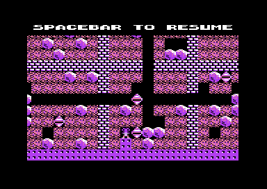

# Boulder Dash: the status line, the score, the time and the sound

The top row of the play screen tells the player what the cave needs. It shows the diamonds that the cave needs, the points of one diamond, the diamonds that the player has, the cave time and the score. Before Rockford appears, the same row shows the player and the lives. It also shows the messages of the pause, of the end of the time and of the end of the game. The score earns a bonus life every 500 points. The SID plays the effects of the cave on three voices, and the title plays a two-voice tune. This page explains these parts of the Micro Fun build (v1).

**Conventions.**
- Addresses are C64 addresses of v1. Names are the names of the knowledge. The v2 code has the same routines at the v1 address plus `$398`.
- A *frame* is one pass of the game interrupt at split 0 (50 each second on PAL). A *tick* is one scan of the cave by the main loop.
- A *cave second* is 60 frames. The status line and the cave data count the time in cave seconds.
- A *digit* is one byte with the value 0-9. The screen code of a digit is `$10` plus the value.
- The *status buffer* is the 20-character line `status_line` at `$983A`. A *text line* is any 20-character line that the program can show in the top row.
- **Observed** marks a fact that a run showed. **Code** marks a fact from the code only. **Conclusion** marks an interpretation.
- The runs are the recordings of the project, replayed on the original. `cave_a` collects 12 diamonds in cave A and enters the exit. `lives` loses three lives. `pause_restart` pauses and resumes. `extras` sets the score to 490 and collects a diamond.

## How it works

Two parts of the program share the work. The game interrupt counts the frames, the cave seconds and the sound timers in each frame. The main loop changes the score and the counts when Rockford collects a diamond. The drawing code copies the status buffer to the screen.

~~~mermaid
flowchart TB
  IRQ["Game interrupt, each frame (play_frame_irq)"] --> CLK["Count 60 frames: one cave second (update_clock)"]
  IRQ --> SND["Play the effects on voices 1-3 (update_sound)"]
  CLK --> TIME["Time minus 1, tick in the last 9 seconds"]
  LOOP["Main loop: one tick (scan_cave)"] --> DIA["Rockford collects a diamond (collect_diamond)"]
  DIA --> PTS["Add the points, check the bonus life (add_points)"]
  DIA --> CNT["Count the diamond, open the exit at the needed count"]
  TIME --> BUF["Status buffer at $983A"]
  PTS --> BUF
  CNT --> BUF
  DRAW["Drawing code (animate_chars)"] --> ROW["Top row: 20 double-width characters"]
  BUF --> ROW
~~~

The routines write the digits only into the status buffer. They do not write the screen. [`animate_chars` `$78C9`](../src/screen/animation.asm#L80) copies the buffer to the screen with [`show_game_status_line` `$7105`](../src/status/score_time.asm#L135) when Rockford is born and `cave_clock_on` is not 0. Before the birth, the top row keeps the player line. **Code.**

### The top row and the double-width text

The top row is row 0 of screen 0 at `$0C00`. The game interrupt makes two splits in each frame. From raster line `$28`, it shows screen `$0C00` with the text charset at `$2000` (`$D018` = `$38`) and fixed scroll values. From raster line `$3B`, it shows the cave screen with the cave charset and the scroll values. Thus the top row stays still while the cave scrolls under it. **Code.**

The status line has 20 characters, but the screen row has 40 columns. [`show_status_line` `$6B16`](../src/status/status_line.asm#L19) writes each character `c` of a text line as two screen cells: `c` in the left cell and `c + $34` in the right cell. The text charset holds the left half of each wide letter at code `c` and the right half at code `c + $34`. The same rule makes the double-width lines of the title. **Code.**

`show_status_line` also sets two colour fields in colour RAM. Columns 2-5 hold characters 1-2 (the needed diamonds). Columns 14-17 hold characters 7-8 (the collected diamonds). The routine compares two characters of the text line: **Code.**

- Character 3 is the diamond symbol `$3C` only in the game status line. Then columns 14-17 get yellow (7), else white (1).
- Character 1 below `$19` (a digit 0-8) gives yellow to columns 2-5, else white. The two diamond symbols that replace the needed count after enough diamonds are white.

The compare uses `$19`, the code of the digit 9. In cave I on level 5 the cave needs 90 diamonds, so the tens digit is 9 and the needed count shows white, not yellow. No run showed this level. **Code** for the compare, **Conclusion** for the colour on the screen.

[`save_status_line` `$6B04`](../src/status/status_line.asm#L6) reads the left cells of the top row back into `saved_status_line` at `$9862`. The pause and the end of the time use this copy to blink a message with the line that was on the screen. **Code.**

### What the top row shows

The top row shows one text line at a time. The game status line is the status buffer [`status_line` `$983A`](../src/constants.asm#L240). The player line is [`status_line_text` `$984E`](../src/constants.asm#L246). The messages come from fixed texts of the program. **Code.**

| When | Text line | Example on the screen |
|---|---|---|
| Before Rockford appears, after a lost life | `status_line_text` | PLAYER 1, 2 MEN A/1 |
| In play | `status_line` | 12◆10 00 150 000000 |
| Pause | `text_spacebar_to_resume` | SPACEBAR TO RESUME, blinking |
| The time ran out | `text_out_of_time` | OUT OF TIME, blinking |
| The last life is lost | `text_game_over` | G A M E   O V E R |
| The next cave is an intermission | `text_bonus_life` | B O N U S  L I F E |

The player line holds the player digit, the lives, MEN or MAN, the cave letter and the level. [`end_cave` `$88AB`](../src/cave/cave_end.asm#L69) writes them into the line after each cave. One life gives MAN, and other counts give MEN. **Code.** A screen capture after the first lost life shows PLAYER 1, 2 MEN A/1. **Observed.**

The image shows the pause of the `pause_restart` run. The message replaces the status line in the top row, and the cave stays on the screen. **Observed.**

### The pause

[`check_game_keys` `$7D6B`](../src/input/game_keys.asm#L69) runs after each tick. SPACE stops the cave clock, stops the three voices and sets `pause_flag`. Then [`pause_game` `$7D2B`](../src/input/game_keys.asm#L38) loops in the main program. **Code.**

1. It saves the top row and shows SPACEBAR TO RESUME.
2. It waits one wait period, or less when SPACE is down.
3. It shows the saved line and waits three wait periods.
4. When SPACE is down, it waits a short time and returns. Else it starts again at step 1.

The message shows for one period and the status line for three periods. The game interrupt continues, but `update_clock`, the magic wall time and `update_sound` do nothing while `pause_flag` is not 0. The `pause_restart` run paused with SPACE and resumed with SPACE after 300 frames. **Observed.**

### The end of the time and the end of the game

When the cave time reaches 000, `check_time` sets `cave_end_state` to 2, and the main loop ends the cave. [`end_of_life` `$802E`](../src/status/end_of_life.asm#L93) then compares the elapsed seconds with the time of the cave. When they agree, it writes the digit 0 directly into screen cell `$0C18`, the left cell of the last time digit. **Code.**

The direct write is necessary because the drawing code shows the buffer only while `cave_clock_on` is not 0. The cave can end before the last 0 reaches the screen. **Conclusion.**

[`show_out_of_time` `$7FCE`](../src/status/end_of_life.asm#L40) then blinks OUT OF TIME with the saved line. The blink stops when the next player presses fire, or after 20 blinks. In an intermission, the fire of the same player counts. **Code.** The time ran out in the second life of the `lives` run, and the coverage shows that `show_out_of_time` ran. **Observed.**

When the last life is lost, `show_game_over` shows G A M E   O V E R and waits. Then the cover hides the cave, and the program goes to the title. **Observed** in the `lives` run.

## The score

The score has 6 digits in `score_digits` at `$5F`, one digit in each byte. The program does not use the decimal mode of the 6502. [`add_points` `$705D`](../src/status/score_time.asm#L32) adds the 6 digits of `points_to_add` with a carry chain. It subtracts 10 from each digit above 9 and keeps the carry for the next digit. It writes each digit as a screen code into `status_score`. A carry out of the highest digit is lost, so the score goes from 999999 to 000000. **Code.**

The cave data gives two point values for a diamond. [`init_cave_state` `$7EDC`](../src/cave/setup.asm#L46) converts both values to 3 digits. The first value goes into the last 3 digits of `points_to_add`, and each diamond adds these points. **Code.**

When the collected count reaches the needed count, [`check_enough_diamonds` `$715E`](../src/status/score_time.asm#L198) does five things: **Code.**

1. It sets `enough_diamonds`, and the exit opens.
2. It copies the second value, the extra diamond points, into `points_to_add`.
3. It shows the new points in the status line.
4. It writes two diamond symbols over the needed count.
5. It requests the crack sound and flashes the screen white for 6 frames.

The `cave_a` run collected 12 diamonds at 10 points each in cave A. The top row then showed three diamond symbols, the new value 15, the count 12 and the score 000120. **Observed.**

| Cave | Points | Extra points |
|---|---|---|
| A | 10 | 15 |
| B | 20 | 50 |
| C | 15 | 0 |
| E | 50 | 90 |
| I | 5 | 10 |
| K | 50 | 0 |
| M | 5 | 8 |
| Intermissions 1-4 | 30, 10, 10, 30 | 0 |

The table gives some values of the cave data. In caves C, K and L and in the intermissions, the extra value is 0. A diamond after the needed count gives no points there. The largest value of all caves is 90, so one diamond never adds 100 points or more. **Code.**

At the exit, [`count_time_bonus` `$8859`](../src/cave/cave_end.asm#L24) counts the remaining time to 0. Each cave second subtracts 1 from the time and adds the level number (1-5) to the score, with a short sound. The `cave_a` run entered the exit with 130 seconds on level 1. The score went from 120 to 250. **Observed.**

After a lost life, `update_best_score` compares the score with the best score of the player. The title shows the scores of both players in the LAST and HIGH lines. **Code.**

## The time

The cave time has 3 digits in `time_digits` at `$AB`. The cave data gives the time of each level in cave seconds, as a binary number. `init_cave_state` converts it to digits with `count_to_decimal`, which counts up by 1 until it reaches the value. **Code.**

[`update_clock` `$7111`](../src/status/score_time.asm#L143) runs in each frame of the game interrupt. It counts `clock_frames` to 60, then it counts one cave second. While `pause_flag` is not 0, the cave second does not count. **Code.**

- Before the birth of Rockford, the second counts `birth_countdown`. The birth comes after 4 seconds, 6 seconds for two players with one joystick, and one second more in cave B. At 0 the crack sound plays, and the cave clock starts.
- After the birth, the second subtracts 1 from the time digits and counts `seconds_elapsed`. At the amoeba time of the cave, the amoeba starts to grow fast.

A PAL C64 gives 50 frames each second, so one cave second takes 1.2 real seconds. The count of 60 frames agrees with the 60 Hz of an NTSC C64, the computer of the US publisher. **Code** for the count, **Conclusion** for the reason.

In the last 9 seconds, [`play_time_tick` `$709D`](../src/status/score_time.asm#L73) plays a tick on voice 2 after each second. The pitch is `$27` minus the ones digit, so the pitch rises as the time falls. **Code.**

## Lives and the bonus life

A new game gives each player 3 lives. The lives of the current player are in `lives` at `$5C`. They start a block of 15 bytes with the cave, the level, the score and the best score. Each player has a copy of this block. After each lost life, `end_turn` saves the block. In a two-player game, it then loads the block of the other player. A player with no lives gets no more turns. When no player has lives, the game ends. **Code.**

[`add_bonus_life` `$7039`](../src/status/score_time.asm#L6) adds one life, up to 9. It also sets `bonus_life_timer` to `$80`. While the timer is not 0, `bonus_life_sparkle` writes random bytes into rows 0 and 4 of the space characters. Thus the empty cells of the cave sparkle. The drawing code calls it in every second frame, so the sparkle lasts 128 draws, about 256 frames. At the end of a cave, the main loop waits until the timer is 0. At 9 lives, the routine adds no life and gives no sparkle. **Code.**

Two events give a bonus life:

1. **Every 500 points.** [`check_bonus_life` `$7046`](../src/status/score_time.asm#L16) runs after each `add_points`. It gives a life when the thousands digit changed, or when the hundreds digit changed from 4. Thus the lives come at 500, 1000, 1500, 2000 and so on. A diamond gives at most 90 points and a time unit at most 5, so no add jumps over a hundreds digit 4. The `extras` run set the score to 490, and the next diamond gave a bonus life with the sparkle. **Observed.** No run reached the thousands case. **Code.**
2. **The way into an intermission.** [`show_next_cave_text` `$8006`](../src/status/end_of_life.asm#L69) runs after a cave. At this time, `cave_number` already holds the next cave. The routine reads the intermission flag of that cave from `cave_sequence`. When the flag is 1, it shows B O N U S  L I F E and calls `add_bonus_life`. **Code.**

The code gives this life when the player completes cave D, H, L or P, before the intermission starts. A death in an intermission costs no life, and the game goes to the next cave. No run reached this code. **Code** for the order, **Conclusion** for what the player sees.

## The sound

The game interrupt calls [`update_sound` `$7971`](../src/sound/effects.asm#L6) in each frame. The routine sets the SID volume to 15 and plays each voice from its requests. The game code does not write most effects to the SID. It writes a request, and `update_sound` plays the request in the next frame. While `pause_flag` is not 0, `update_sound` does nothing more. **Code.**

| Voice | Effects | Request and timer |
|---|---|---|
| 1 | Diamond collected, diamond falls, boulder falls or moves | `sound1_request` (bits 0-6), `sound1_pending` (7 SID values), fade every 8 frames |
| 2 | Steps of Rockford, explosion, time tick, cover noise | `step_sound_pitch`, `step_sound_timer`, `sound2_lock` (80 frames), bit 7 of `sound1_request` |
| 3 | Crack (birth of Rockford, enough diamonds), amoeba, magic wall, time bonus | `noise_request`, `noise_timer` (33 frames) |
| 1 and 2 | Title tune | `tune_index`, `title_note_phase` |

### Voice 1: the effects of the elements

An effect of voice 1 is a record of 7 SID values, the registers `$D400-$D406`. [`play_diamond_sound` `$6E28`](../src/sound/element_sounds.asm#L6), [`play_boulder_sound` `$6E56`](../src/sound/element_sounds.asm#L30) and `collect_diamond` write a record into `sound1_pending` and add 1 to `sound1_request`. The record of a falling diamond gets a random frequency from `random_from_timers`, so each diamond sounds a little different. **Code.**

The voice 1 part runs only in some frames (see the next paragraph). In such a frame with a request, `update_sound` stops the gate of the old effect and copies the new record to `sound1_current` and to the SID. In a frame without a request, it fades the effect: it halves the sustain level and writes it to the SID. At level 0 it stops the voice. A sustain of 15 goes to 7, 3, 1 and 0 in four steps. **Code.**

The voice 1 part runs only when `sound1_frame` AND `sound1_rate` is 0. A new request also waits for such a frame. `sound1_rate` is the third byte of the current record, the pulse width low byte. All three records have the value 7 there, so the fade runs every 8 frames. `init_cave_state` sets the byte to 0, so before the first effect of a cave the part runs in each frame. An effect lasts about 32 frames. **Code** for the values, **Conclusion** for the length.

A test after the fade compares the sustain with 4. The sustain has bits 0-3 clear, so the value is 0 or `$10` and more. The branch always jumps, and the 7 bytes after it at `$7A21` never run. **Code.**

### Voice 2: the steps, the explosions and the ticks

When Rockford moves into space or dirt, `check_rockford_target` writes the step pitch: `$35` for space and `$A5` for dirt. `update_sound` then plays a noise note and counts `step_sound_timer`. The length of a step starts at 8 frames at the cold start and halves with each step to 2 frames. It stays at 2 until the next cold start. Thus only the first steps after the load are longer. **Code.**

`play_explosion_sound` writes its record directly to voice 2 and sets `sound2_lock` to 80. For 80 frames, the steps and the time tick do not play, so the explosion is not cut. Bit 7 of `sound1_request` marks the time tick, and the steps wait while this bit is 1. Only `animate_cover` clears it, while the cover hides the cave. Thus after the first tick of the last 9 seconds, the steps are silent until the end of the cave. **Code.**

While the cover rolls over the cave, `animate_cover` uses voice 2 in a cycle of three frames. The first frame starts a note at a random pitch, and the third frame stops it. **Code.**

### Voice 3: the crack, the amoeba and the magic wall

[`start_crack_sound` `$7087`](../src/status/score_time.asm#L57) sets `noise_request`. In the next frame, `update_sound` copies the record `crack_sound_regs` to voice 3, a noise note, and plays it for 33 frames. The crack plays at the birth of Rockford and when the player has enough diamonds. **Code.**

When the crack does not play, voice 3 plays the amoeba while the amoeba has room to grow. Each frame starts a new note at a random pitch. When the magic wall is active, [`animate_magic_wall` `$7A9B`](../src/engine/magic_wall.asm#L18) also plays a random note on voice 3. The drawing code calls it in every second frame, and the test of an odd frame in the routine is then always true. When neither plays, `update_sound` stops voice 3. **Code.**

At the exit, `end_cave` sets `pause_flag`, so `update_sound` does not touch the SID. Then [`bonus_tick_sound` `$87C8`](../src/sound/bonus_sound.asm#L6) plays one sweep of 15 notes on voice 3 for each cave second of the time bonus. The notes go from the start pitch minus 30 to the start pitch minus 2. `count_time_bonus` sets the start pitch to `$D0`, and each sweep first lowers it by 1. A busy loop of the main program times the notes. **Code.**

### The title tune

[`play_title_tune` `$83AC`](../src/sound/title_tune.asm#L6) plays two voices from 128 note pairs. The developer symbol table calls it MUSPLY. Each note is an index into `tune_freq_table`, and the sustain of voice 1 falls over the 8 steps of a note. The 256 note bytes are also characters `$00-$1F` of the cave charset. Two passes of the tune without fire start the demo. The title page explains the tune and the demo. **Code.**

## The data

### The status buffer

The status buffer `status_line` at `$983A` holds 20 screen codes. `init_score_lines` fills it with spaces and puts the diamond symbol at character 3. **Code.**

| Character | Address | Content |
|---|---|---|
| 0 | `$983A` | Space |
| 1-2 | `$983B-$983C` | Diamonds needed, or two diamond symbols after enough diamonds |
| 3 | `$983D` | Diamond symbol `$3C` |
| 4-5 | `$983E-$983F` | Points of one diamond, tens and ones |
| 6 | `$9840` | Space |
| 7-8 | `$9841-$9842` | Diamonds collected |
| 9 | `$9843` | Space |
| 10-12 | `$9844-$9846` | Cave time |
| 13 | `$9847` | Space |
| 14-19 | `$9848-$984D` | Score |

### The records of voice 1

| Effect | Frequency | Pulse width | Control | Attack/decay | Sustain/release |
|---|---|---|---|---|---|
| Diamond collected | `$1478` | `$0007` | `$11` triangle | `$00` | `$F0` |
| Diamond falls | random, high byte `$86-$BE` | `$0007` | `$11` triangle | `$00` | `$A0` |
| Boulder | `$0932` | `$0007` | `$81` noise | `$00` | `$F0` |

The crack record of voice 3 is `$32 $2F $00 $00 $81 $19 $01`: frequency `$2F32`, noise, attack/decay `$19`, sustain/release `$01`. The explosion record of voice 2 is `$32 $14 $0F $00 $81 $1B $00`. **Code.**

## The state machine of the top row

The top row changes its text line with the stage of the cave. The routines in the last column make each change.

~~~mermaid
stateDiagram-v2
  state "Player line" as Player
  state "Status line" as Status
  state "Pause message" as Pause
  state "OUT OF TIME" as Time
  state "GAME OVER" as Over
  [*] --> Player
  Player --> Status: Rockford is born
  Status --> Pause: SPACE
  Pause --> Status: SPACE
  Status --> Time: time 000
  Status --> Player: cave ends
  Time --> Player: fire or 20 blinks
  Status --> Over: last life lost
  Time --> Over: last life lost
  Over --> [*]
~~~

| State | Condition | Next state | Code |
|---|---|---|---|
| Player line | `birth_countdown` = 0 and `cave_clock_on` set | Status line | `animate_chars` |
| Status line | SPACE | Pause message | `check_game_keys` |
| Pause message | SPACE | Status line | `pause_game` |
| Status line | time 000 | OUT OF TIME | `end_of_life` |
| Status line | exit or lost life | Player line | `end_cave`, `show_next_cave_text` |
| OUT OF TIME | fire or 20 blinks | Player line | `show_out_of_time` |
| Status line or OUT OF TIME | `game_over` set | GAME OVER | `show_game_over` |

## Worked example: the top row at the start of cave A

The image `cave_a_start.png` shows the top row of cave A on level 1: 12◆10 00 150 000000. These are the 20 bytes of the status buffer and the cells that `show_status_line` writes. **Observed** for the screen, **Code** for the bytes.

| Character | Byte | Meaning | Left cell | Right cell |
|---|---|---|---|---|
| 0 | `$20` | Space | `$20` | `$54` |
| 1 | `$11` | 1 (needed tens) | `$11` | `$45` |
| 2 | `$12` | 2 (needed ones) | `$12` | `$46` |
| 3 | `$3C` | Diamond symbol | `$3C` | `$70` |
| 4 | `$11` | 1 (points tens) | `$11` | `$45` |
| 5 | `$10` | 0 (points ones) | `$10` | `$44` |
| 6 | `$20` | Space | `$20` | `$54` |
| 7-8 | `$10 $10` | 00 collected | `$10` | `$44` |
| 9 | `$20` | Space | `$20` | `$54` |
| 10-12 | `$11 $15 $10` | 150 seconds | `$11 $15 $10` | `$45 $49 $44` |
| 13 | `$20` | Space | `$20` | `$54` |
| 14-19 | `$10` six times | 000000 | `$10` | `$44` |

Cave A has the header values 12 diamonds, 10 points and 150 seconds on level 1. Character 3 is `$3C`, so columns 14-17 are yellow. Character 1 is `$11`, below `$19`, so columns 2-5 are yellow too. The image shows 12 and 00 in yellow and the other characters in white. **Observed.**

## Still open

- The colour of the needed count in cave I on level 5. A run that starts cave I on level 5 and captures the top row can show it.
- The bonus life on the way into an intermission. A run that completes cave D can show B O N U S  L I F E and the new life count.
- A bonus life at 1000 points (the thousands case). A run that sets the score to 990 and collects a diamond can show it.
