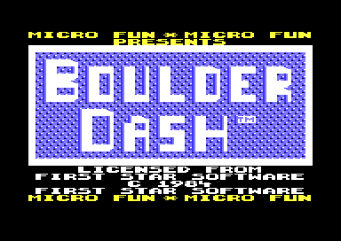
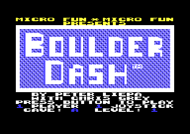
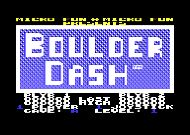

# The title screen

The title is the first screen of the game, and the game returns to it after each game over. It shows the Micro Fun line, the BOULDER DASH logo with a moving background and the licence lines of First Star Software. It plays a two-voice tune. F1 replaces the licence lines with the credits and the options. On the options, F3 selects one or two players and one or two joysticks, and joystick 1 selects the start cave and the level. Fire starts the game. When nobody starts a game, the title plays a demo of cave A after two loops of the tune. After a game, the title shows the last score and the best score of each player.

The title after the load: the options are hidden, and the lower part shows the licence lines (**Observed**).

**Conventions.**
- Addresses are C64 addresses. Names are the names of the knowledge.
- A *title tick* is one call of `title_irq_frame`. The raster interrupt calls it two times in each frame, one time for each split.
- A *wide character* takes two screen cells. The left cell has the code `c` of the text, and the right cell has the code `c + $34`. The title writes all its texts as wide characters.
- The *options are hidden* when `options_hidden` is 1. Then the title shows the licence lines and no options.
- The *cave number* is 1-20, and the *level* is 0-4, shown as 1-5. The start caves are A, E, I and M (cave numbers 1, 5, 9 and 13).
- **Observed** marks a fact that a run showed. **Code** marks a fact from the code only. **Conclusion** marks an interpretation.

## How it works

The top loop starts the title when the cave number is 0. It calls `title_screen_setup` to draw the title, and then `run_title`. The page [main_loop.md](main_loop.md) explains the top loop. [`title_screen_setup` `$861B`](../src/title/run_title.asm#L79) sets the colours, draws the title scene and switches the interrupt to the title mode. Then it waits for the first title tick and resets the tune (**Code**).

~~~mermaid
flowchart TB
  A["Draw the title (title_screen_setup)"] --> B["Pattern to character 0, cave A, demo on (run_title)"]
  B --> C["F3: player mode (options_check_f3)"]
  C --> D["Joystick: level and cave (options_read_joystick)"]
  D --> E{"Options hidden?"}
  E -->|yes, F1| F["Draw the credits and the options"]
  E -->|yes, no F1| H{"Title done?"}
  E -->|no| G["Show the digits, read fire"]
  F --> G
  G --> H
  H -->|no| C
  H -->|"fire, or two tune loops"| I["Game values for the interrupt, status line"]
~~~

[`run_title` `$859B`](../src/title/run_title.asm#L6) does these steps (**Code**):

1. It copies character 11 of the text charset into character 0. Character 0 is the moving pattern of the title.
2. It sets cave A and `demo_mode` = 1. Thus each title starts with cave A, and the demo is on until the player presses fire.
3. It calls `title_options_loop` until `title_done` is 1.
4. It copies the split values of the game to `$54-$5B` and sets the interrupt to the game mode.
5. In demo mode, it sets cave A and level 1.
6. It writes three lives, the cave letter and the level digit into the status line.

[`title_options_loop` `$8518`](../src/title/options.asm#L104) is the loop of the title. It does not wait for the raster. A busy wait in each pass sets its speed. The interrupt plays the tune and moves the pattern at the same time (**Code**).

### The title picture

`title_screen` at `$66E8` holds 1000 screen codes, one full screen of 40 x 25 cells. [`draw_title_screen` `$8227`](../src/title/draw_title_screen.asm#L6) copies bytes 0-767 to `$0800-$0AFF` and bytes 744-999 to `$0EE8-$0FE7`. The address `$0800` is also the map of the cave. Thus the title draws its picture into the map, and the next cave writes the map again (**Code**).

The interrupt shows two screens on the title (**Code**):

| Raster lines | Options hidden | Options shown |
|---|---|---|
| `$28-$C1` | Screen `$0800`: the Micro Fun line and the logo | Screen `$0800` |
| `$C2` to the bottom | Screen `$0C00`: the licence lines from `$0EE8` | Screen `$0800`: the credits or the scores, and the options |

When the options show, the interrupt writes `$28` into the `$D018` value of the lower split. Then the full screen shows `$0800` (**Code**).

The title also uses colour. `title_screen_setup` writes black, black, blue, light blue and brown into `$D020-$D024`. The title is in multicolour text mode (`$D016` = `$18`). `color_status_rows` makes the two top rows yellow, and `color_option_digits` makes the digits of the options light blue. The developer symbol table calls these two routines YELLOW and BLUE (**Code**).

### The moving pattern

The title data fills the background of the logo with character 0, and the pattern of this character moves up. [`title_irq_frame` `$8446`](../src/title/title_animation.asm#L19) counts the title ticks from 1 to 4. At each fourth tick, `rotate_title_char` moves the 8 bytes of character 0 up by one byte. The last byte gets the old first byte. Two ticks come in each frame, so the pattern moves one pixel row each two frames (**Code**).

The pattern must also show around the edges of the letters. [`mask_title_chars` `$842E`](../src/title/title_animation.asm#L6) runs after each rotation. It makes character 9 from character 6 OR character 0, and character 10 from character 7 OR character 0. The title data uses the codes 9 and 10 at the edges of the letters. Thus the moving pattern also fills the free pixels of these cells (**Conclusion**). The developer symbol table calls this routine MASQUE (**Code**).

After the title, the top loop clears character 0. The status line uses the same text charset, and character 0 must be empty there (**Conclusion**).

### The credits page

The credits page after F1: the credits, the player mode, the cave and the level (**Observed**).

F1 opens the credits page only while the options are hidden. `title_options_loop` then sets `show_credits` and draws the title again. `draw_title_screen` selects the lines with `show_credits` OR `demo_mode` (**Code**):

- When one of them is not 0, it writes BY PETER LIEPA, WITH CHRIS GREY and PRESS BUTTON TO PLAY into the rows 19-21.
- Else it writes the score lines.

Then it writes the player line in row 22 and the cave line in row 23, and it clears row 24. At the end it sets `show_credits` to 0. The game text writes the name of Chris Gray as GREY (**Code**).

## The options

The options are three values: the player mode, the start cave and the level. The player mode also sets the number of joysticks (**Code**).

### Players and joysticks

[`options_check_f3` `$8467`](../src/title/options.asm#L6) reads F3, bit 5 of keyboard row 0. Each press adds 1 to `player_mode`, and after 3 it starts at 1 again (**Code**):

| `player_mode` | `two_players` | `two_joysticks` | Screen |
|---|---|---|---|
| 1 | 0 | 0 | 1 PLAYER 1 JOYSTICK |
| 2 | 1 | 0 | 2 PLAYER 1 JOYSTICK |
| 3 | 1 | 1 | 2 PLAYER 2 JOYSTICK |

`show_player_options` writes the new digits, then the routine waits a long delay. F3 also works while the options are hidden, but the screen does not show the change (**Code**). A run pressed F3 four times and saw the modes change. It then played two players with one joystick (**Observed**).

With two joysticks, player 2 moves Rockford with joystick port 2 and starts with fire on port 2. A run did this with player 2 (**Observed**). With one joystick, both players use port 1, and Rockford comes out of the inbox 2 seconds later (**Code**).

### Cave and level

[`options_read_joystick` `$84A2`](../src/title/options.asm#L40) reads joystick port 1 three times in each pass of the loop (**Code**):

1. Down takes 1 from the level, down to level 1.
2. Up adds 1 to the level, up to level 5. When the new level is 4, the start cave becomes A.
3. Left takes 4 from the cave number, down to cave A.
4. Right adds 4 to the cave number, up to cave M. Right works only on the levels 1-3.

The routine compares the full direction value, so a diagonal does nothing. Each move clears `tune_loop_count`, so the demo does not start while a player selects (**Code**).

The rules make one combination impossible. Up from level 3 to level 4 sets cave A. Level 5 comes only from level 4, and down from level 5 keeps the cave. On the levels 4 and 5, right does nothing. Thus the levels 4 and 5 always start in cave A (**Code**). A run selected a cave with right, moved up to level 4 and saw the cave change back to A (**Observed**).

The forum post states that Statesoft fixed a bug of the cave selection. The bug was in the caves E, I and M on the levels 4 and 5. The forum post also states that Micro Fun branched from Statesoft. Thus this rule is probably that fix (**Conclusion**).

### The start of a game

Fire on joystick port 1 starts the game, but only while the options show. `title_options_loop` then writes 0 into `demo_mode` and 1 into `title_done` (**Code**). Thus the first fire after the load does nothing, and the player must press F1 first. The recordings press F1, wait 50 frames and then press fire (**Observed**).

## The title tune

The tune plays on SID voices 1 and 2 with the triangle waveform. [`play_title_tune` `$83AC`](../src/sound/title_tune.asm#L6) runs at each title tick, but it works only when the tick count is odd. Thus the tune moves one step in each frame (**Code**). The developer symbol table calls this routine MUSPLY.

A note lasts 8 steps. `title_note_phase` counts from `$A0` to `$A7`. At `$A0` the routine stops the gate of both voices and reads the next note pair. Then it writes the two frequencies and starts the gate again. In each step, the routine lowers the sustain level of voice 1, so each note of voice 1 fades (**Code**).

[`title_tune_voice2` `$5FE8`](../src/data/title_tune_notes.asm#L6) holds 128 note pairs: the note of voice 2, then the note of voice 1. `tune_index` moves 2 bytes for each note and wraps after 256 bytes. Thus one loop of the tune is 128 notes of 8 frames, or 1024 frames. This is about 20 seconds on a PAL C64 (**Conclusion**).

The notes are in the range `$0F-$3A`. [`tune_freq_table` `$8317`](../src/sound/tune_frequencies.asm#L6) has one SID frequency word for each note `$0A-$3A`, 49 words. The last word, `$2DC0`, is 16 times the first word, `$02DC`. Thus the table covers four octaves in semitone steps (**Code**).

The routine reads the table at `tune_freq_table-$14` with the note times 2. The developer symbol table has FREQ at `$8303`, which is exactly that address. Thus the original source used FREQ as the base of the table, and the first note `$0A` points to the first word (**Conclusion**). In the source, `$8303` is in the middle of `draw_title_screen`. The tune never reads there, because no note is below `$0A` (**Code**).

`init_screens` also copies the 256 bytes of the tune to `$3000-$30FF`, the characters `$00-$1F` of the cave charset (**Code**).

## The demo

### When the demo starts

`demo_mode` is 1 at each title, and only fire clears it. `play_title_tune` adds 1 to `tune_loop_count` at the end of each loop of the tune. In demo mode, the second loop sets `title_done`, and the title ends (**Code**). A press of F3 and a move of the joystick clear the count. Thus the demo starts after 2048 frames without input, about 41 seconds on a PAL C64 (**Conclusion**). A run waited 3000 frames on the title, and the demo code ran. No other run waited that long, and no other run ran the demo code (**Observed**).

`run_title` sets cave A and level 1 for the demo. The top loop then builds the cave and calls [`run_demo` `$8913`](../src/title/demo.asm#L6) in place of `play_cave` (**Code**).

### How the demo plays

`run_demo` replaces the joystick. It reads one byte of `demo_moves` and writes its low 4 bits into `joystick_dir`. Then it calls `scan_cave` as many times as the high 4 bits give. The handler of Rockford reads `joystick_dir` in demo mode, and else it reads the joystick (**Code**).

The demo ends in two cases (**Code**):

- Fire on joystick port 1.
- A byte with the low 4 bits 0. The table ends with `$00`.

`run_demo` does not read `cave_end_state`. Thus the demo continues after a death or after the exit, until the moves end. At the end, `run_demo` counts the time bonus when Rockford reached the exit, and writes 0 into the cave number. The next pass of the top loop shows the title again (**Code**). No run reached this end. F1 in the demo starts the program again, because each tick reads the game keys (**Code**).

### The format of the demo moves

[`demo_moves` `$5EA8`](../src/input/demo_moves.asm#L6) has 63 moves and one end byte (**Code**):

| Bits | Meaning |
|---|---|
| 0-3 | Joystick bits, 0 = pressed: `$E` up, `$D` down, `$B` left, `$7` right, `$F` no direction |
| 4-7 | Count of ticks with this direction |
| `$00` | End of the demo |

The 63 moves take 259 ticks in all (**Code**).

## The score lines

The title after a game over: the score lines PLYR 1, LAST and HIGH, with the options under them (**Observed**).

The score lines are three wide lines of 20 characters. [`init_score_lines` `$895E`](../src/init/init_screens.asm#L6) writes the start values at the first start, and [`copy_scores_to_title` `$8822`](../src/status/scores.asm#L33) fills them at each game over (**Code**):

| Line | Address | Text | Content |
|---|---|---|---|
| Header | `text_plyr_1_plyr_2` | `PLYR 1      PLYR 2` | Fixed text |
| LAST | `$9812` | `000000 LAST 000000` | Score of player 1 at `$9813`, of player 2 at `$981F` |
| HIGH | `$9826` | `000000 HIGH 000000` | Best score of player 1 at `$9827`, of player 2 at `$9833` |

The LAST digits come from the saved copies of the players. They are digits 0-9, so the routine adds `$10` to make screen codes. The HIGH digits are screen codes already (**Code**).

HIGH is not one high score of the game. It is the best score of each player since the load. The best score of a player changes only at the end of a life, and the lines change only at a game over. F1 and RESTORE keep the best scores (**Code**).

`draw_title_screen` shows the score lines when `show_credits` and `demo_mode` are both 0. This is true after a game, because fire cleared `demo_mode`. After a game the options also stay visible, so the title shows the scores and the options together (**Code**). A run lost three lives and came back to the title with these lines (**Observed**).

## The state machine of the title

The title has three pages. `options_hidden`, `show_credits` and `demo_mode` select the page.

~~~mermaid
stateDiagram-v2
  state "Licence lines, options hidden" as Licence
  state "Credits and options" as Credits
  state "Scores and options" as Scores
  state "Game" as Game
  state "Demo" as Demo
  [*] --> Licence: cold start
  Licence --> Credits: F1
  Licence --> Demo: two tune loops
  Credits --> Game: fire
  Credits --> Demo: two tune loops
  Game --> Scores: game over
  Scores --> Game: fire
  Scores --> Demo: two tune loops
  Demo --> Credits: fire or end of the moves
  Demo --> Licence: F1 (cold start)
~~~

| State | Condition | Next state | Code |
|---|---|---|---|
| Licence lines | F1 | Credits and options | `title_options_loop` |
| Licence lines | Two tune loops | Demo | `play_title_tune` |
| Credits and options | Fire on port 1 | Game | `title_options_loop` |
| Credits and options | Two tune loops | Demo | `play_title_tune` |
| Game | No lives left | Scores and options | `lose_life`, `copy_scores_to_title` |
| Scores and options | Fire on port 1 | Game | `title_options_loop` |
| Scores and options | Two tune loops | Demo | `play_title_tune` |
| Demo | Fire or the end byte | Credits and options | `run_demo`, `top_loop` |
| Demo | F1 | Licence lines | `check_game_keys`, `cold_start` |

After the end of the demo, `demo_mode` is still 1, so the title shows the credits. The top loop also clears `options_hidden`, so the options show (**Code**). After a game over, the title draws the scores first. Then `run_title` sets `demo_mode` to 1, so the scores page also leads to the demo (**Code**).

## The worked example: the first demo moves

The first eight bytes of `demo_moves` are `$FF $FF $1E $77 $2D $97 $4F $2D` (**Code**):

| Byte | Ticks | Direction |
|---|---|---|
| `$FF` | 15 | None |
| `$FF` | 15 | None |
| `$1E` | 1 | Up |
| `$77` | 7 | Right |
| `$2D` | 2 | Down |
| `$97` | 9 | Right |
| `$4F` | 4 | None |
| `$2D` | 2 | Down |

The two `$FF` bytes give 30 ticks without a direction at the start. Rockford is in the inbox at this time (**Conclusion**). Then the demo moves up, right and down.

The wide text works in the same way on each line. `text_cave_level` starts with `$20 $23 $21 $36 $25 $1A`, a space and CAVE:. `draw_title_screen` writes `$20 $54`, `$23 $57`, `$21 $55`, `$36 $6A`, `$25 $59` and `$1A $4E` into twelve cells of row 23 (**Code**).

## Still open

- No run reached the end of the demo (`$894F`). A recording that waits 2048 frames on the title and then presses fire can show it.
- It is not known whether the cave shows the characters `$00-$1F` of the cave charset, which hold the tune bytes. A run that compares `$3000-$30FF` with the screen codes of the cave can answer it.
- It is not known how many title ticks Rockford needs to come out of the inbox in the demo. A run of the demo with a trace of `handle_rockford` can give it.
