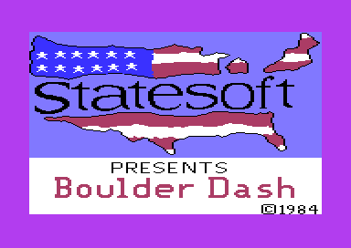

# Boulder Dash v2: the Statesoft build

This is the Statesoft build of Boulder Dash (Peter Liepa with Chris Gray, First Star Software, 1984), the release for the UK market. The program of this project is the game file of the original Statesoft tape, `$5000-$8FFF`, with the cold start at `$8E6A`. The Donald Duck & Co and Roan cracks hold the same game bytes. The pages that the two builds share are in the [group folder](../README.md).

**Evidence.** **Observed** marks a fact that a run showed. **Code** marks a fact from the code only. **Conclusion** marks an interpretation.

## The development

The Statesoft build keeps the First Star Software logo: a multicolour bitmap in the rows 19-24 of the title. Text characters make the words BOULDER and DASH. The Micro Fun build (v1) is a later edit of this source (**Conclusion**, from the leftovers and the forum post). The end of the file holds a part of the symbol table of the developer's assembler, [`symbol_table_leftover` `$8F3D`](src/dev/symbol_table.asm#L6). Its names have the addresses of this build: `KEY1`, `KEY`, `SETUP0`, `GMINIT`, `NXTPLY` and local loop names. For example, `GMINIT` = `$8ADD` is the start of a new game (**Observed**). The table breaks off at `$8FFF`, the end of the file. The details are on [the development page](../docs/development.md).

## The copy protection

The game code of this build has no check (**Code**). The original tape uses a turbo loader that shows the Statesoft picture while the game loads, and then jumps to `$8E6A`. The cracks start the game at `$8E69`, the CLI before the cold start, which is also the target of the NMI vector (**Observed**). The details are on [the copy protection page](../docs/protection.md).

## Findings

- **The game is the v1 game.** Apart from the title, each routine is the v1 routine moved by about `$398` bytes, with other 16-bit operands. The magic wall scan stop, the CIA timer random numbers and the other findings of v1 are true here too (**Observed**: a byte compare). See [../docs/versions.md](../docs/versions.md).
- **The title mixes text and bitmap mode.** A raster split at line `$CA` sets bitmap mode for the First Star logo in the rows 19-24. The same memory at `$2000` is the text charset above the split (**Code**). See [docs/title.md](docs/title.md).
- **The symbol table stays in the default build.** The coverage marks two reads in it, at `$8FE6` and `$8FFC`, so the source generation does not make it a leftover. A trace of the title shows no read there (**Observed**). These are most likely dummy reads of the 6502 (**Conclusion**).

## How the program works

The program works as the Micro Fun build: the [v1 entry page](../v1/README.md) and its subsystem pages explain each part. The addresses of v2 are about `$398` higher from `$6E68` on. The main parts of v2:

1. **The start.** [`cold_start` `$8E6A`](src/init/cold_start.asm#L9) sets up the machine. [`init_screens` `$8D11`](src/init/init_screens.asm#L21) builds the First Star logo into the bitmap rows (**Code**).
2. **The title.** [`draw_title_screen` `$85BF`](src/title/draw_title_screen.asm#L6) draws the logo words into the map and a frame around them (**Code**).
3. **The main loop.** [`play_cave` `$8C92`](src/engine/play_loop.asm#L6) calls [`scan_cave` `$8171`](src/engine/cave_scan.asm#L39) once in each tick (**Code**).
4. **The interrupt.** [`irq_handler` `$8A0C`](src/irq/irq_handler.asm#L6) sets the raster splits, reads the keys and calls the frame work (**Code**).

## The pages

| Page | Content |
|---|---|
| [docs/title.md](docs/title.md) | **The Statesoft title.** The start screen of the tape, the logo words, the First Star bitmap logo and how the title differs from v1. |
| [../v1/README.md](../v1/README.md) | **The Micro Fun build.** The pages of the engine, Rockford, the screen, the status line and the sound, which are the same in v2. |
| [../docs/cave_format.md](../docs/cave_format.md) | **The cave format.** The data of the 20 caves, shared with v1. |

## The releases

| Label | File | SHA-256 |
|---|---|---|
| STATESOFT | `original/Boulder Dash (1984)(State Soft).tap` | `6b2fd79a36084dc0a35474704879f005b87fb59cf529d69cb5ca915025a0a1bc` |
| DDC | `original/BoulderDash-DonaldDuck&Co.d64` | `71bc27c343b8931948fe804684ceeeee02233fc5345268cec21836b25a975612` |
| ROAN | `original/boulderdash-Roan-Cardboard5.d64` | `bf95c01dc2f55445676bc43f452c426a9f4ec2088c4c78bc2b7b3bce0eb93954` |

- **STATESOFT**: the original tape, a TAP dump of 1996 from Planet Emulation. A turbo loader shows the Statesoft picture and loads the game file `$5000-$8FFF`.
- **DDC** (CSDb 150877): a boot at `$0302` loads the file `BOULDER 1` (`$5000-$9001`) and jumps to `$8E69`. The two bytes after the game, `FF 00`, are not part of the program (**Observed**).
- **ROAN** (CSDb 199178): a memory image `BD` (`$0801-$A000`) holds the game at `$5000`. The files `BDE000` and `BD1` hold the Statesoft picture without its colour RAM. Its bitmap has 32 KERNAL bytes at `$FD30-$FD4F` (**Observed**). No code of the release shows the picture.

The three releases hold the same bytes `$5000-$8FFF`. The details are on [the releases page](../docs/releases.md).

## The rebuild

The base release is STATESOFT. The program of the knowledge is its game file. The entry state comes from the boot of the Donald Duck & Co disk, which starts at `$8E69`. The tape leaves `$01` = `$27`. The PLAY key of the recorder holds the cassette sense line low, and a loader cannot set that line (**Observed**: the check of the loader). The game sets `$01` = `$36` at its cold start, so the difference does not matter (**Code**).

The start screen of the rebuild is the Statesoft loading picture. It comes from a capture of the tape loader while it shows the picture, with its colour RAM, in the space `loading` of the knowledge. The loader shows it, waits for a key or a fire button, and then starts the game. The border has the colour of one moment of the flashing border of the tape loader (**Observed**).

The knowledge has no switch: the cracks changed no byte of the game, and the program has no trainer and no correction.

- The default build: `build src main.asm` of the c64-assembler skill gives `build/clean.prg`. `generate --loader` of the c64-source skill gives the verified loader `build/clean_loader.prg`, with the start screen.
- The releases: `build src main.asm --release STATESOFT --compare` gives the game file byte for byte. The builds of DDC and ROAN also match (**Observed**).

Seven recordings of scripted play replay on the default build. The replays compare the state at each tick of the cave scan, 4133 ticks in all. The state is the cave map, the lives, the cave and the level. It also has the score, the diamonds, the exit flag, the end state and the position of Rockford. Each tick has the state of the original (**Observed**). The notes of the tests are in [tests/README.md](tests/README.md).

## Still open

- Code that no run executed: 33 ranges, as in v1. A recording of a longer play in the caves with butterflies and the amoeba can reach most of them.
- The two coverage reads in the symbol table. A trace of each recording can find the instruction.

## The reference

[docs/reference/index.md](docs/reference/index.md)
