<!-- Generated by c64-docs from knowledge revision 20261024T103116.823-byvbsh and .c64-re-tools/local/generated/src/source-map.json. Do not edit: change the knowledge, generate the source again, then run docs.ts generate. -->
# Graphics

Each sprite, bitmap, charset and screen region of the knowledge. The knowledge gives no display mode and no colours, so a sprite, bitmap or charset shows in hires and in multicolour, in pattern colours: black is pixel value 0, white is 1 in hires; in multicolour light grey is 1, grey is 2 and yellow is 3. Index: [the reference](index.md).

## [`text_chars_2000` `$5000`](../../src/data/text_charset.asm#L6) `$5000-$53AF`

*charset*

Multicolour characters $00-$75. The set-up copies $5000-$53ff to the character set at $2000. Digits are $10-$19 plus $44-$4d, letters $21-$3a plus $55-$6e.

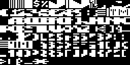

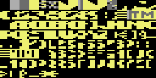

## [`amoeba_glyph_tl` `$5406`](../../src/data/element_glyphs.asm#L6) `$5406-$5505`

*charset*

Eight amoeba frames, 16 bytes each: left and right top character. Animation copies them to $40-$41/$50-$51 (cells $3a-$3b) if $ff is 4 or more.

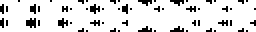

## [`firefly_glyph_tl` `$5506`](../../src/data/element_glyphs.asm#L44) `$5506-$5605`

*charset*

Eight firefly frames, 16 bytes each: left and right top character. Animation copies them to $64-$65/$74-$75 (cells $08-$0f) if bit 0 of $ff is 1.

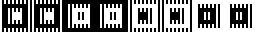

## [`diamond_glyph_tl` `$5606`](../../src/data/element_glyphs.asm#L82) `$5606-$5705`

*charset*

Eight diamond frames, 16 bytes each: left and right top character. Animation copies them to $48-$49/$58-$59 (cells $14-$17) in each cave.

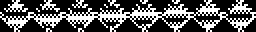

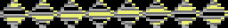

## [`butterfly_glyph_tl` `$5706`](../../src/data/element_glyphs.asm#L120) `$5706-$5805`

*charset*

Eight butterfly frames, 16 bytes each: left and right top character. Animation copies them to $20-$21/$30-$31 (cells $30-$37) if bit 1 of $ff is 1.

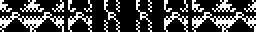

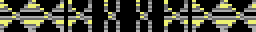

## [`cell_chars_3100` `$60E8`](../../src/data/cell_charset.asm#L6) `$60E8-$63E7`

*charset*

Characters $20-$7f of the cave character set at $3000. Four characters show one cell: n and n+1 on top, n+16 and n+17 below.
Copied to $3100: characters $20-$3f.

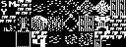

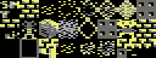

## [`rockford_blink_tl` `$63E8`](../../src/rockford/rockford_glyphs.asm#L6) `$63E8-$66E7`

*charset*

Eight frames of the top of Rockford with blinking eyes, 16 bytes each (left and right character). Used at random when the joystick is idle. The animation copies the top frames to characters $4c-$4d and the bottom frames to $5c-$5d of the cave character set.

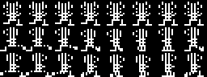

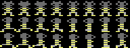
