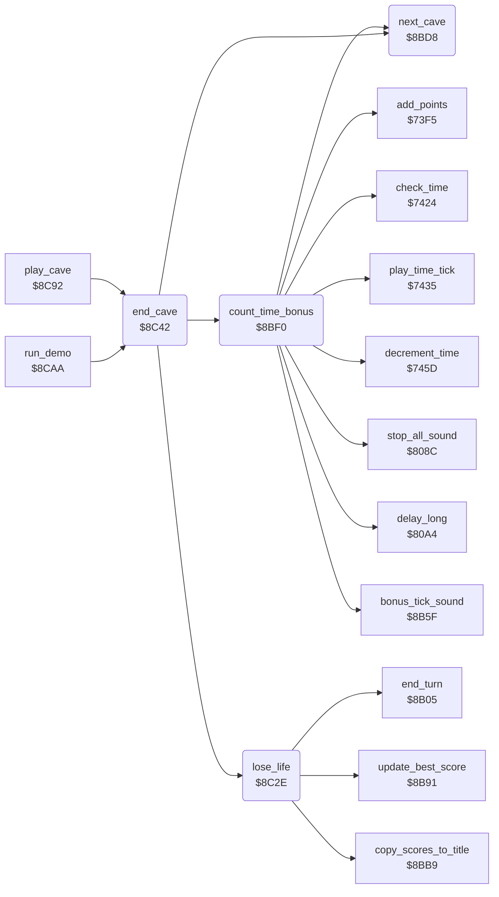

<!-- Generated by c64-docs from knowledge revision 20261025T214622.009-09wod3 and .c64-re-tools/local/generated/src/source-map.json. Do not edit: change the knowledge, generate the source again, then run docs.ts generate. -->
# cave/cave_end.asm: End of a cave

Range `$8BD8-$8C91`. Source: [cave/cave_end.asm](../../../../src/cave/cave_end.asm). Index: [the reference](../../index.md).

## Routines

| Routine | Address | Reached from | Summary |
|---|---|---|---|
| [`next_cave`](cave_end.md#next_cave) | `$8BD8` | [`count_time_bonus`](cave_end.md#count_time_bonus), [`end_cave`](cave_end.md#end_cave) | Sets cave_number to the next cave from the cave table. |
| [`count_time_bonus`](cave_end.md#count_time_bonus) | `$8BF0` | [`end_cave`](cave_end.md#end_cave) | Counts the remaining time down to 0. |
| [`lose_life`](cave_end.md#lose_life) | `$8C2E` | [`end_cave`](cave_end.md#end_cave) | After a lost life: updates the best score and changes turns. |
| [`end_cave`](cave_end.md#end_cave) | `$8C42` | [`play_cave`](../engine/play_loop.md#play_cave), [`run_demo`](../title/demo.md#run_demo) | Ends a cave: the exit gives the time bonus, a death in an intermission goes on, another death costs a life. |

## Call graph

A solid arrow is a call, a thick arrow a table entry. Rounded nodes are in this file.

## Details

### [`next_cave`](../../../../src/cave/cave_end.asm#L6) `$8BD8`

*routine*

Sets cave_number to the next cave from the cave table. After intermission 4 it sets cave A and the next level, at most 4.

- **Called from:** [`count_time_bonus`](cave_end.md#count_time_bonus), [`end_cave`](cave_end.md#end_cave)
- **Reads:** [`cave_number`](../../memory-map.md#cave_number), [`cave_sequence_base`](../status/decimal.md#cave_sequence_base), [`level`](../../memory-map.md#level)
- **Writes:** [`level`](../../memory-map.md#level), [`cave_number`](../../memory-map.md#cave_number)
- **Refers to:** [`cave_sequence`](sequence.md#cave_sequence)

| Label | Address | Comment |
|---|---|---|
| [`next_cave_wrap`](../../../../src/cave/cave_end.asm#L18) | `$8BEB` |  |
| [`next_cave_store`](../../../../src/cave/cave_end.asm#L20) | `$8BED` |  |

### [`count_time_bonus`](../../../../src/cave/cave_end.asm#L24) `$8BF0`

*routine*

Counts the remaining time down to 0. Each unit adds level plus 1 to the score with a sound. Then goes to the next cave.

- **Called from:** [`end_cave`](cave_end.md#end_cave)
- **Calls:** [`check_time`](../status/score_time.md#check_time), [`stop_all_sound`](../sound/voices_off.md#stop_all_sound), [`decrement_time`](../status/score_time.md#decrement_time), [`add_points`](../status/score_time.md#add_points), [`bonus_tick_sound`](../sound/bonus_sound.md#bonus_tick_sound), [`play_time_tick`](../status/score_time.md#play_time_tick), [`delay_long`](../input/game_keys.md#delay_long), [`next_cave`](cave_end.md#next_cave)
- **Reads:** [`level`](../../memory-map.md#level), [`cave_end_state`](../../memory-map.md#cave_end_state)
- **Writes:** [`points_to_add`](../../memory-map.md#points_to_add), [`diamond_points_tens`](../../memory-map.md#diamond_points_tens), [`cave_end_state`](../../memory-map.md#cave_end_state), [`view_row_ptrs`](../../memory-map.md#view_row_ptrs), [`view_row_ptrs_hi`](../../memory-map.md#view_row_ptrs_hi)

| Label | Address | Comment |
|---|---|---|
| [`time_bonus_clear`](../../../../src/cave/cave_end.asm#L27) | `$8BF4` |  |
| [`time_bonus_loop`](../../../../src/cave/cave_end.asm#L43) | `$8C12` |  |
| [`time_bonus_done`](../../../../src/cave/cave_end.asm#L50) | `$8C21` |  |

### [`lose_life`](../../../../src/cave/cave_end.asm#L57) `$8C2E`

*routine*

After a lost life: updates the best score and changes turns. At game over it goes back to the title and fills the score lines.

- **Called from:** [`end_cave`](cave_end.md#end_cave)
- **Calls:** [`update_best_score`](../status/scores.md#update_best_score), [`end_turn`](../status/players.md#end_turn), [`copy_scores_to_title`](../status/scores.md#copy_scores_to_title)
- **Reads:** [`game_over`](../../memory-map.md#game_over)
- **Writes:** [`cave_number`](../../memory-map.md#cave_number), [`level`](../../memory-map.md#level)

| Label | Address | Comment |
|---|---|---|
| [`lose_life_done`](../../../../src/cave/cave_end.asm#L66) | `$8C41` |  |

### [`end_cave`](../../../../src/cave/cave_end.asm#L69) `$8C42`

*routine*

Ends a cave: the exit gives the time bonus, a death in an intermission goes on, another death costs a life. Updates the status line.

- **Called from:** [`play_cave`](../engine/play_loop.md#play_cave), [`run_demo`](../title/demo.md#run_demo)
- **Calls:** [`count_time_bonus`](cave_end.md#count_time_bonus), [`next_cave`](cave_end.md#next_cave), [`lose_life`](cave_end.md#lose_life)
- **Reads:** [`exit_reached`](../../memory-map.md#exit_reached), [`intermission_flag`](../../memory-map.md#intermission_flag), [`demo_mode`](../../memory-map.md#demo_mode), [`current_player`](../../memory-map.md#current_player), [`lives`](../../memory-map.md#lives), [`cave_number`](../../memory-map.md#cave_number), [`level`](../../memory-map.md#level)
- **Writes:** [`pause_flag`](../../memory-map.md#pause_flag), [`status_line_text`](../../memory-map.md#status_line_text), [`cave_clock_on`](../../memory-map.md#cave_clock_on)

| Label | Address | Comment |
|---|---|---|
| [`end_cave_no_exit`](../../../../src/cave/cave_end.asm#L76) | `$8C50` | A death in an intermission costs no life. |
| [`end_cave_lost_life`](../../../../src/cave/cave_end.asm#L82) | `$8C5A` |  |
| [`end_cave_status`](../../../../src/cave/cave_end.asm#L84) | `$8C5D` |  |
| [`end_cave_men_text`](../../../../src/cave/cave_end.asm#L100) | `$8C7A` |  |
| [`end_cave_done`](../../../../src/cave/cave_end.asm#L110) | `$8C8D` |  |
