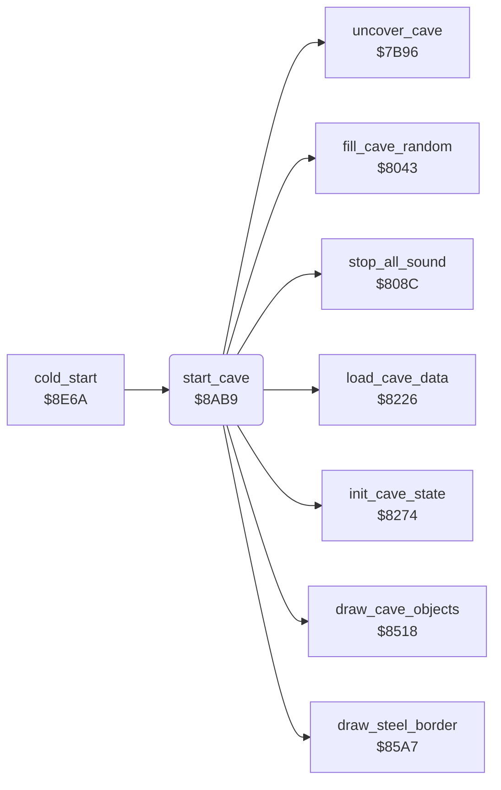

<!-- Generated by c64-docs from knowledge revision 20261025T214622.009-09wod3 and .c64-re-tools/local/generated/src/source-map.json. Do not edit: change the knowledge, generate the source again, then run docs.ts generate. -->
# cave/cave_start.asm: Start of a cave

Range `$8AB9-$8ADC`. Source: [cave/cave_start.asm](../../../../src/cave/cave_start.asm). Index: [the reference](../../index.md).

## Routines

| Routine | Address | Reached from | Summary |
|---|---|---|---|
| [`start_cave`](cave_start.md#start_cave) | `$8AB9` | [`cold_start`](../init/cold_start.md#cold_start) | Prepares cave_number at level: decodes it, draws the outer wall and the objects, resets the cave variables and the scroll, silences the sound. |

## Call graph

A solid arrow is a call, a thick arrow a table entry. Rounded nodes are in this file.

## Details

### [`start_cave`](../../../../src/cave/cave_start.asm#L6) `$8AB9`

*routine*

Prepares cave_number at level: decodes it, draws the outer wall and the objects, resets the cave variables and the scroll, silences the sound.
SETUP0 in the developer symbol table.

- **Called from:** [`cold_start`](../init/cold_start.md#cold_start)
- **Calls:** [`load_cave_data`](setup.md#load_cave_data), [`fill_cave_random`](random_fill.md#fill_cave_random), [`draw_steel_border`](steel_border.md#draw_steel_border), [`draw_cave_objects`](draw_objects.md#draw_cave_objects), [`init_cave_state`](setup.md#init_cave_state), [`uncover_cave`](../screen/cover.md#uncover_cave), [`stop_all_sound`](../sound/voices_off.md#stop_all_sound)
- **Writes:** [`scroll_y_speed`](../../memory-map.md#scroll_y_speed), [`scroll_y_speed_hi`](../../memory-map.md#scroll_y_speed_hi), [`scroll_x_speed`](../../memory-map.md#scroll_x_speed), [`scroll_x_speed_hi`](../../memory-map.md#scroll_x_speed_hi), [`cave_covered`](../../memory-map.md#cave_covered)
