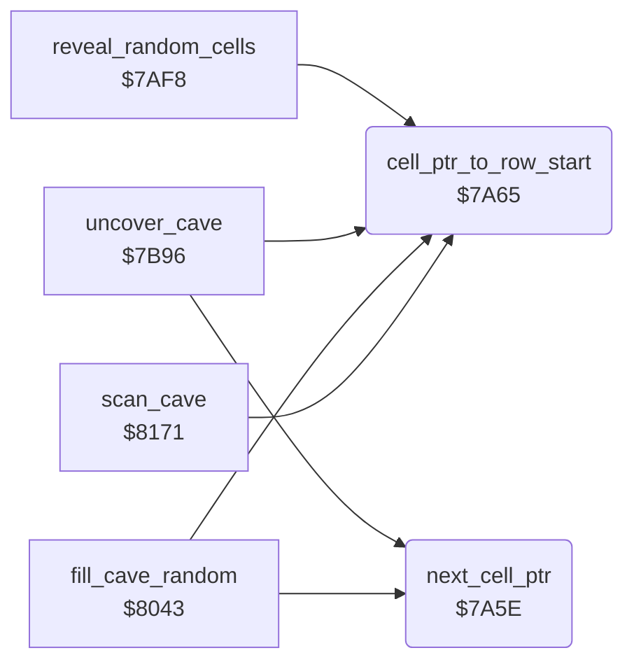

<!-- Generated by c64-docs from knowledge revision 20261024T103116.823-byvbsh and .c64-re-tools/local/generated/src/source-map.json. Do not edit: change the knowledge, generate the source again, then run docs.ts generate. -->
# cave/cell_ptr.asm: Cell pointer

Range `$7A5E-$7A72`. Source: [cave/cell_ptr.asm](../../../../src/cave/cell_ptr.asm). Index: [the reference](../../index.md).

## Call graph

A solid arrow is a call, a thick arrow a table entry, a dotted arrow a jump. Rounded nodes are in this file.

## Names

### [`next_cell_ptr`](../../../../src/cave/cell_ptr.asm#L6) `$7A5E`

*routine*

Increments cell_ptr by one cell.

- **Called from:** [`uncover_cave`](../screen/cover.md#uncover_cave) [`$7BAB`](../../../../src/screen/cover.asm#L189), [`fill_cave_random`](random_fill.md#fill_cave_random) [`$8051`](../../../../src/cave/random_fill.asm#L32)
- **Reads:** [`cell_ptr`](../../memory-map.md#cell_ptr), [`cell_ptr_hi`](../../memory-map.md#cell_ptr_hi)
- **Writes:** [`cell_ptr`](../../memory-map.md#cell_ptr), [`cell_ptr_hi`](../../memory-map.md#cell_ptr_hi)

### [`next_cell_ptr_done`](../../../../src/cave/cell_ptr.asm#L10) `$7A64`

*label*

- **Jumped to from:** [`next_cell_ptr`](cell_ptr.md#next_cell_ptr) [`$7A60`](../../../../src/cave/cell_ptr.asm#L8)

### [`cell_ptr_to_row_start`](../../../../src/cave/cell_ptr.asm#L13) `$7A65`

*routine*

Sets cell_ptr for the first cell of cave row 0 (Z = 1) or cave row 1 (Z = 0).

- **Called from:** [`reveal_random_cells`](../screen/cover.md#reveal_random_cells) [`$7B00`](../../../../src/screen/cover.asm#L99), [`uncover_cave`](../screen/cover.md#uncover_cave) [`$7B9D`](../../../../src/screen/cover.asm#L181), [`fill_cave_random`](random_fill.md#fill_cave_random) [`$8047`](../../../../src/cave/random_fill.asm#L26), [`scan_cave`](../engine/cave_scan.md#scan_cave) [`$8183`](../../../../src/engine/cave_scan.asm#L50)
- **Writes:** [`cell_ptr`](../../memory-map.md#cell_ptr), [`cell_ptr_hi`](../../memory-map.md#cell_ptr_hi)

### [`cell_ptr_to_row_start_set`](../../../../src/cave/cell_ptr.asm#L16) `$7A69`

*label*

- **Jumped to from:** [`cell_ptr_to_row_start`](cell_ptr.md#cell_ptr_to_row_start) [`$7A65`](../../../../src/cave/cell_ptr.asm#L14)
