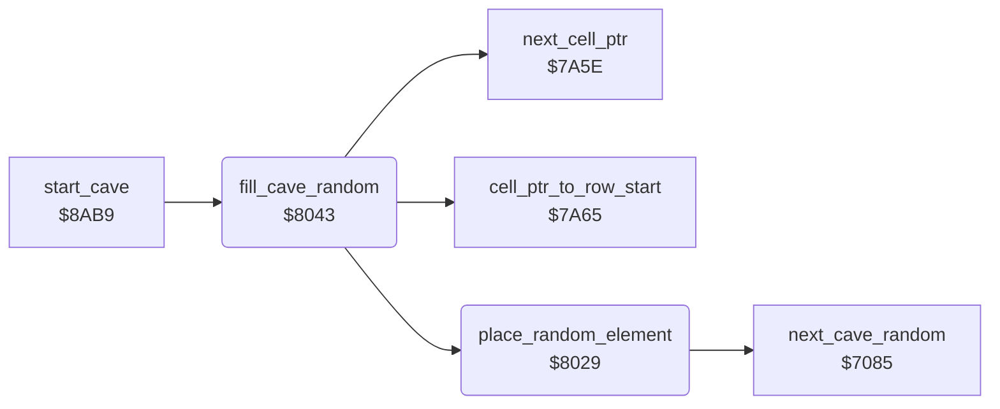

<!-- Generated by c64-docs from knowledge revision 20261025T214622.009-09wod3 and .c64-re-tools/local/generated/src/source-map.json. Do not edit: change the knowledge, generate the source again, then run docs.ts generate. -->
# cave/random_fill.asm: Random fill of the cave

Range `$8029-$8064`. Source: [cave/random_fill.asm](../../../../src/cave/random_fill.asm). Index: [the reference](../../index.md).

## Routines

| Routine | Address | Reached from | Summary |
|---|---|---|---|
| [`place_random_element`](random_fill.md#place_random_element) | `$8029` | [`fill_cave_random`](random_fill.md#fill_cave_random) | Writes a random element to the scan cell. |
| [`fill_cave_random`](random_fill.md#fill_cave_random) | `$8043` | [`start_cave`](cave_start.md#start_cave) | Fills 21 rows of 40 cells, from the second cave row on, with the random elements of the cave. |

## Call graph

A solid arrow is a call, a thick arrow a table entry. Rounded nodes are in this file.

## Details

### [`place_random_element`](../../../../src/cave/random_fill.asm#L6) `$8029`

*routine*

Writes a random element to the scan cell. Input: cell pointer $32. Output: A is the element.
Dirt is the default element.

- **Called from:** [`fill_cave_random`](random_fill.md#fill_cave_random)
- **Calls:** [`next_cave_random`](cave_random.md#next_cave_random)
- **Reads:** [`cave_random_odds`](../../memory-map.md#cave_random_odds), [`cave_random_elements`](../../memory-map.md#cave_random_elements), [`cell_ptr`](../../memory-map.md#cell_ptr)

| Label | Address | Comment |
|---|---|---|
| [`place_random_test`](../../../../src/cave/random_fill.asm#L10) | `$8030` | A number below the odds byte selects the random element. The last match wins. |
| [`place_random_next`](../../../../src/cave/random_fill.asm#L14) | `$8038` |  |

### [`fill_cave_random`](../../../../src/cave/random_fill.asm#L23) `$8043`

*routine*

Fills 21 rows of 40 cells, from the second cave row on, with the random elements of the cave.

- **Called from:** [`start_cave`](cave_start.md#start_cave)
- **Calls:** [`cell_ptr_to_row_start`](cell_ptr.md#cell_ptr_to_row_start), [`place_random_element`](random_fill.md#place_random_element), [`next_cell_ptr`](cell_ptr.md#next_cell_ptr)
- **Reads:** [`scan_col`](../../memory-map.md#scan_col), [`scan_row`](../../memory-map.md#scan_row)
- **Writes:** [`scan_row`](../../memory-map.md#scan_row), [`scan_col`](../../memory-map.md#scan_col)

| Label | Address | Comment |
|---|---|---|
| [`fill_random_row`](../../../../src/cave/random_fill.asm#L27) | `$804A` |  |
| [`fill_random_cell`](../../../../src/cave/random_fill.asm#L30) | `$804E` |  |
