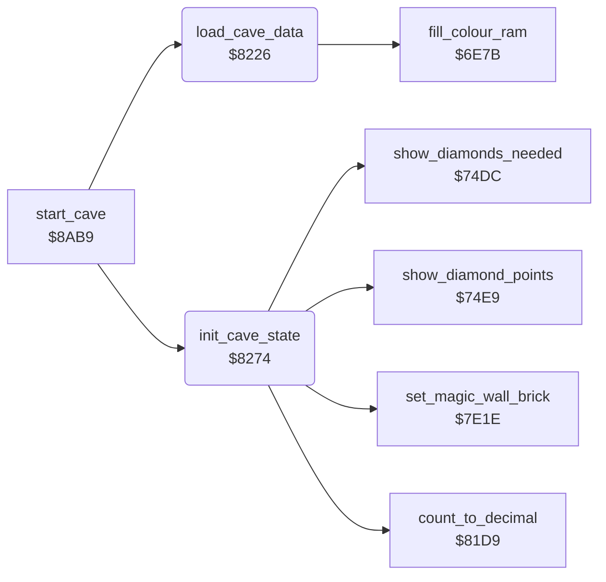

<!-- Generated by c64-docs from knowledge revision 20261024T103116.823-byvbsh and .c64-re-tools/local/generated/src/source-map.json. Do not edit: change the knowledge, generate the source again, then run docs.ts generate. -->
# cave/setup.asm: Cave set-up

Range `$8226-$8335`. Source: [cave/setup.asm](../../../../src/cave/setup.asm). Index: [the reference](../../index.md).

## Call graph

A solid arrow is a call, a thick arrow a table entry, a dotted arrow a jump. Rounded nodes are in this file.

## Names

### [`load_cave_data`](../../../../src/cave/setup.asm#L6) `$8226`

*routine*

Copies the 240 bytes of cave data to cave_data when the cave changed. Sets the level seed and the cave colours.

- **Called from:** [`start_cave`](cave_start.md#start_cave) [`$8AB9`](../../../../src/cave/cave_start.asm#L7)
- **Calls:** [`fill_colour_ram`](../screen/colour_ram.md#fill_colour_ram)
- **Reads:** [`cave_number`](../../memory-map.md#cave_number), [`decoded_cave`](../../memory-map.md#decoded_cave), [`count_to_decimal_done`](../status/decimal.md#count_to_decimal_done), [`cave_data_offsets_base`](../data/element_glyphs.md#cave_data_offsets_base), [`cave_data_offsets_base_hi`](../data/element_glyphs.md#cave_data_offsets_base_hi), [`cave_data_ptr`](../../memory-map.md#cave_data_ptr), [`level`](../../memory-map.md#level), [`cave_seeds`](../../memory-map.md#cave_seeds), [`cave_color1`](../../memory-map.md#cave_color1), [`cave_color2`](../../memory-map.md#cave_color2), [`cave_color3`](../../memory-map.md#cave_color3)
- **Writes:** [`decoded_cave`](../../memory-map.md#decoded_cave), [`intermission_flag`](../../memory-map.md#intermission_flag), [`cave_data_ptr`](../../memory-map.md#cave_data_ptr), [`cave_data_ptr_hi`](../../memory-map.md#cave_data_ptr_hi), [`cave_data`](../../memory-map.md#cave_data), [`random_seed1`](../../memory-map.md#random_seed1), [`random_seed_copy`](../../memory-map.md#random_seed_copy), [`random_seed2`](../../memory-map.md#random_seed2), [`random_seed_copy_hi`](../../memory-map.md#random_seed_copy_hi), [`BGCOL1`](../../memory-map.md#BGCOL1), [`BGCOL2`](../../memory-map.md#BGCOL2)
- **Refers to:** [`cave_sequence`](sequence.md#cave_sequence)

### [`load_cave_copy`](../../../../src/cave/setup.asm#L23) `$8246`

*label*

- **Jumped to from:** [`load_cave_data`](setup.md#load_cave_data) [`$824E`](../../../../src/cave/setup.asm#L28)

### [`load_cave_level`](../../../../src/cave/setup.asm#L29) `$8250`

*label*

- **Jumped to from:** [`load_cave_data`](setup.md#load_cave_data) [`$822A`](../../../../src/cave/setup.asm#L9)

### [`init_cave_state`](../../../../src/cave/setup.asm#L46) `$8274`

*routine*

Sets the variables for the play of a cave: counters, delay, time, diamonds needed, diamond values, birth countdown, amoeba speed and animations.

- **Called from:** [`start_cave`](cave_start.md#start_cave) [`$8AC5`](../../../../src/cave/cave_start.asm#L11)
- **Calls:** [`set_magic_wall_brick`](../engine/magic_wall.md#set_magic_wall_brick), [`count_to_decimal`](../status/decimal.md#count_to_decimal), [`show_diamonds_needed`](../status/score_time.md#show_diamonds_needed), [`show_diamond_points`](../status/score_time.md#show_diamond_points)
- **Reads:** [`level`](../../memory-map.md#level), [`level_row_delays`](../engine/row_delay.md#level_row_delays), [`cave_times`](../../memory-map.md#cave_times), [`decimal_digits`](../../memory-map.md#decimal_digits), [`cave_diamonds_needed`](../../memory-map.md#cave_diamonds_needed), [`decimal_digits+1`](../../memory-map.md#decimal_digits), [`cave_diamond_value`](../../memory-map.md#cave_diamond_value), [`cave_extra_value`](../../memory-map.md#cave_extra_value), [`exit_reached`](../../memory-map.md#exit_reached), [`two_joysticks`](../../memory-map.md#two_joysticks), [`two_players`](../../memory-map.md#two_players), [`cave_number`](../../memory-map.md#cave_number), [`birth_countdown`](../../memory-map.md#birth_countdown), [`cave_anim_flags_table`](../data/cave_animations.md#cave_anim_flags_table)
- **Writes:** [`amoeba_room_found`](../../memory-map.md#amoeba_room_found), [`amoeba_room_last`](../../memory-map.md#amoeba_room_last), [`rockford_absent`](../../memory-map.md#rockford_absent), [`cave_end_state`](../../memory-map.md#cave_end_state), [`magic_wall_state`](../../memory-map.md#magic_wall_state), [`magic_wall_frames`](../../memory-map.md#magic_wall_frames), [`magic_wall_seconds`](../../memory-map.md#magic_wall_seconds), [`enough_diamonds`](../../memory-map.md#enough_diamonds), [`amoeba_count`](../../memory-map.md#amoeba_count), [`seconds_elapsed`](../../memory-map.md#seconds_elapsed), [`clock_frames`](../../memory-map.md#clock_frames), [`exit_reached`](../../memory-map.md#exit_reached), [`pause_flag`](../../memory-map.md#pause_flag), [`sound1_rate`](../../memory-map.md#sound1_rate), [`row_delay`](../../memory-map.md#row_delay), [`cave_time`](../../memory-map.md#cave_time), [`decimal_count`](../../memory-map.md#decimal_count), [`time_digits`](../../memory-map.md#time_digits), [`status_time`](../../memory-map.md#status_time), [`diamonds_needed`](../../memory-map.md#diamonds_needed), [`diamond_points`](../../memory-map.md#diamond_points), [`extra_diamond_points`](../../memory-map.md#extra_diamond_points), [`diamonds_collected`](../../memory-map.md#diamonds_collected), [`diamonds_collected_ones`](../../memory-map.md#diamonds_collected_ones), [`status_collected`](../../memory-map.md#status_collected), [`status_collected+1`](../../memory-map.md#status_collected), [`amoeba_growing`](../../memory-map.md#amoeba_growing), [`rockford_waiting`](../../memory-map.md#rockford_waiting), [`birth_countdown`](../../memory-map.md#birth_countdown), [`amoeba_grow_mask`](../../memory-map.md#amoeba_grow_mask), [`cave_anim_flags`](../../memory-map.md#cave_anim_flags)

### [`init_cave_time`](../../../../src/cave/setup.asm#L71) `$82AA`

*label*

Time digits to the status line.

- **Jumped to from:** [`init_cave_state`](setup.md#init_cave_state) [`$82B4`](../../../../src/cave/setup.asm#L77)

### [`init_cave_needed`](../../../../src/cave/setup.asm#L83) `$82C2`

*label*

- **Jumped to from:** [`init_cave_state`](setup.md#init_cave_state) [`$82C7`](../../../../src/cave/setup.asm#L87)

### [`init_cave_value`](../../../../src/cave/setup.asm#L93) `$82D6`

*label*

- **Jumped to from:** [`init_cave_state`](setup.md#init_cave_state) [`$82DB`](../../../../src/cave/setup.asm#L97)

### [`init_cave_extra_value`](../../../../src/cave/setup.asm#L102) `$82E7`

*label*

- **Jumped to from:** [`init_cave_state`](setup.md#init_cave_state) [`$82EC`](../../../../src/cave/setup.asm#L106)

### [`init_cave_check_b`](../../../../src/cave/setup.asm#L127) `$8319`

*label*

- **Jumped to from:** [`init_cave_state`](setup.md#init_cave_state) [`$830B`](../../../../src/cave/setup.asm#L120), [`init_cave_state`](setup.md#init_cave_state) [`$8313`](../../../../src/cave/setup.asm#L124)

### [`init_cave_slow_amoeba`](../../../../src/cave/setup.asm#L132) `$8321`

*label*

- **Jumped to from:** [`init_cave_state`](setup.md#init_cave_state) [`$831D`](../../../../src/cave/setup.asm#L130)

### [`init_cave_done`](../../../../src/cave/setup.asm#L143) `$8335`

*label*

- **Jumped to from:** [`init_cave_state`](setup.md#init_cave_state) [`$832D`](../../../../src/cave/setup.asm#L139)
