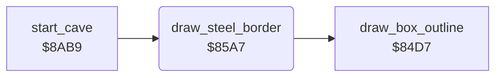

<!-- Generated by c64-docs from knowledge revision 20261024T103116.823-byvbsh and .c64-re-tools/local/generated/src/source-map.json. Do not edit: change the knowledge, generate the source again, then run docs.ts generate. -->
# cave/steel_border.asm: Steel border of the cave

Range `$85A7-$85BE`. Source: [cave/steel_border.asm](../../../../src/cave/steel_border.asm). Index: [the reference](../../index.md).

## Call graph

A solid arrow is a call, a thick arrow a table entry, a dotted arrow a jump. Rounded nodes are in this file.

## Names

### [`draw_steel_border`](../../../../src/cave/steel_border.asm#L6) `$85A7`

*routine*

Draws the steel wall edge of the cave: 40 by 22 cells from map row 2.
OUTWAL in the developer symbol table of the Micro Fun build.

- **Called from:** [`start_cave`](cave_start.md#start_cave) [`$8ABF`](../../../../src/cave/cave_start.asm#L9)
- **Calls:** [`draw_box_outline`](draw_objects.md#draw_box_outline)
- **Writes:** [`object_element`](../../memory-map.md#object_element), [`object_x`](../../memory-map.md#object_x), [`object_y`](../../memory-map.md#object_y), [`object_width`](../../memory-map.md#object_width), [`object_height`](../../memory-map.md#object_height)
