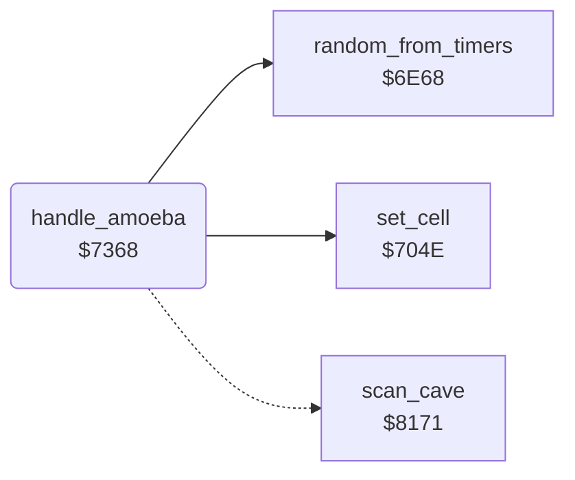

<!-- Generated by c64-docs from knowledge revision 20261024T103116.823-byvbsh and .c64-re-tools/local/generated/src/source-map.json. Do not edit: change the knowledge, generate the source again, then run docs.ts generate. -->
# engine/amoeba.asm: Amoeba

Range `$7364-$73D0`. Source: [engine/amoeba.asm](../../../../src/engine/amoeba.asm). Index: [the reference](../../index.md).

## Call graph

A solid arrow is a call, a thick arrow a table entry, a dotted arrow a jump. Rounded nodes are in this file.

## Data

| Range | Type | Name | Read by | Written by |
|---|---|---|---|---|
| [`$7364`](../../../../src/engine/amoeba.asm#L7)-`$7367` | bytes | [`amoeba_neighbours`](../../../../src/engine/amoeba.asm#L6) | [`handle_amoeba`](amoeba.md#handle_amoeba) |  |

## Names

### [`amoeba_neighbours`](../../../../src/engine/amoeba.asm#L6) `$7364-$7367`

*data*

Cell offsets of the four neighbours that the amoeba grows into: up, left, right, down.

- **Read by:** [`handle_amoeba`](amoeba.md#handle_amoeba) [`$7392`](../../../../src/engine/amoeba.asm#L33), [`handle_amoeba`](amoeba.md#handle_amoeba) [`$73B4`](../../../../src/engine/amoeba.asm#L52)

### [`handle_amoeba`](../../../../src/engine/amoeba.asm#L9) `$7368`

*routine*

Handler of the amoeba $3a. Counts the cells, becomes boulders at 200 cells or diamonds when enclosed, else grows at random into space or dirt.

- **Calls:** [`set_cell`](cell_draw.md#set_cell), [`random_from_timers`](random.md#random_from_timers)
- **Jumps to:** [`scan_cell_settle`](cave_scan.md#scan_cell_settle)
- **Reads:** [`amoeba_count`](../../memory-map.md#amoeba_count), [`amoeba_count_last`](../../memory-map.md#amoeba_count_last), [`amoeba_growing`](../../memory-map.md#amoeba_growing), [`amoeba_room_found`](../../memory-map.md#amoeba_room_found), [`text_ptr`](../../memory-map.md#text_ptr), [`amoeba_neighbours`](amoeba.md#amoeba_neighbours), [`cell_ptr`](../../memory-map.md#cell_ptr), [`amoeba_grow_mask`](../../memory-map.md#amoeba_grow_mask)
- **Writes:** [`amoeba_count`](../../memory-map.md#amoeba_count), [`text_ptr`](../../memory-map.md#text_ptr), [`amoeba_room_found`](../../memory-map.md#amoeba_room_found)

### [`amoeba_check_growing`](../../../../src/engine/amoeba.asm#L18) `$737A`

*label*

- **Jumped to from:** [`handle_amoeba`](amoeba.md#handle_amoeba) [`$7370`](../../../../src/engine/amoeba.asm#L13)

### [`amoeba_check_room`](../../../../src/engine/amoeba.asm#L25) `$7386`

*label*

- **Jumped to from:** [`handle_amoeba`](amoeba.md#handle_amoeba) [`$737C`](../../../../src/engine/amoeba.asm#L20)

### [`amoeba_room_loop`](../../../../src/engine/amoeba.asm#L31) `$7390`

*label*

- **Jumped to from:** [`handle_amoeba`](amoeba.md#handle_amoeba) [`$73A0`](../../../../src/engine/amoeba.asm#L41)

### [`amoeba_room_next`](../../../../src/engine/amoeba.asm#L39) `$739E`

*label*

- **Jumped to from:** [`handle_amoeba`](amoeba.md#handle_amoeba) [`$739A`](../../../../src/engine/amoeba.asm#L37)

### [`amoeba_try_grow`](../../../../src/engine/amoeba.asm#L46) `$73AA`

*label*

- **Jumped to from:** [`handle_amoeba`](amoeba.md#handle_amoeba) [`$7388`](../../../../src/engine/amoeba.asm#L27), [`handle_amoeba`](amoeba.md#handle_amoeba) [`$73A4`](../../../../src/engine/amoeba.asm#L43)

### [`amoeba_check_dirt`](../../../../src/engine/amoeba.asm#L58) `$73BF`

*label*

- **Jumped to from:** [`handle_amoeba`](amoeba.md#handle_amoeba) [`$73BB`](../../../../src/engine/amoeba.asm#L55)

### [`amoeba_grow`](../../../../src/engine/amoeba.asm#L62) `$73C5`

*label*

- **Jumped to from:** [`handle_amoeba`](amoeba.md#handle_amoeba) [`$73C1`](../../../../src/engine/amoeba.asm#L60)

### [`amoeba_next`](../../../../src/engine/amoeba.asm#L67) `$73CE`

*label*

- **Jumped to from:** [`handle_amoeba`](amoeba.md#handle_amoeba) [`$73B1`](../../../../src/engine/amoeba.asm#L50), [`handle_amoeba`](amoeba.md#handle_amoeba) [`$73C7`](../../../../src/engine/amoeba.asm#L64)
