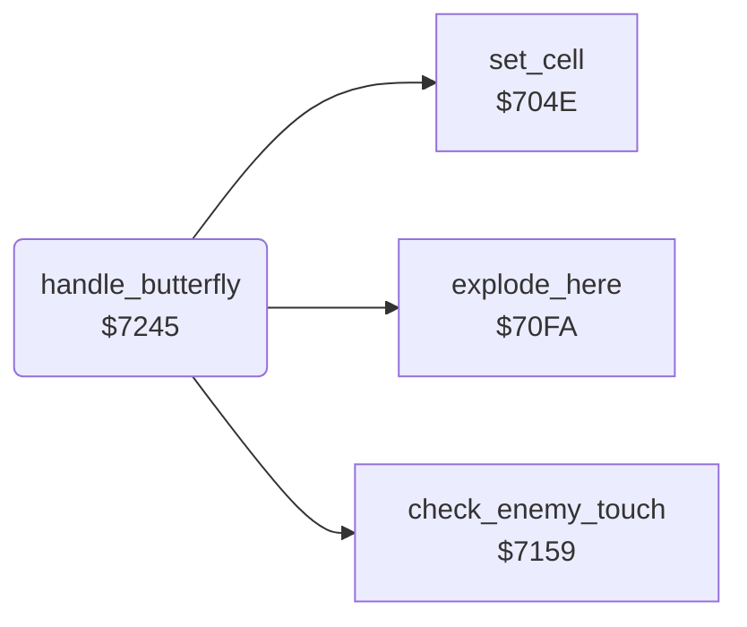

<!-- Generated by c64-docs from knowledge revision 20261025T214622.009-09wod3 and .c64-re-tools/local/generated/src/source-map.json. Do not edit: change the knowledge, generate the source again, then run docs.ts generate. -->
# engine/butterfly.asm: Butterflies

Range `$7245-$7292`. Source: [engine/butterfly.asm](../../../../src/engine/butterfly.asm). Index: [the reference](../../index.md).

## Routines

| Routine | Address | Reached from | Summary |
|---|---|---|---|
| [`handle_butterfly`](butterfly.md#handle_butterfly) | `$7245` |  | Handler of the butterflies $30-$33. |

## Call graph

A solid arrow is a call, a thick arrow a table entry. Rounded nodes are in this file.

## Details

### [`handle_butterfly`](../../../../src/engine/butterfly.asm#L6) `$7245`

*routine*

Handler of the butterflies $30-$33. Explodes to diamonds next to Rockford or amoeba. Else it turns right, moves ahead or turns left.

- **Calls:** [`check_enemy_touch`](firefly.md#check_enemy_touch), [`explode_here`](explosion.md#explode_here), [`set_cell`](cell_draw.md#set_cell)
- **Jumps to:** [`scan_cell_settle`](cave_scan.md#scan_cell_settle), [`clear_cell_and_next`](cell_draw.md#clear_cell_and_next)
- **Reads:** [`cell_ptr`](../../memory-map.md#cell_ptr), [`dir_offsets`](firefly.md#dir_offsets), [`dir_offsets_turned`](firefly.md#dir_offsets_turned)
- **Writes:** [`explosion_code`](../../memory-map.md#explosion_code)

| Label | Address | Comment |
|---|---|---|
| [`butterfly_move`](../../../../src/engine/butterfly.asm#L14) | `$7254` |  |
| [`butterfly_try_ahead`](../../../../src/engine/butterfly.asm#L29) | `$7270` |  |
| [`butterfly_turn_left`](../../../../src/engine/butterfly.asm#L39) | `$7284` |  |
