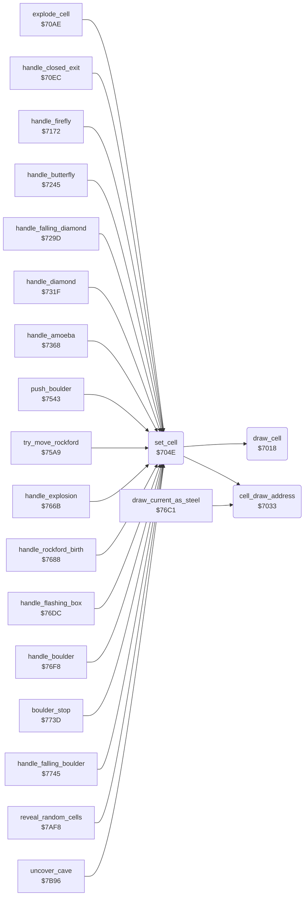

<!-- Generated by c64-docs from knowledge revision 20261025T214622.009-09wod3 and .c64-re-tools/local/generated/src/source-map.json. Do not edit: change the knowledge, generate the source again, then run docs.ts generate. -->
# engine/cell_draw.asm: Writing and drawing cells

Range `$7018-$7084`. Source: [engine/cell_draw.asm](../../../../src/engine/cell_draw.asm). Index: [the reference](../../index.md).

## Routines

| Routine | Address | Reached from | Summary |
|---|---|---|---|
| [`draw_cell`](cell_draw.md#draw_cell) | `$7018` | [`set_cell`](cell_draw.md#set_cell) | Draws cell code drawn_cell_code as 2 x 2 characters at draw_ptr in the 80-column map screen at $4000. |
| [`cell_draw_address`](cell_draw.md#cell_draw_address) | `$7033` | [`set_cell`](cell_draw.md#set_cell), [`draw_current_as_steel`](stages.md#draw_current_as_steel) | Sets draw_ptr to cell_screen_ptr plus the screen delta of neighbour cell Y. |
| [`set_cell`](cell_draw.md#set_cell) | `$704E` | [`explode_cell`](explosion.md#explode_cell), [`handle_closed_exit`](explosion.md#handle_closed_exit), [`handle_firefly`](firefly.md#handle_firefly), [`handle_butterfly`](butterfly.md#handle_butterfly), [`handle_falling_diamond`](diamond.md#handle_falling_diamond), [`handle_diamond`](diamond.md#handle_diamond), [`handle_amoeba`](amoeba.md#handle_amoeba), [`push_boulder`](../rockford/movement.md#push_boulder), [`try_move_rockford`](../rockford/movement.md#try_move_rockford), [`handle_explosion`](stages.md#handle_explosion), [`handle_rockford_birth`](stages.md#handle_rockford_birth), [`handle_flashing_box`](stages.md#handle_flashing_box) and 6 more | Writes cell code A at scan_ptr+Y and draws it. |
| [`clear_cell_and_next`](cell_draw.md#clear_cell_and_next) | `$706F` | [`handle_firefly`](firefly.md#handle_firefly), [`handle_butterfly`](butterfly.md#handle_butterfly), [`handle_falling_diamond`](diamond.md#handle_falling_diamond), [`handle_diamond`](diamond.md#handle_diamond), [`handle_boulder`](boulder.md#handle_boulder), [`handle_falling_boulder`](boulder.md#handle_falling_boulder) | Writes space at the current cell, draws it and continues the cave scan. |

## Call graph

A solid arrow is a call, a thick arrow a table entry. Rounded nodes are in this file.

## Details

### [`draw_cell`](../../../../src/engine/cell_draw.asm#L6) `$7018`

*routine*

Draws cell code drawn_cell_code as 2 x 2 characters at draw_ptr in the 80-column map screen at $4000. Uses the character table $5f28.

- **Called from:** [`set_cell`](cell_draw.md#set_cell)
- **Reads:** [`drawn_cell_code`](../../memory-map.md#drawn_cell_code), [`cell_glyph_chars`](element_tables.md#cell_glyph_chars), [`draw_ptr`](../../memory-map.md#draw_ptr)

### [`cell_draw_address`](../../../../src/engine/cell_draw.asm#L23) `$7033`

*routine*

Sets draw_ptr to cell_screen_ptr plus the screen delta of neighbour cell Y. The table at $53b0 holds triplets: cell offset, delta low, delta high.

- **Called from:** [`set_cell`](cell_draw.md#set_cell), [`draw_current_as_steel`](stages.md#draw_current_as_steel)
- **Reads:** [`cell_offset_keys`](../screen/cell_screen_tables.md#cell_offset_keys), [`cell_buffer_ptr`](../../memory-map.md#cell_buffer_ptr), [`cell_offset_lo`](../screen/cell_screen_tables.md#cell_offset_lo), [`cell_buffer_ptr_hi`](../../memory-map.md#cell_buffer_ptr_hi), [`cell_offset_hi`](../screen/cell_screen_tables.md#cell_offset_hi)
- **Writes:** [`draw_ptr`](../../memory-map.md#draw_ptr), [`draw_ptr_hi`](../../memory-map.md#draw_ptr_hi)

| Label | Address | Comment |
|---|---|---|
| [`cell_draw_address_find`](../../../../src/engine/cell_draw.asm#L26) | `$7036` |  |

### [`set_cell`](../../../../src/engine/cell_draw.asm#L41) `$704E`

*routine*

Writes cell code A at scan_ptr+Y and draws it. Sets cell_screen_ptr for the current scan row and column. Returns the code in A.

- **Called from:** [`explode_cell`](explosion.md#explode_cell), [`handle_closed_exit`](explosion.md#handle_closed_exit), [`handle_firefly`](firefly.md#handle_firefly), [`handle_butterfly`](butterfly.md#handle_butterfly), [`$7297`](../../../../src/engine/diamond.asm#L9), [`handle_falling_diamond`](diamond.md#handle_falling_diamond), [`handle_diamond`](diamond.md#handle_diamond), [`handle_amoeba`](amoeba.md#handle_amoeba), [`push_boulder`](../rockford/movement.md#push_boulder), [`try_move_rockford`](../rockford/movement.md#try_move_rockford), [`handle_explosion`](stages.md#handle_explosion), [`handle_rockford_birth`](stages.md#handle_rockford_birth) and 6 more
- **Calls:** [`cell_draw_address`](cell_draw.md#cell_draw_address), [`draw_cell`](cell_draw.md#draw_cell)
- **Jumps to:** [`scan_cell_settle`](cave_scan.md#scan_cell_settle)
- **Reads:** [`cell_ptr`](../../memory-map.md#cell_ptr), [`scan_row`](../../memory-map.md#scan_row), [`scan_col`](../../memory-map.md#scan_col), [`cave_row_addr_lo`](../screen/cell_screen_tables.md#cave_row_addr_lo), [`cave_row_addr_hi`](../screen/cell_screen_tables.md#cave_row_addr_hi), [`drawn_cell_code`](../../memory-map.md#drawn_cell_code), [`cell_buffer_ptr`](../../memory-map.md#cell_buffer_ptr), [`cell_buffer_ptr_hi`](../../memory-map.md#cell_buffer_ptr_hi)
- **Writes:** [`drawn_cell_code`](../../memory-map.md#drawn_cell_code), [`cell_buffer_ptr`](../../memory-map.md#cell_buffer_ptr), [`cell_buffer_ptr_hi`](../../memory-map.md#cell_buffer_ptr_hi), [`draw_ptr`](../../memory-map.md#draw_ptr), [`draw_ptr_hi`](../../memory-map.md#draw_ptr_hi)

### [`clear_cell_and_next`](../../../../src/engine/cell_draw.asm#L60) `$706F`

*label*

Writes space at the current cell, draws it and continues the cave scan. The handlers jump here after an object leaves its cell.

- **Jumped to from:** [`handle_firefly`](firefly.md#handle_firefly), [`handle_butterfly`](butterfly.md#handle_butterfly), [`handle_falling_diamond`](diamond.md#handle_falling_diamond), [`handle_diamond`](diamond.md#handle_diamond), [`handle_boulder`](boulder.md#handle_boulder), [`handle_falling_boulder`](boulder.md#handle_falling_boulder)
