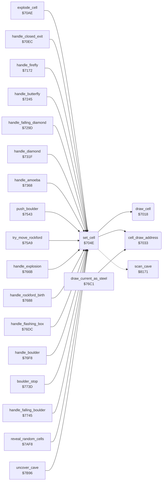

<!-- Generated by c64-docs from knowledge revision 20261024T103116.823-byvbsh and .c64-re-tools/local/generated/src/source-map.json. Do not edit: change the knowledge, generate the source again, then run docs.ts generate. -->
# engine/cell_draw.asm: Writing and drawing cells

Range `$7018-$7084`. Source: [engine/cell_draw.asm](../../../../src/engine/cell_draw.asm). Index: [the reference](../../index.md).

## Call graph

A solid arrow is a call, a thick arrow a table entry, a dotted arrow a jump. Rounded nodes are in this file.

## Names

### [`draw_cell`](../../../../src/engine/cell_draw.asm#L6) `$7018`

*routine*

Draws cell code drawn_cell_code as 2 x 2 characters at draw_ptr in the 80-column map screen at $4000. Uses the character table $5f28.

- **Called from:** [`set_cell`](cell_draw.md#set_cell) [`$7069`](../../../../src/engine/cell_draw.asm#L56), [`set_cell`](cell_draw.md#set_cell) [`$707F`](../../../../src/engine/cell_draw.asm#L69)
- **Reads:** [`drawn_cell_code`](../../memory-map.md#drawn_cell_code), [`cell_glyph_chars`](element_tables.md#cell_glyph_chars), [`draw_ptr`](../../memory-map.md#draw_ptr)

### [`cell_draw_address`](../../../../src/engine/cell_draw.asm#L23) `$7033`

*routine*

Sets draw_ptr to cell_screen_ptr plus the screen delta of neighbour cell Y. The table at $53b0 holds triplets: cell offset, delta low, delta high.

- **Called from:** [`set_cell`](cell_draw.md#set_cell) [`$7066`](../../../../src/engine/cell_draw.asm#L55), [`draw_current_as_steel`](stages.md#draw_current_as_steel) [`$76D5`](../../../../src/engine/stages.asm#L95)
- **Reads:** [`cell_offset_keys`](../screen/cell_screen_tables.md#cell_offset_keys), [`cell_buffer_ptr`](../../memory-map.md#cell_buffer_ptr), [`cell_offset_lo`](../screen/cell_screen_tables.md#cell_offset_lo), [`cell_buffer_ptr_hi`](../../memory-map.md#cell_buffer_ptr_hi), [`cell_offset_hi`](../screen/cell_screen_tables.md#cell_offset_hi)
- **Writes:** [`draw_ptr`](../../memory-map.md#draw_ptr), [`draw_ptr_hi`](../../memory-map.md#draw_ptr_hi)

### [`cell_draw_address_find`](../../../../src/engine/cell_draw.asm#L26) `$7036`

*label*

- **Jumped to from:** [`cell_draw_address`](cell_draw.md#cell_draw_address) [`$703C`](../../../../src/engine/cell_draw.asm#L31)

### [`set_cell`](../../../../src/engine/cell_draw.asm#L41) `$704E`

*routine*

Writes cell code A at scan_ptr+Y and draws it. Sets cell_screen_ptr for the current scan row and column. Returns the code in A.

- **Called from:** [`explode_cell`](explosion.md#explode_cell) [`$70B6`](../../../../src/engine/explosion.asm#L11), [`handle_closed_exit`](explosion.md#handle_closed_exit) [`$70F4`](../../../../src/engine/explosion.asm#L42), [`handle_firefly`](firefly.md#handle_firefly) [`$7197`](../../../../src/engine/firefly.asm#L55), [`handle_firefly`](firefly.md#handle_firefly) [`$71AB`](../../../../src/engine/firefly.asm#L65), [`handle_butterfly`](butterfly.md#handle_butterfly) [`$726A`](../../../../src/engine/butterfly.asm#L27), [`handle_butterfly`](butterfly.md#handle_butterfly) [`$727E`](../../../../src/engine/butterfly.asm#L37), [`$7297`](../../../../src/engine/diamond.asm#L9), [`handle_falling_diamond`](diamond.md#handle_falling_diamond) [`$72A5`](../../../../src/engine/diamond.asm#L17), [`handle_falling_diamond`](diamond.md#handle_falling_diamond) [`$72C3`](../../../../src/engine/diamond.asm#L34), [`handle_falling_diamond`](diamond.md#handle_falling_diamond) [`$72E6`](../../../../src/engine/diamond.asm#L51), [`handle_falling_diamond`](diamond.md#handle_falling_diamond) [`$72FA`](../../../../src/engine/diamond.asm#L61), [`handle_diamond`](diamond.md#handle_diamond) [`$7327`](../../../../src/engine/diamond.asm#L87), [`handle_diamond`](diamond.md#handle_diamond) [`$7347`](../../../../src/engine/diamond.asm#L103), [`handle_diamond`](diamond.md#handle_diamond) [`$735B`](../../../../src/engine/diamond.asm#L114), [`handle_amoeba`](amoeba.md#handle_amoeba) [`$7374`](../../../../src/engine/amoeba.asm#L16), [`handle_amoeba`](amoeba.md#handle_amoeba) [`$7380`](../../../../src/engine/amoeba.asm#L23), [`handle_amoeba`](amoeba.md#handle_amoeba) [`$73CB`](../../../../src/engine/amoeba.asm#L66), [`push_boulder`](../rockford/movement.md#push_boulder) [`$7551`](../../../../src/rockford/movement.asm#L27), [`try_move_rockford`](../rockford/movement.md#try_move_rockford) [`$75B7`](../../../../src/rockford/movement.asm#L91), [`try_move_rockford`](../rockford/movement.md#try_move_rockford) [`$75C1`](../../../../src/rockford/movement.asm#L97), [`try_move_rockford`](../rockford/movement.md#try_move_rockford) [`$75C8`](../../../../src/rockford/movement.asm#L100), [`handle_explosion`](stages.md#handle_explosion) [`$7682`](../../../../src/engine/stages.asm#L43), [`handle_rockford_birth`](stages.md#handle_rockford_birth) [`$76A3`](../../../../src/engine/stages.asm#L63), [`handle_flashing_box`](stages.md#handle_flashing_box) [`$76E8`](../../../../src/engine/stages.asm#L106), [`handle_boulder`](boulder.md#handle_boulder) [`$7700`](../../../../src/engine/boulder.asm#L11), [`handle_boulder`](boulder.md#handle_boulder) [`$7720`](../../../../src/engine/boulder.asm#L26), [`handle_boulder`](boulder.md#handle_boulder) [`$7734`](../../../../src/engine/boulder.asm#L36), [`boulder_stop`](boulder.md#boulder_stop) [`$7741`](../../../../src/engine/boulder.asm#L44), [`handle_falling_boulder`](boulder.md#handle_falling_boulder) [`$774D`](../../../../src/engine/boulder.asm#L52), [`handle_falling_boulder`](boulder.md#handle_falling_boulder) [`$776B`](../../../../src/engine/boulder.asm#L68), [`handle_falling_boulder`](boulder.md#handle_falling_boulder) [`$7772`](../../../../src/engine/boulder.asm#L72), [`handle_falling_boulder`](boulder.md#handle_falling_boulder) [`$7792`](../../../../src/engine/boulder.asm#L87), [`handle_falling_boulder`](boulder.md#handle_falling_boulder) [`$77A6`](../../../../src/engine/boulder.asm#L98), [`reveal_random_cells`](../screen/cover.md#reveal_random_cells) [`$7B24`](../../../../src/screen/cover.asm#L118), [`uncover_cave`](../screen/cover.md#uncover_cave) [`$7BA8`](../../../../src/screen/cover.asm#L188)
- **Calls:** [`cell_draw_address`](cell_draw.md#cell_draw_address), [`draw_cell`](cell_draw.md#draw_cell)
- **Jumps to:** [`scan_cell_settle`](cave_scan.md#scan_cell_settle)
- **Reads:** [`cell_ptr`](../../memory-map.md#cell_ptr), [`scan_row`](../../memory-map.md#scan_row), [`scan_col`](../../memory-map.md#scan_col), [`cave_row_addr_lo`](../screen/cell_screen_tables.md#cave_row_addr_lo), [`cave_row_addr_hi`](../screen/cell_screen_tables.md#cave_row_addr_hi), [`drawn_cell_code`](../../memory-map.md#drawn_cell_code), [`cell_buffer_ptr`](../../memory-map.md#cell_buffer_ptr), [`cell_buffer_ptr_hi`](../../memory-map.md#cell_buffer_ptr_hi)
- **Writes:** [`drawn_cell_code`](../../memory-map.md#drawn_cell_code), [`cell_buffer_ptr`](../../memory-map.md#cell_buffer_ptr), [`cell_buffer_ptr_hi`](../../memory-map.md#cell_buffer_ptr_hi), [`draw_ptr`](../../memory-map.md#draw_ptr), [`draw_ptr_hi`](../../memory-map.md#draw_ptr_hi)

### [`clear_cell_and_next`](../../../../src/engine/cell_draw.asm#L60) `$706F`

*label*

Writes space at the current cell, draws it and continues the cave scan. The handlers jump here after an object leaves its cell.

- **Jumped to from:** [`handle_firefly`](firefly.md#handle_firefly) [`$719A`](../../../../src/engine/firefly.asm#L56), [`handle_firefly`](firefly.md#handle_firefly) [`$71AE`](../../../../src/engine/firefly.asm#L66), [`handle_butterfly`](butterfly.md#handle_butterfly) [`$726D`](../../../../src/engine/butterfly.asm#L28), [`handle_butterfly`](butterfly.md#handle_butterfly) [`$7281`](../../../../src/engine/butterfly.asm#L38), [`handle_falling_diamond`](diamond.md#handle_falling_diamond) [`$72A8`](../../../../src/engine/diamond.asm#L18), [`handle_falling_diamond`](diamond.md#handle_falling_diamond) [`$72C9`](../../../../src/engine/diamond.asm#L37), [`handle_falling_diamond`](diamond.md#handle_falling_diamond) [`$72E9`](../../../../src/engine/diamond.asm#L52), [`handle_falling_diamond`](diamond.md#handle_falling_diamond) [`$72FD`](../../../../src/engine/diamond.asm#L62), [`handle_diamond`](diamond.md#handle_diamond) [`$732D`](../../../../src/engine/diamond.asm#L89), [`handle_diamond`](diamond.md#handle_diamond) [`$734A`](../../../../src/engine/diamond.asm#L104), [`handle_diamond`](diamond.md#handle_diamond) [`$735E`](../../../../src/engine/diamond.asm#L115), [`handle_boulder`](boulder.md#handle_boulder) [`$7706`](../../../../src/engine/boulder.asm#L13), [`handle_boulder`](boulder.md#handle_boulder) [`$7723`](../../../../src/engine/boulder.asm#L27), [`handle_boulder`](boulder.md#handle_boulder) [`$7737`](../../../../src/engine/boulder.asm#L37), [`handle_falling_boulder`](boulder.md#handle_falling_boulder) [`$7750`](../../../../src/engine/boulder.asm#L53), [`handle_falling_boulder`](boulder.md#handle_falling_boulder) [`$7795`](../../../../src/engine/boulder.asm#L88), [`handle_falling_boulder`](boulder.md#handle_falling_boulder) [`$77A9`](../../../../src/engine/boulder.asm#L99)
