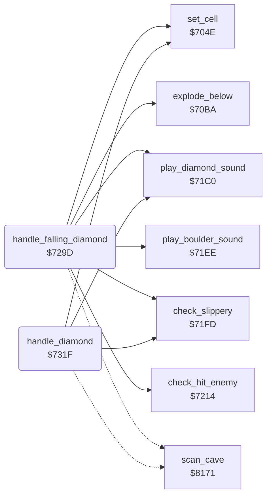

<!-- Generated by c64-docs from knowledge revision 20261024T103116.823-byvbsh and .c64-re-tools/local/generated/src/source-map.json. Do not edit: change the knowledge, generate the source again, then run docs.ts generate. -->
# engine/diamond.asm: Diamonds

Range `$7293-$7363`. Source: [engine/diamond.asm](../../../../src/engine/diamond.asm). Index: [the reference](../../index.md).

## Call graph

A solid arrow is a call, a thick arrow a table entry, a dotted arrow a jump. Rounded nodes are in this file.

## Names

### [`diamond_stop`](../../../../src/engine/diamond.asm#L6) `$7293`

*label*

Changes the current cell to a scanned diamond $15 and continues the scan.

- **Jumped to from:** [`handle_falling_diamond`](diamond.md#handle_falling_diamond) [`$7300`](../../../../src/engine/diamond.asm#L64), [`handle_falling_diamond`](diamond.md#handle_falling_diamond) [`$731C`](../../../../src/engine/diamond.asm#L80)

### [`handle_falling_diamond`](../../../../src/engine/diamond.asm#L12) `$729D`

*routine*

Handler of the falling diamond $16. It falls, passes through the magic wall, rolls off slippery cells, kills Rockford or an enemy, or stops.

- **Calls:** [`set_cell`](cell_draw.md#set_cell), [`play_boulder_sound`](../sound/element_sounds.md#play_boulder_sound), [`play_diamond_sound`](../sound/element_sounds.md#play_diamond_sound), [`check_slippery`](falling_checks.md#check_slippery), [`explode_below`](explosion.md#explode_below), [`check_hit_enemy`](falling_checks.md#check_hit_enemy)
- **Jumps to:** [`clear_cell_and_next`](cell_draw.md#clear_cell_and_next), [`diamond_stop`](diamond.md#diamond_stop), [`scan_cell_settle`](cave_scan.md#scan_cell_settle)
- **Reads:** [`cell_ptr`](../../memory-map.md#cell_ptr), [`magic_wall_state`](../../memory-map.md#magic_wall_state)
- **Writes:** [`magic_wall_state`](../../memory-map.md#magic_wall_state), [`explosion_code`](../../memory-map.md#explosion_code)

### [`falling_diamond_blocked`](../../../../src/engine/diamond.asm#L19) `$72AB`

*label*

$03 is the magic wall.

- **Jumped to from:** [`handle_falling_diamond`](diamond.md#handle_falling_diamond) [`$72A1`](../../../../src/engine/diamond.asm#L15)

### [`falling_diamond_magic`](../../../../src/engine/diamond.asm#L27) `$72B7`

*label*

- **Jumped to from:** [`handle_falling_diamond`](diamond.md#handle_falling_diamond) [`$72B1`](../../../../src/engine/diamond.asm#L24)

### [`falling_diamond_magic_done`](../../../../src/engine/diamond.asm#L35) `$72C6`

*label*

- **Jumped to from:** [`handle_falling_diamond`](diamond.md#handle_falling_diamond) [`$72B9`](../../../../src/engine/diamond.asm#L29), [`handle_falling_diamond`](diamond.md#handle_falling_diamond) [`$72BF`](../../../../src/engine/diamond.asm#L32)

### [`falling_diamond_land`](../../../../src/engine/diamond.asm#L38) `$72CC`

*label*

- **Jumped to from:** [`handle_falling_diamond`](diamond.md#handle_falling_diamond) [`$72AD`](../../../../src/engine/diamond.asm#L21)

### [`falling_diamond_roll_right`](../../../../src/engine/diamond.asm#L53) `$72EC`

*label*

- **Jumped to from:** [`handle_falling_diamond`](diamond.md#handle_falling_diamond) [`$72DC`](../../../../src/engine/diamond.asm#L46), [`handle_falling_diamond`](diamond.md#handle_falling_diamond) [`$72E2`](../../../../src/engine/diamond.asm#L49)

### [`falling_diamond_stop`](../../../../src/engine/diamond.asm#L63) `$7300`

*label*

- **Jumped to from:** [`handle_falling_diamond`](diamond.md#handle_falling_diamond) [`$72F0`](../../../../src/engine/diamond.asm#L56), [`handle_falling_diamond`](diamond.md#handle_falling_diamond) [`$72F6`](../../../../src/engine/diamond.asm#L59)

### [`falling_diamond_hit`](../../../../src/engine/diamond.asm#L65) `$7303`

*label*

- **Jumped to from:** [`handle_falling_diamond`](diamond.md#handle_falling_diamond) [`$72D6`](../../../../src/engine/diamond.asm#L43)

### [`falling_diamond_hit_enemy`](../../../../src/engine/diamond.asm#L73) `$7311`

*label*

- **Jumped to from:** [`handle_falling_diamond`](diamond.md#handle_falling_diamond) [`$7305`](../../../../src/engine/diamond.asm#L67)

### [`falling_diamond_no_enemy`](../../../../src/engine/diamond.asm#L79) `$731C`

*label*

- **Jumped to from:** [`handle_falling_diamond`](diamond.md#handle_falling_diamond) [`$7314`](../../../../src/engine/diamond.asm#L75)

### [`handle_diamond`](../../../../src/engine/diamond.asm#L82) `$731F`

*routine*

Handler of the diamond $14. It starts to fall into space below, or rolls off a slippery cell below.

- **Calls:** [`set_cell`](cell_draw.md#set_cell), [`play_diamond_sound`](../sound/element_sounds.md#play_diamond_sound), [`check_slippery`](falling_checks.md#check_slippery)
- **Jumps to:** [`clear_cell_and_next`](cell_draw.md#clear_cell_and_next), [`scan_cell_settle`](cave_scan.md#scan_cell_settle)
- **Reads:** [`cell_ptr`](../../memory-map.md#cell_ptr)

### [`diamond_check_roll`](../../../../src/engine/diamond.asm#L90) `$7330`

*label*

- **Jumped to from:** [`handle_diamond`](diamond.md#handle_diamond) [`$7323`](../../../../src/engine/diamond.asm#L85)

### [`diamond_roll_right`](../../../../src/engine/diamond.asm#L105) `$734D`

*label*

- **Jumped to from:** [`handle_diamond`](diamond.md#handle_diamond) [`$733D`](../../../../src/engine/diamond.asm#L97), [`handle_diamond`](diamond.md#handle_diamond) [`$7343`](../../../../src/engine/diamond.asm#L100)

### [`diamond_next`](../../../../src/engine/diamond.asm#L116) `$7361`

*label*

- **Jumped to from:** [`handle_diamond`](diamond.md#handle_diamond) [`$7337`](../../../../src/engine/diamond.asm#L94), [`handle_diamond`](diamond.md#handle_diamond) [`$7351`](../../../../src/engine/diamond.asm#L108), [`handle_diamond`](diamond.md#handle_diamond) [`$7357`](../../../../src/engine/diamond.asm#L111)
