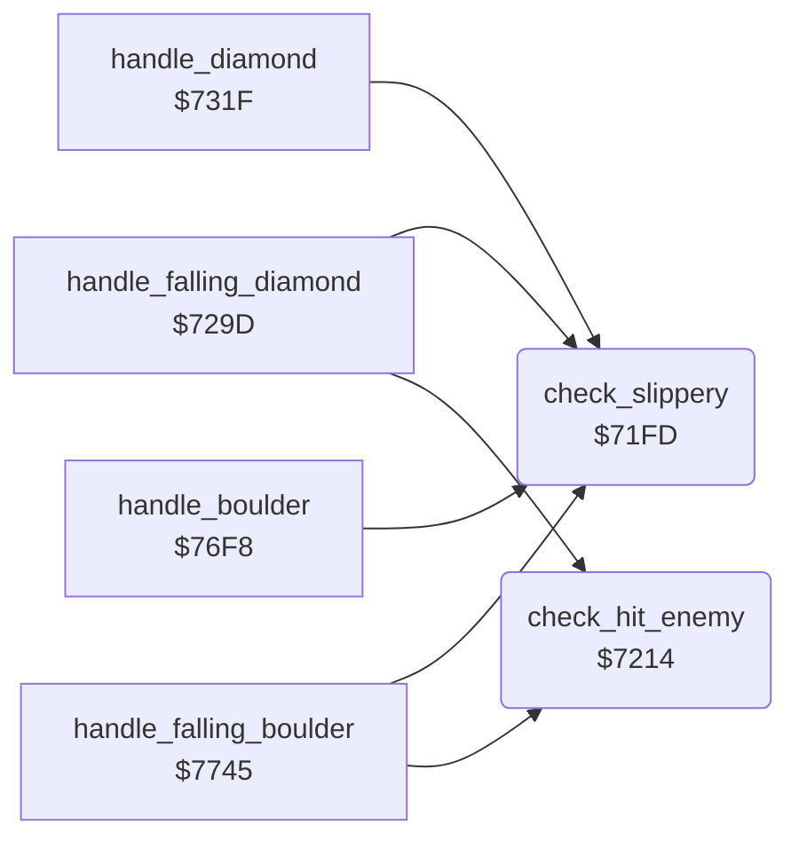

<!-- Generated by c64-docs from knowledge revision 20261025T214622.009-09wod3 and .c64-re-tools/local/generated/src/source-map.json. Do not edit: change the knowledge, generate the source again, then run docs.ts generate. -->
# engine/falling_checks.asm: What a falling object lands on

Range `$71FD-$7244`. Source: [engine/falling_checks.asm](../../../../src/engine/falling_checks.asm). Index: [the reference](../../index.md).

## Routines

| Routine | Address | Reached from | Summary |
|---|---|---|---|
| [`check_slippery`](falling_checks.md#check_slippery) | `$71FD` | [`handle_falling_diamond`](diamond.md#handle_falling_diamond), [`handle_diamond`](diamond.md#handle_diamond), [`handle_boulder`](boulder.md#handle_boulder), [`handle_falling_boulder`](boulder.md#handle_falling_boulder) | Returns Z set when cell code A is a boulder, a diamond or brick wall. |
| [`check_hit_enemy`](falling_checks.md#check_hit_enemy) | `$7214` | [`handle_falling_diamond`](diamond.md#handle_falling_diamond), [`handle_falling_boulder`](boulder.md#handle_falling_boulder) | Returns Z set when the cell at scan_ptr+Y is a butterfly ($30-$33) or firefly ($08-$0b). |

## Call graph

A solid arrow is a call, a thick arrow a table entry. Rounded nodes are in this file.

## Details

### [`check_slippery`](../../../../src/engine/falling_checks.asm#L6) `$71FD`

*routine*

Returns Z set when cell code A is a boulder, a diamond or brick wall. Falling objects roll off these cells.

- **Called from:** [`handle_falling_diamond`](diamond.md#handle_falling_diamond), [`handle_diamond`](diamond.md#handle_diamond), [`handle_boulder`](boulder.md#handle_boulder), [`handle_falling_boulder`](boulder.md#handle_falling_boulder)

| Label | Address | Comment |
|---|---|---|
| [`check_slippery_diamond`](../../../../src/engine/falling_checks.asm#L11) | `$7205` |  |
| [`check_slippery_wall`](../../../../src/engine/falling_checks.asm#L15) | `$720B` |  |
| [`check_slippery_done`](../../../../src/engine/falling_checks.asm#L19) | `$7211` |  |

### [`check_hit_enemy`](../../../../src/engine/falling_checks.asm#L23) `$7214`

*routine*

Returns Z set when the cell at scan_ptr+Y is a butterfly ($30-$33) or firefly ($08-$0b). Sets explosion_code to $21 (diamonds) or $1c (space).

- **Called from:** [`handle_falling_diamond`](diamond.md#handle_falling_diamond), [`handle_falling_boulder`](boulder.md#handle_falling_boulder)
- **Reads:** [`cell_ptr`](../../memory-map.md#cell_ptr)
- **Writes:** [`explosion_code`](../../memory-map.md#explosion_code)

| Label | Address | Comment |
|---|---|---|
| [`check_hit_firefly`](../../../../src/engine/falling_checks.asm#L36) | `$722A` |  |
| [`check_hit_enemy_done`](../../../../src/engine/falling_checks.asm#L49) | `$7242` |  |
