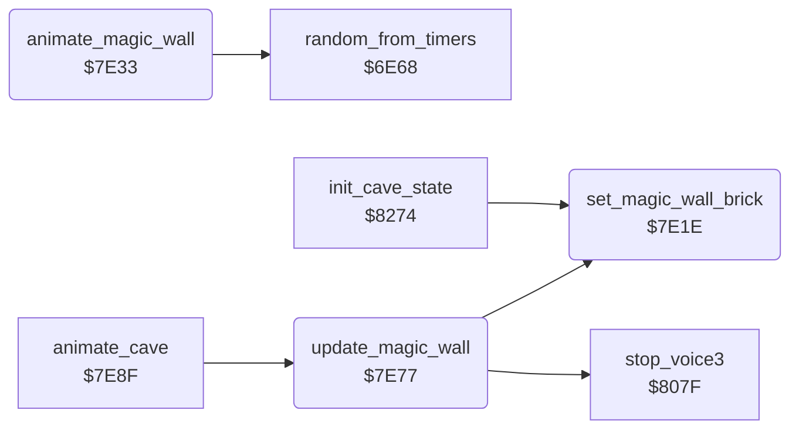

<!-- Generated by c64-docs from knowledge revision 20261025T214622.009-09wod3 and .c64-re-tools/local/generated/src/source-map.json. Do not edit: change the knowledge, generate the source again, then run docs.ts generate. -->
# engine/magic_wall.asm: Magic wall

Range `$7E1E-$7E8E`. Source: [engine/magic_wall.asm](../../../../src/engine/magic_wall.asm). Index: [the reference](../../index.md).

## Routines

| Routine | Address | Reached from | Summary |
|---|---|---|---|
| [`set_magic_wall_brick`](magic_wall.md#set_magic_wall_brick) | `$7E1E` | [`update_magic_wall`](magic_wall.md#update_magic_wall), [`init_cave_state`](../cave/setup.md#init_cave_state) | Copies the brick wall character $4E into the four magic wall characters $22, $23, $32 and $33. |
| [`animate_magic_wall`](magic_wall.md#animate_magic_wall) | `$7E33` |  | Active magic wall: plays its noise on voice 3 on odd frames and copies an animation frame into the four magic wall characters. |
| [`update_magic_wall`](magic_wall.md#update_magic_wall) | `$7E77` | [`animate_cave`](../screen/animate_cave.md#animate_cave) | State 1 animates the magic wall. |

## Call graph

A solid arrow is a call, a thick arrow a table entry. Rounded nodes are in this file.

## Details

### [`set_magic_wall_brick`](../../../../src/engine/magic_wall.asm#L6) `$7E1E`

*routine*

Copies the brick wall character $4E into the four magic wall characters $22, $23, $32 and $33.

- **Called from:** [`update_magic_wall`](magic_wall.md#update_magic_wall), [`init_cave_state`](../cave/setup.md#init_cave_state)
- **Reads:** [`gfx_brick`](../../memory-map.md#gfx_brick)
- **Writes:** [`gfx_magic_wall_tl`](../../memory-map.md#gfx_magic_wall_tl), [`gfx_magic_wall_tr`](../../memory-map.md#gfx_magic_wall_tr), [`gfx_magic_wall_bl`](../../memory-map.md#gfx_magic_wall_bl), [`gfx_magic_wall_br`](../../memory-map.md#gfx_magic_wall_br)

| Label | Address | Comment |
|---|---|---|
| [`set_magic_wall_brick_loop`](../../../../src/engine/magic_wall.asm#L8) | `$7E20` |  |

### [`animate_magic_wall`](../../../../src/engine/magic_wall.asm#L18) `$7E33`

*routine*

Active magic wall: plays its noise on voice 3 on odd frames and copies an animation frame into the four magic wall characters.

- **Jumped to from:** [`update_magic_wall`](magic_wall.md#update_magic_wall)
- **Calls:** [`random_from_timers`](random.md#random_from_timers)
- **Reads:** [`frame_counter`](../../memory-map.md#frame_counter), [`anim_frame`](../../memory-map.md#anim_frame), [`gfx_magic_wall_frames`](../../memory-map.md#gfx_magic_wall_frames)
- **Writes:** [`VCREG3`](../../memory-map.md#VCREG3), [`FREHI3`](../../memory-map.md#FREHI3), [`ATDCY3`](../../memory-map.md#ATDCY3), [`SUREL3`](../../memory-map.md#SUREL3), [`gfx_magic_wall_tl`](../../memory-map.md#gfx_magic_wall_tl), [`gfx_magic_wall_tr`](../../memory-map.md#gfx_magic_wall_tr), [`gfx_magic_wall_bl`](../../memory-map.md#gfx_magic_wall_bl), [`gfx_magic_wall_br`](../../memory-map.md#gfx_magic_wall_br)

| Label | Address | Comment |
|---|---|---|
| [`animate_magic_wall_gfx`](../../../../src/engine/magic_wall.asm#L37) | `$7E5A` |  |
| [`animate_magic_wall_loop`](../../../../src/engine/magic_wall.asm#L42) | `$7E61` |  |

### [`update_magic_wall`](../../../../src/engine/magic_wall.asm#L54) `$7E77`

*routine*

State 1 animates the magic wall. State 2 shows it as a brick wall, stops voice 3 and sets state 3.

- **Called from:** [`animate_cave`](../screen/animate_cave.md#animate_cave)
- **Calls:** [`set_magic_wall_brick`](magic_wall.md#set_magic_wall_brick), [`stop_voice3`](../sound/voices_off.md#stop_voice3)
- **Jumps to:** [`animate_magic_wall`](magic_wall.md#animate_magic_wall)
- **Reads:** [`magic_wall_state`](../../memory-map.md#magic_wall_state)
- **Writes:** [`magic_wall_state`](../../memory-map.md#magic_wall_state)

| Label | Address | Comment |
|---|---|---|
| [`update_magic_wall_expire`](../../../../src/engine/magic_wall.asm#L59) | `$7E80` |  |
| [`update_magic_wall_done`](../../../../src/engine/magic_wall.asm#L66) | `$7E8E` |  |
