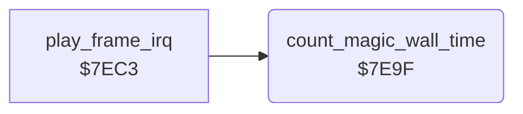

<!-- Generated by c64-docs from knowledge revision 20261024T103116.823-byvbsh and .c64-re-tools/local/generated/src/source-map.json. Do not edit: change the knowledge, generate the source again, then run docs.ts generate. -->
# engine/magic_wall_time.asm: Magic wall time

Range `$7E9F-$7EC2`. Source: [engine/magic_wall_time.asm](../../../../src/engine/magic_wall_time.asm). Index: [the reference](../../index.md).

## Call graph

A solid arrow is a call, a thick arrow a table entry, a dotted arrow a jump. Rounded nodes are in this file.

## Names

### [`count_magic_wall_time`](../../../../src/engine/magic_wall_time.asm#L6) `$7E9F`

*routine*

While the magic wall is active and the game is not paused, counts seconds. At cave_magic_time seconds the magic wall expires (state 2).

- **Called from:** [`play_frame_irq`](../irq/play_frame.md#play_frame_irq) [`$7ECE`](../../../../src/irq/play_frame.asm#L13)
- **Reads:** [`pause_flag`](../../memory-map.md#pause_flag), [`magic_wall_state`](../../memory-map.md#magic_wall_state), [`magic_wall_frames`](../../memory-map.md#magic_wall_frames), [`magic_wall_seconds`](../../memory-map.md#magic_wall_seconds), [`cave_magic_time`](../../memory-map.md#cave_magic_time)
- **Writes:** [`magic_wall_frames`](../../memory-map.md#magic_wall_frames), [`magic_wall_seconds`](../../memory-map.md#magic_wall_seconds), [`magic_wall_state`](../../memory-map.md#magic_wall_state)

### [`count_magic_wall_done`](../../../../src/engine/magic_wall_time.asm#L24) `$7EC2`

*label*

- **Jumped to from:** [`count_magic_wall_time`](magic_wall_time.md#count_magic_wall_time) [`$7EA7`](../../../../src/engine/magic_wall_time.asm#L11), [`count_magic_wall_time`](magic_wall_time.md#count_magic_wall_time) [`$7EAF`](../../../../src/engine/magic_wall_time.asm#L15), [`count_magic_wall_time`](magic_wall_time.md#count_magic_wall_time) [`$7EBC`](../../../../src/engine/magic_wall_time.asm#L21)
