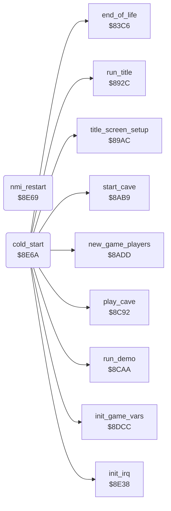

<!-- Generated by c64-docs from knowledge revision 20261025T214622.009-09wod3 and .c64-re-tools/local/generated/src/source-map.json. Do not edit: change the knowledge, generate the source again, then run docs.ts generate. -->
# init/cold_start.asm: Cold start and top loop

Range `$8E69-$8F3C`. Source: [init/cold_start.asm](../../../../src/init/cold_start.asm). Index: [the reference](../../index.md).

## Routines

| Routine | Address | Reached from | Summary |
|---|---|---|---|
| [`nmi_restart`](cold_start.md#nmi_restart) | `$8E69` |  | NMI vector target: RESTORE enables interrupts and restarts the game at the cold start. |
| [`cold_start`](cold_start.md#cold_start) | `$8E6A` | [`check_game_keys`](../input/game_keys.md#check_game_keys) | Entry. |

## Call graph

A solid arrow is a call, a thick arrow a table entry. Rounded nodes are in this file.

## Details

### [`nmi_restart`](../../../../src/init/cold_start.asm#L6) `$8E69`

*routine*

NMI vector target: RESTORE enables interrupts and restarts the game at the cold start.

- **Referred to by:** [`cold_start`](cold_start.md#cold_start)

### [`cold_start`](../../../../src/init/cold_start.asm#L9) `$8E6A`

*routine*

Entry. Sets the stack, CIAs, NMI vector and $01, resets the variables, copies the screen drawer to $9e00, then runs title and game.

- **Jumped to from:** [`check_game_keys`](../input/game_keys.md#check_game_keys)
- **Calls:** [`init_game_vars`](init_vars.md#init_game_vars), [`init_irq`](../irq/irq_setup.md#init_irq), [`title_screen_setup`](../title/run_title.md#title_screen_setup), [`run_title`](../title/run_title.md#run_title), [`new_game_players`](../status/players.md#new_game_players), [`start_cave`](../cave/cave_start.md#start_cave), [`run_demo`](../title/demo.md#run_demo), [`play_cave`](../engine/play_loop.md#play_cave), [`end_of_life`](../status/end_of_life.md#end_of_life)
- **Reads:** [`view_row_ptrs`](../../memory-map.md#view_row_ptrs), [`view_row_ptrs_1`](../../memory-map.md#view_row_ptrs_1), [`text_player_men_cave`](../text/texts.md#text_player_men_cave), [`cave_number`](../../memory-map.md#cave_number), [`demo_mode`](../../memory-map.md#demo_mode)
- **Writes:** [`CIAICR`](../../memory-map.md#CIAICR), [`CI2ICR`](../../memory-map.md#CI2ICR), [`CIATALO`](../../memory-map.md#CIATALO), [`CIATAHI`](../../memory-map.md#CIATAHI), [`CI2TALO`](../../memory-map.md#CI2TALO), [`CI2TAHI`](../../memory-map.md#CI2TAHI), [`CI2TBLO`](../../memory-map.md#CI2TBLO), [`CI2TBHI`](../../memory-map.md#CI2TBHI), [`CI2CRA`](../../memory-map.md#CI2CRA), [`CI2CRB`](../../memory-map.md#CI2CRB), [`NMINV`](../../memory-map.md#NMINV), [`R6510`](../../memory-map.md#R6510) and 17 more
- **Refers to:** [`nmi_restart`](cold_start.md#nmi_restart)

| Label | Address | Comment |
|---|---|---|
| [`cold_start_copy_drawer`](../../../../src/init/cold_start.asm#L46) | `$8EBC` |  |
| [`cold_start_status_text`](../../../../src/init/cold_start.asm#L58) | `$8ED3` |  |
| [`cold_start_clear_score`](../../../../src/init/cold_start.asm#L65) | `$8EE0` |  |
| [`top_loop`](../../../../src/init/cold_start.asm#L69) | `$8EE6` | No cave selected: title, else play a cave. |
| [`top_loop_fill_screen`](../../../../src/init/cold_start.asm#L79) | `$8EFC` |  |
| [`top_loop_play`](../../../../src/init/cold_start.asm#L88) | `$8F11` |  |
| [`top_loop_player`](../../../../src/init/cold_start.asm#L99) | `$8F27` |  |
| [`top_loop_after_cave`](../../../../src/init/cold_start.asm#L103) | `$8F2E` | Shows the end of the cave and the next state. |
| [`top_loop_clear_char0`](../../../../src/init/cold_start.asm#L105) | `$8F31` | Clears character 0 of the text charset. |
| [`top_loop_clear_char0_loop`](../../../../src/init/cold_start.asm#L108) | `$8F35` |  |
