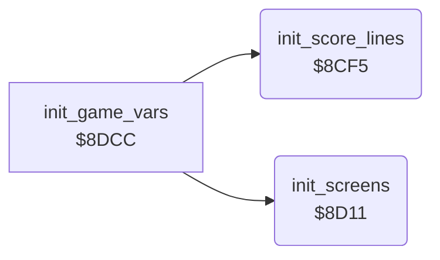

<!-- Generated by c64-docs from knowledge revision 20261025T214622.009-09wod3 and .c64-re-tools/local/generated/src/source-map.json. Do not edit: change the knowledge, generate the source again, then run docs.ts generate. -->
# init/init_screens.asm: Screens, charsets and sprites

Range `$8CF5-$8DCB`. Source: [init/init_screens.asm](../../../../src/init/init_screens.asm). Index: [the reference](../../index.md).

## Routines

| Routine | Address | Reached from | Summary |
|---|---|---|---|
| [`init_score_lines`](init_screens.md#init_score_lines) | `$8CF5` | [`init_game_vars`](init_vars.md#init_game_vars) | Fills the LAST and HIGH score lines from the texts at $6F64 and $6F78, and a blank third line. |
| [`init_screens`](init_screens.md#init_screens) | `$8D11` | [`init_game_vars`](init_vars.md#init_game_vars) | Copies both charsets from $5000 and $5fe8, builds bitmap rows 19-24 from $68E8, makes the sprite bar and sets seven expanded sprites in a row. |

## Call graph

A solid arrow is a call, a thick arrow a table entry. Rounded nodes are in this file.

## Details

### [`init_score_lines`](../../../../src/init/init_screens.asm#L6) `$8CF5`

*routine*

Fills the LAST and HIGH score lines from the texts at $6F64 and $6F78, and a blank third line.

- **Called from:** [`init_game_vars`](init_vars.md#init_game_vars)
- **Reads:** [`text_last_scores`](../text/texts.md#text_last_scores), [`text_high_scores`](../text/texts.md#text_high_scores)
- **Writes:** [`last_scores_line`](../../memory-map.md#last_scores_line), [`high_scores_line`](../../memory-map.md#high_scores_line), [`status_line`](../../memory-map.md#status_line), [`status_needed`](../../memory-map.md#status_needed)

| Label | Address | Comment |
|---|---|---|
| [`init_score_lines_loop`](../../../../src/init/init_screens.asm#L8) | `$8CF7` |  |

### [`init_screens`](../../../../src/init/init_screens.asm#L21) `$8D11`

*routine*

Copies both charsets from $5000 and $5fe8, builds bitmap rows 19-24 from $68E8, makes the sprite bar and sets seven expanded sprites in a row.

- **Called from:** [`init_game_vars`](init_vars.md#init_game_vars)
- **Reads:** [`text_chars_2000`](../data/text_charset.md#text_chars_2000), [`text_chars_2100`](../data/text_charset.md#text_chars_2100), [`text_chars_2200`](../data/text_charset.md#text_chars_2200), [`text_chars_2300`](../data/text_charset.md#text_chars_2300), [`title_tune_voice2`](../data/title_tune_notes.md#title_tune_voice2), [`cell_chars_3100`](../data/cell_charset.md#cell_chars_3100), [`cell_chars_3200`](../data/cell_charset.md#cell_chars_3200), [`cell_chars_3300`](../data/cell_charset.md#cell_chars_3300), [`first_star_logo_r23_left`](../data/first_star_logo.md#first_star_logo_r23_left), [`first_star_logo_r24_left`](../data/first_star_logo.md#first_star_logo_r24_left), [`first_star_logo_r19_right`](../data/first_star_logo.md#first_star_logo_r19_right), [`first_star_logo_r20_right`](../data/first_star_logo.md#first_star_logo_r20_right) and 4 more
- **Writes:** [`charset_text`](../../memory-map.md#charset_text), [`charset_cave`](../../memory-map.md#charset_cave), [`gfx_butterfly_tl`](../../memory-map.md#gfx_butterfly_tl), [`gfx_amoeba_tl`](../../memory-map.md#gfx_amoeba_tl), [`gfx_space_tl`](../../memory-map.md#gfx_space_tl), `$37C0`, `$3900`, `$3A40`, `$3B80`, `$3CC0`, `$3E00`, `$3840` and 14 more

| Label | Address | Comment |
|---|---|---|
| [`init_screens_charsets`](../../../../src/init/init_screens.asm#L23) | `$8D13` | Text charset $2000-$23ff and cave charset $3000-$33ff. |
| [`init_screens_bitmap_rows`](../../../../src/init/init_screens.asm#L43) | `$8D48` |  |
| [`init_screens_sprite_bar`](../../../../src/init/init_screens.asm#L69) | `$8D8D` | Sprite data at $3780: eight solid rows, then empty rows. |
| [`init_screens_sprite_ptrs`](../../../../src/init/init_screens.asm#L77) | `$8D9C` | Sprite pointers $de ($3780) for both screens, colour black. |
| [`init_screens_sprite_pos`](../../../../src/init/init_screens.asm#L87) | `$8DB0` | Sprites 6 down to 0, 48 pixels apart. |
